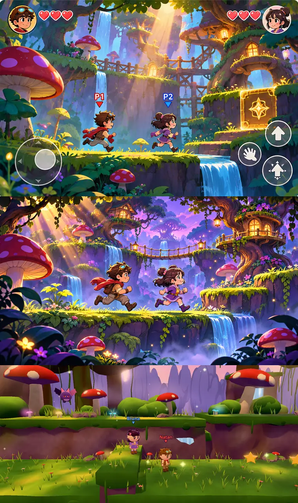
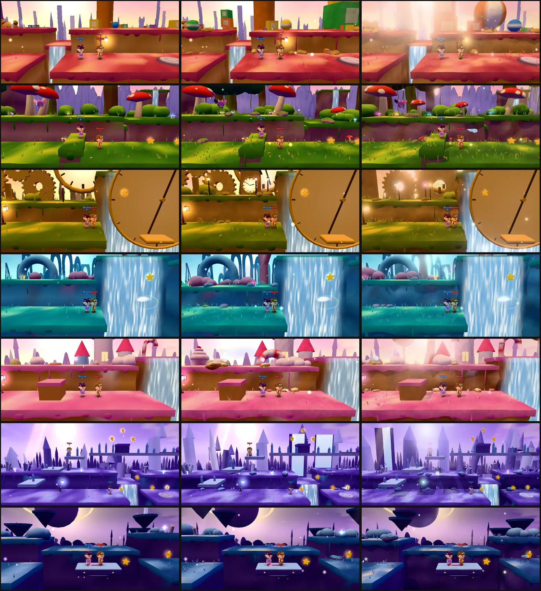
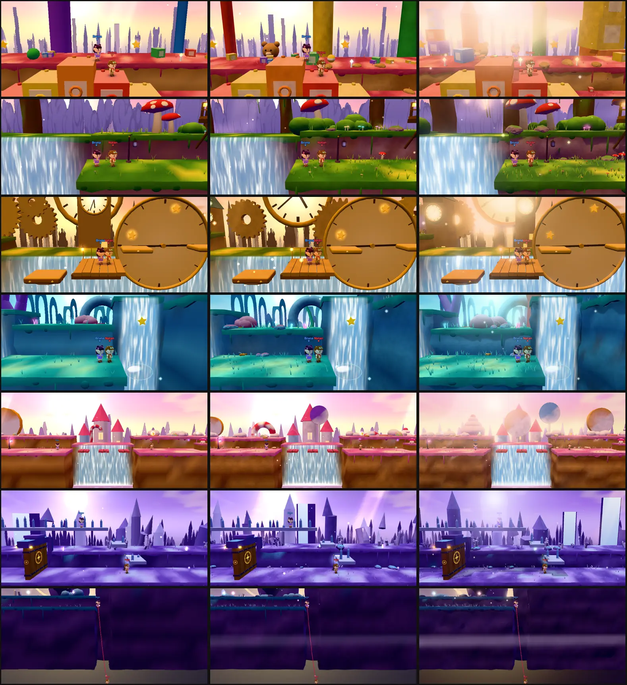
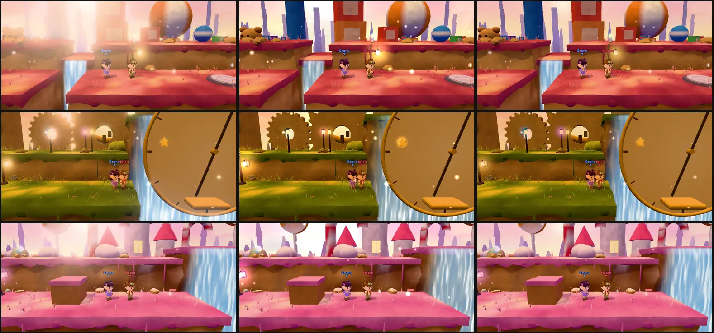
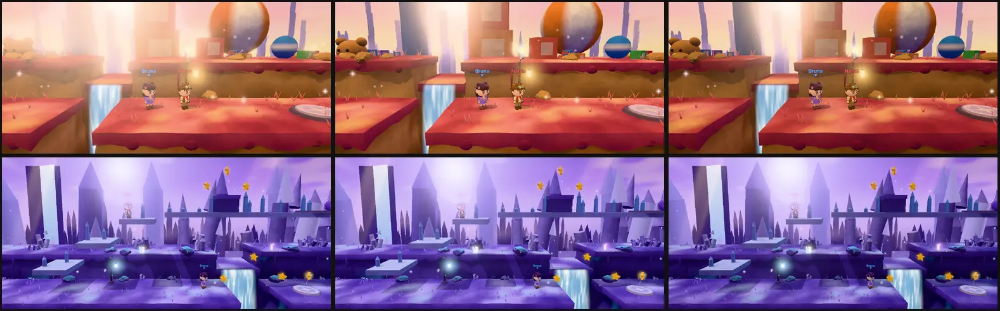
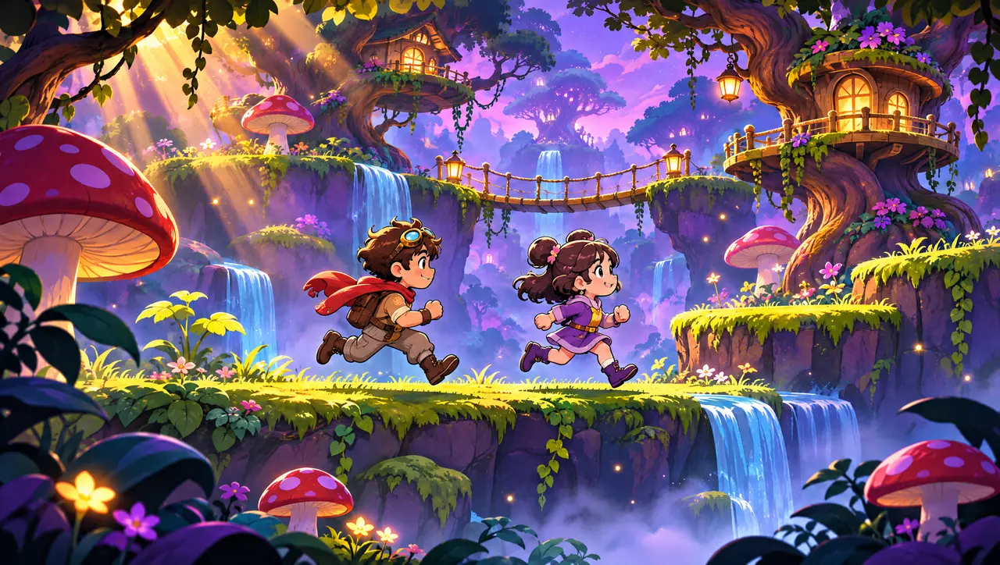

# Diagnóstico de arte e render — Entre Dois Mundos (2.5D)

Autor: arte-diagnostico (diretor de arte + técnico de render) · 2026-11-24 · commit medido: `612fe86`
Escopo: só diagnóstico e design. Nada em `src/`, `index.html`, `public/` ou `test/` foi alterado; os experimentos
rodaram numa cópia isolada (worktree) já apagada. Imagens em `docs/revisao/img/arte-diagnostico/`.

## 0. Resumo (o que importa)

1. **O "esbranquiçado" da qualidade alta é o brilho (bloom) — causa confirmada por experimento.** `src/render/pos.ts:16`
   cria um `UnrealBloomPass` com força 0,55, raio 0,65 e limiar 0,82 (0,2 / 0,4 / 0,97 nos temas "claros"). O limiar
   0,82 é ultrapassado por áreas enormes (céu do horizonte, sol, raios de sol aditivos, cascatas, lanternas) e o raio
   0,65 espalha isso pela tela inteira: um véu leitoso por cima de tudo. Desligando só o bloom (mesma cena, mesmo tick),
   o capítulo 1 cai de L\* 62,3 → 51 e a saturação sobe de 0,47 → 0,61; o 3 vai de 0,69 → 0,79 de saturação. Sombras
   reais, material Standard × Lambert e a névoa da cena mudam **≤ 1 ponto** de L\* (seção 3).
2. **Mesmo sem o véu, o jogo está longe da arte conceitual em contraste e em "desenho".** Faltam pretos e brancos
   intencionais (o histograma é uma corcova nos meios-tons), o fundo é pastel e claro (silhuetas e névoa pré-pintadas
   em lilás/rosa claro), o chão de cada capítulo é o **mesmo bloco** recolorido (`src/render/aderecos.ts:3` diz isso),
   os cenários não têm contorno nem rampa de toon (só os personagens têm), e a câmera mostra o **tampo** das
   plataformas (4 m de fundo) como uma grande área chapada de uma cor só (estimado a olho nas capturas: 25–35 % da tela nos capítulos 1 e 5).
3. **Personagens pequenos** (calculado pela geometria da câmera, `cena.ts:298`, FOV 42°): 1,1 m de altura com a câmera a 7,6–22 m → 19 % da altura da tela com os dois juntos e
   **6–10 %** quando se afastam (o conceito tem ~22 %). No capítulo 5 (p05) eles somem.
4. **A qualidade muda a composição:** na mesma cena e no mesmo tick, média e alta mostram adereços diferentes no fundo
   (capítulo 1: blocos verdes na média, bola listrada e urso na alta; capítulo 5: castelo diferente). Observado nas
   capturas; causa exata não confirmada (hipótese: consumo do sorteio que depende da qualidade). Fere "baixa mantém a
   identidade".
5. **Dois erros de espaço de cor confirmados no código** que clareiam a água e os vaga-lumes: `agua.ts:74` e
   `efeitos.ts:57` passam cores sRGB como se fossem lineares (`setHex(…, LinearSRGBColorSpace)`): o azul-marinho do lago
   `#1a296b` aparece como ~`#5970ad`.
6. **Alvos visuais gerados** (7 style frames, um por capítulo, 14 créditos Higgsfield) e **guia de estilo verificável**
   com faixas numéricas (seção 6), conferidas por `tools/revisao/comparar.mjs`.
7. **Ferramenta reprodutível de capturas** (`tools/revisao/capturas.mjs` + `medir.mjs` + `comparar.mjs`): relógio falso
   parado, entradas dos bots, mesmo tick; duas execuções dão imagens idênticas ou com PSNR ≥ 48 dB (partículas).


*De cima para baixo: quadro de jogo da arte conceitual, alvo gerado para o capítulo 2, o jogo hoje (capítulo 2, alta,
844×390@2, tick 610).*

## 1. Ferramenta de capturas (use em todo antes/depois)

Arquivos: `tools/revisao/capturas.mjs` (capturas), `tools/revisao/medir.mjs` (medidas e folhas de contato, sem
dependências: decodifica no Chromium), `tools/revisao/comparar.mjs` (antes → depois e conferência do guia).

```sh
# numa cópia do repositório (worktree "antes" e outra "depois"), sem build: usa o servidor de dev do Vite da cópia
node tools/revisao/capturas.mjs --raiz <cópia> --rotulo antes --medir --folha
node tools/revisao/capturas.mjs --raiz <outra cópia> --rotulo depois --medir --folha
node tools/revisao/comparar.mjs <cópia>/test-out/revisao/capturas/antes <outra>/test-out/revisao/capturas/depois --folha
# opções: --caps 1,3  --q baixa,media,alta  --tam 844x390@2,915x412@1  --pontos 0.12,0.5 (fração da partida dos bots
# ou tick absoluto)  --hud (mantém HUD)  --url "tema=floresta"  --porta 4870  --saida <dir>
```

Como garante "mesma cena, mesmo enquadramento, mesmo tick":
- **Relógio falso e parado** (`page.clock.install` + `pauseAt`): `requestAnimationFrame`, `performance.now` e o tempo
  das animações só andam com `clock.runFor(16,67 ms)`. Sem o `pauseAt` o relógio corre no tempo real e o tick da foto
  variava 856 / 1023 / 1298 entre execuções (medido).
- **Posição**: grava as entradas dos dois bots cooperativos (`test/fases/planos`) com o núcleo da própria cópia e
  reproduz com `window.__edm.roteiro(lista.slice(0, alvo))` (gancho de `src/ui/partida.ts:77`), com
  `__edm.acelerar(30)`; depois 90 quadros em tempo normal para a câmera assentar (o `lerp` é `dt*4`).
- **Avanço rápido barato**: o avanço roda com a janela a ¼ do tamanho (mesma proporção; a câmera depende só da
  proporção) e volta ao tamanho real para os 4 últimos quadros: de 6 min 24 s para ~20–40 s por foto aqui.
- `?resfixa` desliga a resolução dinâmica; tela cheia e trava de orientação viram no-op; HUD escondido por padrão.
- **Foto preta**: em ~7 % das fotos o SwiftShader devolvia a tela preta depois da troca de tamanho; a ferramenta
  detecta e redesenha até 5 vezes (registra em `capturas.json › erros` se não conseguir).
- **Reprodutibilidade medida**: duas execuções → foto do p05 idêntica byte a byte; p012 com 340 pixels diferentes em
  1,3 milhão (PSNR 48 dB; partículas usam `Math.random`, `src/render/particulas.ts:94`).
- **Limites**: sem GPU aqui (SwiftShader) — fps não vale; MSAA/precisão podem diferir de leve de um celular. Se a
  física ou as fases mudarem, as entradas dos bots mudam e "p012" pode cair noutro lugar: compare com o mesmo
  `src/core` + `test/fases`, ou use ticks absolutos. Tempo: rodada completa (7 × 3 × 2 tamanhos × 2 pontos = 84 fotos)
  ≈ 40 min aqui.

Saída: `cap<N>_<q>_<W>x<H>@<dsf>_p<ponto>.png`, `capturas.json` (tick, posições, chamadas, triângulos),
`medidas.json` e `folha_<tam>.webp`.

## 2. Medidas: jogo × arte conceitual × alvos

Medidas por imagem (`medir.mjs`): **L\*** (CIELAB, 0–100) médio; **contraste** = desvio-padrão de L\*; **% branco** =
pixels com L\* ≥ 90; **% sombra** = L\* ≤ 30; **sat.** = saturação HSV média; **C\*** = croma médio.

### 2.1 Referências
| Imagem | L\* | contraste | % branco | % sombra | sat. | C\* |
|---|---|---|---|---|---|---|
| Conceito, quadro de jogo (recorte 420,0,890,585) | 43,9 | 21,9 | 3,4 | 30,7 | 0,50 | 27,7 |
| Alvo cap. 1 (brinquedos) | 45,9 | 19,8 | 2,7 | 22,7 | 0,61 | 44,0 |
| Alvo cap. 2 (floresta) | 41,0 | 23,9 | 4,5 | 38,0 | 0,55 | 38,6 |
| Alvo cap. 3 (relógio) | 42,4 | 25,2 | 4,2 | 34,3 | 0,58 | 36,6 |
| Alvo cap. 4 (oceano) | 48,2 | 23,0 | 6,1 | 23,3 | 0,72 | 34,7 |
| Alvo cap. 5 (doces) | 53,4 | 22,3 | 4,9 | 17,6 | 0,59 | 45,2 |
| Alvo cap. 6 (espelhos) | 30,6 | 24,3 | 3,3 | 58,7 | 0,74 | 51,4 |
| Alvo cap. 7 (cosmos) | 31,1 | 23,1 | 3,7 | 62,1 | 0,69 | 51,7 |

Histograma de L\* (10 faixas de 10) — conceito: `2,6 9,9 18,2 19,2 15,0 12,9 6,8 7,2 4,7 3,4`: **duas caudas cheias**
(pretos de 0–20 e brancos de 70–100 = 27,8 %). Jogo, cap. 2 alta: `2,1 10,8 25,0 19,3 18,7 12,3 6,3 4,4 0,9 0,1`:
a cauda clara some (5,4 %) e tudo se amontoa em 20–50.

### 2.2 O jogo hoje (844×390@2; p012 = 12 % da partida dos bots, p05 = 50 %)
| cap | ponto | qualidade | L\* | contraste | % branco | % sombra | sat. | C\* | chamadas / triângulos |
|---|---|---|---|---|---|---|---|---|---|
| 1 | p012 | baixa | 54,6 | 24,9 | 14,7 | 17,2 | 0,60 | 40,2 | 26 / 37 mil |
| 1 | p012 | média | 51,9 | 23,0 | 11,7 | 17,3 | 0,63 | 42,0 | 27 / 49 mil |
| 1 | p012 | **alta** | **62,3** | 21,5 | 9,7 | **8,3** | **0,47** | 33,5 | 49 / 108 mil |
| 1 | p05 | média | 62,2 | 24,3 | 20,1 | 9,0 | 0,54 | 39,3 | 28 / 51 mil |
| 1 | p05 | **alta** | **69,7** | **19,0** | 18,4 | **1,5** | 0,45 | 33,1 | 51 / 125 mil |
| 2 | p012 | média | 36,1 | 17,2 | 0,2 | 43,6 | 0,75 | 40,7 | 32 / 185 mil |
| 2 | p012 | alta | 38,3 | 17,2 | 0,1 | 37,6 | 0,69 | 38,6 | 53 / 407 mil |
| 3 | p012 | média | 46,9 | 18,2 | 3,9 | 16,5 | 0,78 | 42,0 | 33 / 91 mil |
| 3 | p012 | alta | 50,2 | **16,8** | 1,6 | 10,8 | 0,69 | 39,7 | 53 / 177 mil |
| 3 | p05 | média | 56,1 | 19,7 | 8,4 | 9,1 | 0,63 | 38,7 | 35 / 100 mil |
| 3 | p05 | **alta** | **64,2** | **17,0** | 7,0 | **3,0** | **0,51** | 34,3 | 56 / 217 mil |
| 4 | p012 | média | 52,3 | 22,1 | 5,6 | 20,3 | 0,64 | **25,8** | 29 / 78 mil |
| 4 | p012 | alta | 55,0 | 21,9 | 4,3 | 14,2 | 0,59 | 24,1 | 50 / 168 mil |
| 5 | p012 | média | 58,6 | 22,1 | 12,4 | 8,2 | 0,48 | 34,6 | 30 / 84 mil |
| 5 | p012 | alta | 59,7 | 20,5 | 5,6 | 7,8 | 0,46 | 33,3 | 51 / 182 mil |
| 5 | p05 | média | 64,3 | 27,3 | **26,2** | 13,2 | 0,43 | 27,5 | 39 / 95 mil |
| 5 | p05 | alta | 65,5 | 24,0 | 16,8 | 11,0 | **0,40** | 25,3 | 61 / 219 mil |
| 6 | p012 | média | 53,5 | 26,9 | 10,0 | 25,4 | 0,49 | 48,4 | 33 / 68 mil |
| 6 | p012 | alta | 49,4 | 23,6 | 2,1 | 24,7 | 0,50 | 48,9 | 58 / 174 mil |
| 7 | p012 | média | 31,2 | 27,6 | 1,3 | 59,2 | 0,67 | 35,7 | 31 / 68 mil |
| 7 | p012 | alta | 30,9 | 26,3 | 0,0 | 58,2 | 0,65 | 35,2 | 51 / 134 mil |

Tabela completa (84 fotos, 2 tamanhos, baixa incluída, posições e chamadas por foto):
`img/arte-diagnostico/medidas_base.json` (regerável com o comando da seção 1). Médias por qualidade (14 fotos cada):

| tamanho | qualidade | L\* | contraste | % branco | % sombra | sat. | C\* |
|---|---|---|---|---|---|---|---|
| 844×390@2 | baixa | 47,9 | 22,7 | 9,0 | 28,2 | 0,62 | 37,2 |
| 844×390@2 | média | 47,9 | 22,4 | 8,3 | 28,6 | 0,61 | 37,0 |
| 844×390@2 | alta | **50,8** | **21,0** | 5,6 | **24,4** | **0,56** | **34,2** |
| 915×412@1 | alta | **52,4** | **19,9** | 5,5 | **22,1** | **0,53** | **33,0** |

Leitura:
- **Alta × média, mesma cena**: L\* +3 a +10, contraste −1 a −5, % sombra cai pela metade (cap. 1: 17 → 8; cap. 3:
  16,5 → 10,8), saturação −0,05 a −0,12. É exatamente "esbranquiçado, sem contraste". O % de branco **cai** na alta
  porque a curva Neutral do `OutputPass` comprime os brancos: o véu não estoura, ele **levanta os meios-tons e as
  sombras** (por isso a medida de "% quase branco" sozinha engana).
- **Problema de todas as qualidades** nos capítulos 1, 5 e 6: 10–26 % da tela quase branca (céu e silhuetas pastel
  ocupando o terço de cima; o conceito tem 3,4 %). No capítulo 4 o croma é baixo (25 vs 35 do alvo): ciano lavado.
- Capítulos 2 e 7 estão perto do alvo em brilho, mas com contraste 17 (cap. 2) e sem cauda clara: "chapado".


*Colunas: baixa, média, alta. Linhas: capítulos 1 a 7. Mesmo tick por linha.*


*Mesmo, em p05 (meio da fase). Capítulo 5: os dois a 14 m um do outro — personagens com ~25 px de altura.*

## 3. Causas do esbranquiçado na alta (experimentos)

Método: cópia isolada com parâmetros por URL (um por vez), capítulos 1–7, alta, 844×390@2, p012, mesmo tick.
Médias dos 7 capítulos (o cap. 1 da rodada e00 saiu preto e foi substituído pelo valor da rodada base).

| # | Mudança (só ela) | L\* | contraste | % branco | % sombra | sat. | Efeito |
|---|---|---|---|---|---|---|---|
| e00 | alta como está | 49,4 | 21,1 | 3,3 | 23,1 | 0,581 | — |
| e01 | (média como está, referência) | 47,2 | 22,4 | 6,5 | 27,2 | 0,635 | — |
| **e02** | **sem bloom** (render direto, como a média) | **46,2** | **22,3** | 5,0 | **27,8** | **0,632** | **véu some** |
| **e15** | bloom com força 0 (compositor + OutputPass mantidos) | **45,5** | 21,2 | 1,3 | **27,4** | **0,639** | **véu some** |
| e03 | Lambert no lugar de Standard | 49,4 | 21,1 | 3,3 | 23,3 | 0,590 | nenhum |
| e04 | sem sombras reais | 50,0 | 20,7 | 3,3 | 21,7 | 0,578 | nenhum (+0,6 L\*) |
| e05 | sem névoa (`scene.fog`) | 49,4 | 21,1 | 3,3 | 23,1 | 0,581 | nenhum |
| e06 | curva ACES no lugar da Neutral | 55,1 | 22,1 | 5,3 | 18,6 | 0,456 | **pior** (mais claro, −0,13 sat.) |
| e07 | curva AgX | 55,0 | 16,5 | 2,5 | 11,4 | 0,349 | **muito pior** (lavado) |
| e08 | exposição 0,85 | 46,2 | 20,8 | 2,6 | 27,5 | 0,599 | escurece, não devolve a cor |
| e09 | luz hemisférica × 0,6 | 46,5 | 22,2 | 3,3 | 28,9 | 0,599 | idem |
| e16 | bloom 0 + sem névoa em camadas + sem raios/halos/vaga-lumes | 44,9 | 21,2 | 1,3 | 28,5 | 0,650 | −0,6 L\* além do e15 |
| e17 | sem bloom + sem névoa em camadas + sem raios/halos/vaga-lumes | 45,7 | 22,3 | 5,0 | 28,3 | 0,640 | −0,5 L\* além do e02 |
| e18 | **proposta P0**: bloom limiar 1,0, força 0,3, raio 0,3 | 47,8 | 21,0 | 2,6 | 24,6 | 0,605 | véu quase some (cap. 1: 62 → 54) |
| e19 | e18 + hemisférica × 0,7 + sol × 0,8 | **44,3** | **22,0** | 2,5 | **31,4** | **0,625** | mais perto do conceito (43,9 / 21,9 / 3,4 / 30,7 / 0,50) |

e18 × média (e01): ΔL\* +0,6, Δsat −0,03 — passa no critério P0 da seção 7 por pouco; no cap. 1 ainda +3 L\* sobre
o sem-bloom, porque o céu e os raios aditivos passam de 1,0. Daí a regra da seção 6.6: limiar alto **e** céu/raios
fora do bloom (emissivo marcado). e19 indica a ordem de grandeza da luz certa para a paleta atual (−30 % de
hemisférica, −20 % de sol), a confirmar depois da rampa de toon.

Por capítulo (L\* / saturação), alta → sem bloom: cap. 1 62,3/0,47 → 51/0,61 · cap. 3 50/0,69 → 46/0,79 ·
cap. 5 60/0,46 → 57/0,50 · cap. 6 49/0,50 → 49/0,52 · cap. 4 55/0,59 → 51/0,65. O efeito é maior nos temas "escuros"
(força 0,55, limiar 0,82) do que nos três "claros" (0,2 / 0,97), mas existe em todos.


*Colunas: alta como está · sem bloom · bloom com força 0. Linhas: capítulos 1, 3 e 5, mesmo tick.*


*Colunas: alta como está · e18 (bloom limiar 1,0 / força 0,3 / raio 0,3) · e19 (e18 + menos luz). Capítulos 1 e 6.*

**Confirmado:**
- C1. `UnrealBloomPass(…, 0.55, 0.65, 0.82)` (`pos.ts:16`) é a causa do véu. O limiar 0,82 é aplicado sobre a cena
  linear (HDR) **antes** da curva de tons; céu do horizonte (`horiz` ≈ 1,0 linear), o termo do sol no céu
  (`ceu.ts:37`, até 6× na direção do sol), os raios aditivos de 15–20 m de altura (`cenario.ts:479`, 9 na média/alta)
  e as cascatas passam do limiar em áreas grandes; o raio 0,65 (5 níveis de mip, metade da resolução) espalha isso
  pela tela. Remover/zerar o bloom: L\* −2 a −11, saturação +0,04 a +0,14, % sombra +3 a +9.
- C2. Sombras reais, Standard × Lambert e a `THREE.Fog` **não** causam o esbranquiçado (≤ 1 ponto).
- C3. Névoa em camadas, raios e vaga-lumes somam −0,6 L\* (pouco) — o problema deles é o bloom que eles alimentam.
- C4. Na alta, o `OutputPass` aplica a curva Neutral também ao que tem `toneMapped: false` (céu, janelas, pedaço da
  estrela, quadros de luz), porque tudo vai para um alvo intermediário linear. Na média/baixa esses itens saem sem
  curva. Por isso os brancos da alta são mais "cinza-creme" (% branco 1,3 no e15 × 5,0 no e02).
- C5. Espaço de cor: `agua.ts:74` (lago) e `efeitos.ts:57` (vaga-lumes) usam `setHex(hex, LinearSRGBColorSpace)` com
  cores escritas em sRGB: o lago `#1a296b` sai ~`#5970ad` (azul médio em vez de marinho), `#8c6bc7` sai quase lilás
  claro. Afeta todas as qualidades.

**Hipóteses (não medidas aqui):**
- H1. Em celular, o compositor da alta usa alvo `HalfFloat` + 2 passes de borrão por mip a metade da resolução com
  DPR 2: custo de banda alto e aquecimento (bloom + sombra 2048² + DPR 2). Medir no Redmi com `?debug=1` e o
  perfilador do Chrome remoto.
- H2. Luz total ~1,5× o albedo nas faces voltadas para o sol (hemisférica 1,55 + sol 2,3 + contraluz 0,9,
  `tema.ts:40`, mais o ×1,1 do "pôr do sol" em `materiais.ts:64`; sem o fator π desde o three r155) deixa os tampos
  claros dos capítulos 1 e 5 em L\* 60–75. e08/e09 mostram que baixar exposição ou luz só escurece (−3 L\*) sem
  devolver saturação: o conserto de cor é bloom + paleta (6.2) + rampa de toon (6.4), não só "menos luz".
- A curva Neutral é a certa para este estilo: ACES e AgX (e06, e07) lavam e dessaturam mais. Manter Neutral.

## 4. Avaliação de arte: por que parece "blocos com enfeites"

### 4.1 Lista objetiva
1. **O chão é o mesmo bloco em todo capítulo** (`cenario.ts:62` `penhasco` = `BoxGeometry` deformada + "tapete"
   `BoxGeometry` de 0,4 m, `cenario.ts:70`; `aderecos.ts:3`: "o chão … é o mesmo, com a paleta do tema"). Muda a cor,
   não a forma: a floresta, o quarto de brinquedos, a cidade do relógio e o reino dos doces têm a mesma silhueta de
   laje com bordas caídas.
2. **Tampos enormes e chapados**: a faixa de chão tem 4 m de fundo (z −2 a 2, `cenario.ts:39`) e a câmera fica acima
   olhando para baixo (`cena.ts:299–302`): o tampo vira um retângulo de uma cor só que ocupa ~25–35 % do quadro
   (capítulos 1 e 5: rosa liso). No conceito, o chão é uma faixa fina de grama com a parede do barranco à mostra.
3. **Arestas retas e cantos de 90°** em toda plataforma especial e bloco (`aderecos.ts` `bloco`: `BoxGeometry` pintada).
   Nada é chanfrado, arredondado, inclinado ou sobreposto; tudo coincide com o retângulo de colisão.
4. **Enfeites espalhados, não compostos**: adereços sorteados ao longo da plataforma (`grande`, `pequeno`, `moita`)
   em intervalos regulares; não há "momentos" (um grande marco por tela, molduras de primeiro plano, caminhos que
   levam o olho ao objetivo).
5. **Sem primeiro plano**: quase nada entre a câmera e a faixa de jogo (z > 2). O conceito tem cogumelos, folhas e
   cascata escuros na frente, que dão profundidade e moldura.
6. **Fundo pastel e recortado**: 3 planos de silhueta com textura de canvas e `alphaTest` (`ceu.ts:63–84`), cores
   já "nevoadas" em rosa/lilás claro (`tema.ts` `silhuetas`), sem névoa da cena e sem paralaxe vertical. Resultado:
   o terço de cima é uma parede clara e plana (L\* 75–95 nos capítulos 1, 5, 6), não uma floresta funda.
7. **Iluminação sem desenho**: cenário em Lambert/Standard com ruído de cor; não há rampa de toon, sombra de contato,
   oclusão nos cantos, nem contorno. Os personagens são toon com contorno — dois estilos na mesma tela.
8. **Rampa de toon dos personagens borrada**: `personagem.ts:337` usa `LinearFilter` no `gradientMap` de 3 tons
   (`[120, 200, 255]`), o que vira um degradê suave e não as faixas de cor do desenho animado (o three.js pede
   `NearestFilter` para cel shading).
9. **Água de papel**: cascata = faixa plana com textura que escorre (`agua.ts`), sem espuma na base, sem respingo,
   sem névoa; o lago está com a cor errada (C5).
10. **Escala e leitura**: personagens com 6–19 % da altura da tela, rótulos de nome por cima (sprites sem teste de
    profundidade) e vários elementos de jogo (placas, porteiras) com o mesmo valor de cor do chão.
11. **Pouca vida**: vento só na grama e nas flores; nenhum animal ambiente, nenhuma folha caindo fora do capítulo 2,
    nenhum objeto que reage ao jogador (moitas que balançam, poças que respingam, sinos, flores que fecham).
12. **Qualidade muda a composição** (item 4 do resumo) e a diferença entre qualidades é só de efeitos: a alta não tem
    nenhuma geometria, textura ou animação a mais que dê "mais bonito e detalhado"; tem bloom e sombra.

### 4.2 Materiais, texturas, modelos, animação
- **Materiais**: um material de mundo (`materiais.ts:19–70`) com cor por vértice, ruído procedural em coordenadas do
  mundo e um tom "pôr do sol" por normal. Barato e coerente, mas sem rampa, sem borda e sem sombra própria desenhada.
  Na alta vira `MeshStandardMaterial` com rugosidade 0,88 (mesma imagem que Lambert: e03 — custo sem ganho).
- **Texturas**: só canvas procedurais (silhuetas, atlas de luz, runa, rostos). Nenhuma textura pintada de superfície
  (casca, pedra, cobertura, tapete). Os rostos dos personagens são uma calota com textura (bom).
- **Modelos**: personagens procedurais (esferas e cápsulas juntadas, ~1 chamada + contorno) — fofos, mas mais simples
  que o conceito (cabelo em bolas, sem mochila/óculos legíveis de perto). Existem `public/modelos/natan.glb` e
  `bruna.glb` (Meshy, 8,3 mil tri, textura 1024, com esqueleto e corrida) **sem uso no 2.5D**, e modelos de cenário
  (`torre_relogio`, `blocos_brinquedo`, `casa_arvore`…) também sem uso. Os de cenário "fracos" (RECURSOS.md) não servem.
- **Animação**: personagens com esqueleto de 8 ossos e poses boas (andar, pular, pendurar, bolha). Faltam antecipação,
  "squash & stretch" na aterrissagem, poeira no pouso, piscar/olhar ocioso e reação ao parceiro (há impulso, mas não
  há olhar, mão, sorriso).
- **Composição e profundidade**: só uma camada de jogo, uma de enfeite atrás e três silhuetas chapadas. Falta a regra
  "escuro na frente, médio no meio, claro e frio atrás, quente no ponto de interesse".

### 4.3 Diferença entre qualidades hoje
| | baixa | média | alta |
|---|---|---|---|
| material | Lambert, 1 oitava de ruído | Lambert, 2 oitavas | Standard (sem ganho visível) |
| luz/sombra | sombra-bolha | sombra-bolha | sombra 2048² PCF |
| pós | — | — | bloom (causa do véu) + OutputPass |
| DPR máx. | 1 | 1,5 | 2 |
| névoa em camadas | não | sim | sim |
| vaga-lumes | 70 | 150 | 240 |
| geometria | menos segmentos | — | mais segmentos em esferas/lajes |
| chamadas / tri (cap. 2 p012) | 28 / 87 mil | 32 / 185 mil | 53 / 407 mil |

A alta custa +65 % de chamadas e 2,2× os triângulos (a sombra redesenha a cena) para uma imagem **pior** pelas
medidas. Proposta de papéis na seção 6.6.

## 5. Alvos visuais (style frames por capítulo)

Gerados no Higgsfield, modelo `gpt_image_2_6`, qualidade alta 2k, 16:9, com a arte conceitual como referência
(mídia `964520c5-283a-4f57-82d0-67f56f06b3d9`, papel `image_references`). **Custo: 7 × 2 = 14 créditos** (cotação
`estimate_image_cost` = 2 por imagem; saldo 249,63 → 235,63). Teto da tarefa: 30.
Arquivos (WebP 1280 px): `img/arte-diagnostico/alvo_cap1.webp` … `alvo_cap7.webp`.

| cap | job id | o que o alvo fixa |
|---|---|---|
| 1 | `98b7c199-5963-44d6-8e21-e05bab2bc780` | quarto gigante ao pôr do sol: blocos ABC, trem de brinquedo como plataforma, livros como escada, fibras do tapete como grama, luz de janela; quentes (âmbar/rosa) com sombras vinho |
| 2 | `4c68889d-e6cb-4740-b6e9-9d14310fc9e3` | floresta do conceito: barrancos com musgo arredondado, cogumelos, casas na árvore, ponte de corda, cascatas com névoa na base, folhas escuras de primeiro plano |
| 3 | `aaca4034-dae6-47cd-b5c3-4f3053dde7a8` | cidade-relógio: engrenagens e mostrador como plataformas, telhados, janelas acesas, vapor; latão + verde-patina + vinho; engrenagens escuras na frente |
| 4 | `f385ccc4-a673-49d6-b3e3-25cb1f8dd524` | praia de ruínas submersas: píer de madeira, bolhas-plataforma, corais, baleia no fundo azul profundo, cáusticas |
| 5 | `5e59b4fd-98bc-4c69-b0ff-0b29420fdaaa` | bolo: cobertura escorrendo sobre camadas de chocolate escuro, gelatinas, pirulitos, pontes de biscoito; marrom escuro dá o contraste que hoje falta |
| 6 | `6c3b580d-80a7-43b8-9e25-ebbe89138b3d` | dois corredores empilhados em caverna de cristal, espelhos que refletem os personagens, placas rúnicas, porta; índigo quase preto + magenta/ciano |
| 7 | `83a1c26a-f084-425c-8f8f-2a6df32d0847` | ilhas flutuantes com raízes e cascatas no vazio, galáxia espiral, castelo dourado; azul-noite + violeta + ouro, Fio Vermelho visível |

Prompt comum (resumo): "in-game screenshot style frame of a 2.5D side-scrolling cooperative platformer, same art
style and characters as the reference, characters large (~1/4 of screen height), clear walkable path, rounded organic
shapes, dark foreground framing, painted background with atmospheric depth, strong contrast, saturated, toon shading,
dark outlines, no HUD". Observação: o gerador fez os personagens com ~18–22 % da altura (não 25 %) — é a escala alvo.


*Alvo do capítulo 2. Os demais: `alvo_cap1.webp` … `alvo_cap7.webp`.*

O que os 7 alvos têm em comum (e o jogo não): (1) chão como **faixa fina** com a parede do barranco à mostra;
(2) **primeiro plano escuro** nas bordas (5–15 % do quadro); (3) um **marco grande** por quadro (árvore com casa,
mostrador, baleia, castelo); (4) **fundo médio-escuro e saturado**, nunca pastel chapado; (5) **contorno** escuro em
tudo, mais fino no fundo; (6) **luz de recorte quente** nos personagens e no caminho; (7) água com espuma e névoa.

## 6. Guia de estilo verificável

### 6.1 Faixas-alvo de imagem (conferidas por `comparar.mjs`, que marca ✗ fora da faixa)
Medidas no quadro inteiro, sem HUD, nos pontos p012 e p05 da ferramenta. Valem para **todas as qualidades** (a baixa
pode ficar até 2 pontos mais chapada no contraste).

| medida | faixa geral | conceito | por que |
|---|---|---|---|
| L\* médio | por capítulo (6.2), ±6 | 43,9 | brilho do mundo |
| contraste (dp de L\*) | **20–32** | 21,9 | hoje 16,8–19 na alta dos caps. 1, 3, 5 |
| % quase branco (L\* ≥ 90) | **≤ 4** (picos ≤ 6 com o pedaço da estrela na tela) | 3,4 | brancos só em brilho e destaque |
| % sombra (L\* ≤ 30) | por capítulo (6.2), ≥ 12 | 30,7 | precisa existir preto de desenho |
| saturação HSV média | **0,42–0,75** | 0,50 | — |
| croma C\* médio | ≥ 30 | 27,7 | ciano lavado do cap. 4 está em 24–26 |
| diferença alta × média, mesma cena | \|ΔL\*\| ≤ 3, Δcontraste ≥ −1, Δsat ≥ −0,03 | — | "alta mais bonita, não mais lavada" |

Faixas no código: `tools/revisao/comparar.mjs › ALVO` (manter iguais a esta tabela).

### 6.2 Paleta e valores por capítulo
Paleta extraída dos alvos (corte mediano, 8 cores, da mais escura para a mais clara; % da área). L\* e % sombra = alvo
medido; usar como centro da faixa.

| cap | L\* alvo | % sombra alvo | paleta (escura → clara) | regra de cor |
|---|---|---|---|---|
| 1 brinquedos | 46 | 18–28 | `#521b2b` `#603447` `#942e38` `#a04344` `#995657` `#c95e51` `#dc7d5b` `#f8b876` | quente; sombras vinho, nunca cinza; azul só em brinquedos |
| 2 floresta | 41 | 30–45 | `#171427` `#2a3149` `#4a3653` `#7a3554` `#5b6388` `#9b698d` `#a489b0` `#d2c095` | sombra azul-violeta, luz dourada; verde saturado só no caminho |
| 3 relógio | 42 | 28–40 | `#210e12` `#432826` `#673239` `#8b3f37` `#83617b` `#bd685e` `#cb877b` `#f3c074` | latão + vinho + verde-patina; fundo âmbar, primeiro plano quase preto |
| 4 oceano | 48 | 18–28 | `#043861` `#303e46` `#025a95` `#037eb4` `#8e4a5a` `#27bacf` `#888082` `#d7c7a3` | azul profundo embaixo, turquesa só na água rasa; coral como acento |
| 5 doces | 53 | 14–24 | `#4f1810` `#6d3945` `#c33346` `#c7576f` `#b67377` `#c6af90` `#f27a83` `#fdb7a2` | rosa sobre **chocolate escuro**; branco só no glacê e no brilho |
| 6 espelhos | 31 | 50–65 | `#0b082a` `#0d1850` `#211559` `#511a8b` `#26368c` `#7e3cb2` `#7b62b9` `#92acd6` | índigo quase preto; magenta/ciano só nos cristais; espelhos refletem |
| 7 cosmos | 31 | 55–68 | `#100e46` `#181961` `#2b1963` `#4e1c6f` `#3e2f6b` `#7c3698` `#935c7f` `#d3a776` | noite + violeta; ouro só nas ilhas, estrelas e no objetivo |

Valores do tema a trocar primeiro (`src/render/tema.ts`): silhuetas e névoa dos caps. 1, 5 e 6 descem para L\* 35–55
(hoje 75–90); o chão claro (`grama` rosa `#d8697c`/`#f59ac0`) vira cor média com borda escura e parede escura.

### 6.3 Contorno
- **Personagens**: casco invertido, espessura em **pixels de tela** (não em metros): 2,5 px a 390 px de altura
  (escala com a altura do canvas), cor = tom mais escuro do capítulo (ex.: `#2a1430` no 2, `#1a0e28` no 7), não preto.
- **Jogo (plataformas, interativos, bichinhos, coletáveis)**: contorno 2 px — casco invertido nas peças pequenas;
  nas lajes, linha escura pintada no vértice da aresta do topo (barato) ou, na alta, contorno por profundidade/normal
  em tela (1 passe).
- **Meio e fundo**: contorno 1 px, cor = sombra do plano; o fundo distante sem contorno.
- Baixa: só personagens, bichinhos e interativos (o que é jogo nunca perde o contorno).

### 6.4 Rampa de toon (cel)
- Personagens: 3 faixas com `NearestFilter` (troca de `personagem.ts:337`), sombra **colorida**: sombra = cor × cor
  de sombra do capítulo (não cinza); limiares em N·L ≈ 0,15 e 0,55; luz de borda quente mantida.
- Cenário: rampa de 2–3 faixas no material do mundo (`materiais.ts`), sombra própria a 55–65 % do valor da luz,
  matiz da sombra = cor de sombra do capítulo (tabela 6.2, a mais escura); oclusão pintada por vértice nos cantos e na
  base dos adereços (sombra de contato de 0,3–0,5 m).
- Luz total nas faces ao sol ≤ 1,0 × albedo (hoje ~1,5×): tampos claros não passam de L\* 75.

### 6.5 Névoa e camadas (profundidade)
| camada | z (m) | valor relativo | névoa | regra |
|---|---|---|---|---|
| primeiro plano | +3 a +8 | **mais escuro** (L\* 8–25) | nenhuma | 5–15 % do quadro, nas bordas e embaixo; desfocado/silhueta; nunca cobre os personagens (some com `alfa` perto deles) |
| jogo | −2 a +2 | médio, mais saturado, contornado | 0 | chão como faixa fina: tampo visível ≤ 0,6 m de fundo aparente |
| meio | −4 a −20 | médio | 0,15–0,4 | marcos do capítulo (1 por tela de 20 m) |
| fundo | −30 a −80 | mais claro e frio que o meio, mas L\* ≤ 70 | 0,5–0,8 da cor de atmosfera | silhuetas com 2 tons e paralaxe; nada de recorte duro de `alphaTest` serrilhado |
| céu | domo | gradiente do capítulo; sol pequeno | — | o terço de cima com ≤ 4 % de branco |
Cor de atmosfera = um tom médio saturado do capítulo (L\* 40–60), não pastel. Névoa exponencial por distância
**à câmera** só no meio/fundo; a faixa de jogo fica limpa.

### 6.6 Brilho (bloom) e papéis das qualidades
- **Bloom só seletivo**: limiar ≥ 1,0 no linear e só em materiais marcados como emissivos (pedaço da estrela, faíscas,
  janelas, lanternas, cristais); força 0,2–0,35, raio ≤ 0,3. Céu, raios de sol e cascatas **não** entram (camada
  própria ou emissivo < 1). Critério: com o bloom ligado, |ΔL\*| ≤ 1,5 e Δsat ≥ −0,02 em relação ao bloom desligado.
- **Baixa**: mesma composição, mesma paleta, mesmo contorno dos personagens/jogo, rampa de toon; corta partículas,
  primeiro plano detalhado (vira silhueta), segmentos e DPR.
- **Média (padrão)**: tudo do estilo, contorno em todo o jogo, vegetação animada, primeiro plano completo.
- **Alta**: **mais detalhe**, não mais véu: mais densidade de vegetação e adereços animados, primeiro plano com
  folhas em camadas, água com espuma e respingo, sombras reais (já existem), contorno em tela, bloom seletivo,
  DPR 2. A sorte dos adereços **não** depende da qualidade (mesmo layout nas três).

### 6.7 Câmera e escala (com a equipe de câmera)
- Personagem com **18–24 %** da altura da tela no jogo normal; **≥ 12 %** no pior caso de afastamento.
- Hoje: `dist = clamp(6 + 0,9·sep, 7,6, 22)` (`cena.ts:298`) → 6,5 % a 22 m. Como cada um tem o seu celular, cada
  aparelho pode enquadrar **o seu** personagem com o parceiro como "convidado" no quadro (até ~12 m) e mostrar uma
  seta/retrato na borda quando o outro sai; o afastamento máximo da câmera cai para ~13 m.
- Câmera mais baixa e menos inclinada (olhar quase paralelo ao chão, como o conceito) para o tampo das lajes sumir.

## 7. Lista de correções (priorizada)

| P | correção | arquivo(s) | critério de aceite (medido com as ferramentas) | esforço |
|---|---|---|---|---|
| P0 | Bloom seletivo (limiar ≥ 1, força ≤ 0,35, raio ≤ 0,3) ou desligado até existir camada emissiva | `src/render/pos.ts:16`, `cena.ts:73` | alta × média na mesma cena: \|ΔL\*\| ≤ 3 e Δsat ≥ −0,03 nos 7 capítulos (p012 e p05) | 0,5 dia |
| P0 | Corrigir espaço de cor do lago e dos vaga-lumes (`setHex(hex)` sem `LinearSRGBColorSpace`) | `agua.ts:74`, `efeitos.ts:57` | cor medida do lago na captura = cor do tema ±5 de ΔE | 1 h |
| P0 | Mesma composição em todas as qualidades (sorteio independente da qualidade) | `cenario.ts`, `aderecos.ts` | diferença de posição dos adereços entre baixa/média/alta = 0 (comparar contorno/máscara das capturas) | 0,5 dia |
| P0 | Fundo e névoa dos caps. 1, 5, 6 para valores médios saturados (tabela 6.2) | `tema.ts` (`silhuetas`, `nevoa`, `ceu`) | % quase branco ≤ 4 e L\* dentro de ±6 do alvo | 0,5 dia |
| P1 | Rampa toon dos personagens com `NearestFilter` e sombra colorida | `personagem.ts:334–340` | faixas visíveis no retrato (`test/retrato/`), 3 tons distintos medidos no rosto | 2 h |
| P1 | Rampa toon + oclusão pintada + sombra colorida no material do mundo; luz total ≤ 1,0× | `materiais.ts`, `tema.ts` (`luz`) | contraste 20–32 e % sombra na faixa do capítulo | 2–3 dias |
| P1 | Contorno: px de tela nos personagens; arestas escuras nas plataformas/interativos | `personagem.ts:362`, `cenario.ts`, `elementos.ts` | captura a 390 px: contorno 2–3 px em personagens e peças de jogo | 2 dias |
| P1 | Chão como faixa fina: menos fundo aparente do tampo, parede do barranco à mostra, câmera mais baixa | `cenario.ts:39,62–100`, `cena.ts:296–302` (com a equipe de câmera) | área do tampo ≤ 12 % do quadro; personagens 18–24 % da altura | 2–3 dias |
| P1 | Formas próprias por capítulo para o chão (não só a cor): trilho/tapete/livros (1), raízes e barranco (2), pedra e engrenagem (3), areia e píer (4), bolo e cobertura (5), cristal e piso rúnico (6), ilhas com raízes (7) | `cenario.ts`, `aderecos.ts` (`Kit` ganha `chao()`) | revisão cega: 5 de 5 pessoas acertam o capítulo por um recorte só do chão | 1–2 semanas |
| P1 | Camada de primeiro plano (silhuetas escuras, folhas, engrenagens, cristais) com transparência perto dos jogadores | novo `src/render/primeiroPlano.ts` | 5–15 % do quadro com L\* ≤ 25 nas bordas; nunca sobre os personagens | 3 dias |
| P2 | Um marco por tela (árvore-casa, mostrador, baleia, castelo) e "momentos" compostos por trecho | `aderecos.ts` (`marcos`) | cada trecho de 20 m tem 1 marco; revisão com os alvos lado a lado | 1–2 semanas |
| P2 | Vida: animais ambiente (pássaros, peixes, borboletas, vaga-lumes que fogem), folhas caindo por tema, plantas que reagem ao jogador, espuma/respingo nas cascatas | `bichinhos.ts`/novo `ambiente.ts`, `agua.ts` | ≥ 3 elementos animados por tela; custo ≤ +4 chamadas na média | 1–2 semanas |
| P2 | Usar `natan.glb`/`bruna.glb` (ou refazer o procedural com mais forma: mochila, óculos, lenço que balança) | `personagem.ts` | retrato lado a lado com o conceito; ≤ 2 chamadas por personagem | 1 semana |
| P2 | Alta "mais detalhe": densidade de vegetação e adereços animados, contorno em tela, água rica — dentro do orçamento | `cenario.ts`, `cena.ts` | alta ≤ 60 chamadas / 300 mil tri; faixas 6.1 iguais ou melhores que a média | 1 semana |

Ordem sugerida: as P0 juntas (1 a 2 dias, efeito imediato no pedido "esbranquiçado"), depois toon + contorno +
fundo (identidade de desenho animado), depois forma do chão e primeiro plano (fim dos "blocos"), depois vida e marcos.
Cada mudança: uma por assunto, rodada `capturas.mjs` antes/depois, `comparar.mjs --folha` no relatório.

## 8. Desempenho (o que a arte precisa respeitar)
Medido aqui (SwiftShader, só contagens): média 25–39 chamadas e 49–185 mil triângulos; alta 48–61 chamadas e
108–435 mil triângulos (o dobro vem do passe de sombra). Orçamento atual do README: média ≤ 80 chamadas / 250 mil tri.
O que as correções custam: rampa e contorno no material (0 chamadas; contorno por casco = +1 chamada por lote de jogo);
primeiro plano (+1–2 chamadas, instanciado); vida ambiente instanciada (+2–4); o bloom seletivo **economiza** banda em
relação ao atual. Medir fps, temperatura e bateria no Redmi Note 11 e no iPhone 14 (fora do alcance daqui).

## 9. O que não foi feito / limites
- Sem GPU: nenhuma medida de fps, banda ou temperatura; a imagem é a do SwiftShader (igual à de GPU salvo MSAA).
- Não medi a HUD nem a legibilidade dos controles (ficou com `--hud` na ferramenta para quem for medir).
- A causa da troca de adereços entre qualidades não foi isolada (só observada).
- Os experimentos rodaram só em p012 e 844×390@2 (7 fotos cada); a conclusão do bloom se repete nas fotos p05 da
  rodada base (alta × média), mas e03–e09 não foram repetidos em p05.
