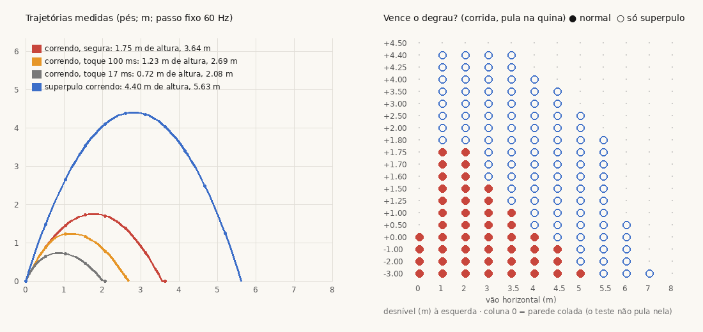

# Auditoria de movimento e de alcance das fases

Autor: auditoria-movimento. Data: 2026-11-24. Base: commit `791dde2`, medido numa cópia isolada (worktree), sem tocar
em `src/`, `test/`, `public/` nem `index.html`.

Pedido do jogador que esta auditoria cobre: **(4)** "há estrelas que eu não alcanço". O pedido também pede para auditar
o pulo, a gravidade, a aceleração e as colisões, a posição das plataformas e dos coletáveis, coyote time, jump buffer,
altura variável, controle no ar e aterrissagem, e para criar testes automáticos de alcance. Toca também a câmera
**(2)**, o modo solo **(5–9)** e o desempenho na rede **(11)**.

## 0. Resumo

1. **Com entradas perfeitas, nenhum coletável dos 7 capítulos é inalcançável.** A busca sobre a simulação real
   testou 6,1 milhões de gestos em 215 mil estados. Ela pega todas as 238 estrelinhas, as 37 lanternas, as 17
   placas e os 7 pedaços de estrela. Na física, as estrelinhas existem.
2. Mesmo assim, o jogador não as pega, e as causas estão no código:
   - **Não há coyote time nem jump buffer.** Medido: 0 tick de tolerância. Quem aperta o pulo 1 tick depois de sair
     da quina cai. Quem aperta 1 tick antes de pousar e segura não pula.
   - **O convidado vê o próprio personagem com cerca de 220 ms de atraso.** Medido com rede de 0 ms; numa rede real
     o atraso é maior. Ele não tem predição local, e o atraso transformado em distância dá cerca de 1 m de corrida.
     Na prática, a Bruna precisa pular 1 m antes da quina que vê.
   - **O pulo é variável e um toque rápido sobe pouco.** Um toque de 100 ms sobe 1,23 m (70 % do pulo). Um degrau de
     1,5 m exige segurar o botão pelo menos 170 ms.
   - **6 estrelinhas só saem com mãos dadas:** cap. 1 #22–24 e cap. 2 #18–20. No modo treino e numa campanha solo
     elas não saem, e nada na tela avisa isso.
   - **Algumas estrelinhas exigem precisão.** As das gelatinas do capítulo 5 seguem um arco desenhado por fórmula, que
     não coincide com a trajetória real, e se pegam por 17 a 64 combinações em vez de centenas ou milhares. As do
     relógio grande do capítulo 3 ficam 2,5 m acima da tela quando a dupla está no chão.
   - **Erro no pisão:** sem segurar o pulo, o quique sobe 0,47 m em vez de 1,35 m (`lancado` não é ligado no pisão).
3. **Sozinho, nenhum capítulo passa da primeira ajuda.** Cada capítulo trava entre 26 % e 43 % do comprimento. A
   campanha solo pedida exige um companheiro controlado pelo jogo que saiba usar placa, mãos dadas e fio (§5).
4. A §3 traz os números propostos para coyote, buffer, quina dos pés e pulo curto mínimo, mais a correção do pisão e
   a predição do convidado. A §6 propõe testes permanentes: envoltória da física, alcance de todo coletável e janela
   mínima.

---

## 1. Envoltória do pulo, medida na simulação real

Ferramenta: `tools/revisao/auditoria-movimento/envoltoria.ts`, que roda `passo()` do núcleo tick a tick a 60 Hz.
Resultado em `tools/revisao/auditoria-movimento/envoltoria.json`. Constantes em `src/core/sim.ts:22-34`
(`FISICA`): largura 0,6 m, altura 1,1 m, `velAndar` 5,2 m/s, `acelChao` 60 m/s², `acelAr` 30 m/s², `gravidade`
30 m/s², `velQuedaMax` 18 m/s, `pulo` 10,5 m/s, `impulsoPulo` 16,5 m/s.



| Pulo | Altura dos pés | Tempo no ar | Distância | Observação |
|---|---|---|---|---|
| Normal, segurando | **1,75 m** | 0,70 s (ápice em 0,33 s) | 3,64 m correndo; 3,31 m saindo parado com o joystick | `docs` e `LEIAME` dizem "≈ 1,8 m" |
| Toque de 1 tick (17 ms) | 0,73 m | — | 2,08 m | corte `vy *= 0,88` por tick solto (`sim.ts:184`) |
| Toque de 100 ms | 1,23 m | — | 2,69 m | toque típico no celular |
| Segurando 170 / 250 ms | 1,51 / 1,70 m | — | — | só a partir de cerca de 330 ms chega a 1,75 |
| Superpulo (mãos dadas) | **4,40 m** | 1,08 s | 5,63 m correndo | `LEIAME` diz "≈ 4,5 m" |
| Gelatina (força 15) | 3,63 m (solto) / **5,25 m** (segurando) | — | — | `LEIAME` diz 3,75 / 5,4 m: a medida é acima do topo da gelatina |
| Pisão, segurando | 2,71 m | — | — | quique 13 m/s |
| Pisão, sem segurar | **0,47 m** | — | — | **erro**, explicado na §3.4 |

A tabela "vão × desnível" é medida com corrida e pulo no último tick sobre o chão (sem coyote). Com o pulo normal
segurado:

| Desnível | Vão máximo vencido |
|---|---|
| +1,75 m (máximo) | 2 m |
| +1,5 m | 3 m |
| +1,0 m / +0,5 m | 3,5 m |
| 0 | 4 m |
| −1 / −2 m | 4,5 m |
| −3 m | 5 m |

O superpulo sobe até 4,4 m, vence um vão de 5,5 m no mesmo nível e de 6 m descendo.

- **Degrau colado:** com o pulo cheio e o joystick contra a parede, sobe até **1,74 m**; com 1,76 m já não sobe.
  Não existe correção de quina para os pés: quem chega 1 cm abaixo do topo bate na parede e cai.
- **Aceleração:** chega a 5,2 m/s em 0,087 s no chão e em 0,17 s no ar; para em 0,23 m; inverte a direção no ar em
  0,35 s. É responsiva e não precisa mudar.
- **Correção de quina da cabeça:** existe, até 0,32 m (`colisao.ts:31-33`). É maior que meia largura (0,30 m), então
  o corpo pode ser empurrado 32 cm para o lado. Proposta: 0,20 m.
- As medidas usadas nos comentários e no `LEIAME` estão de 5 a 15 cm acima do real. Quem coloca uma estrela "no
  limite" pela regra do documento a põe fora do alcance de um toque normal.

## 2. Alcance de cada coletável, por busca sobre a simulação real

Ferramenta: `tools/revisao/auditoria-movimento/alcance_estrelinhas.ts`. Resultado em `alcance.json`; saída de texto
na §2.4.

### 2.1 Método

- **Estado da busca:** o `Estado` inteiro do núcleo depois de um gesto que termina com o jogador em pé. A chave
  discretiza x a cada 0,25 m e y a cada 0,05 m, e inclui a plataforma especial em que está, a posição das especiais
  a até 10 m (a cada 0,5 m) e a abertura das portas (a cada 0,25).
- **Gestos:** cerca de 22 (45 em dupla) por estado:
  - andar e andar soltando;
  - esperar 0,5 s, para pegar móvel, ponteiro ou bolha;
  - pulo segurando 99 ticks ou só 6, com 5 perfis de joystick (reto, atrasa, para no meio, volta, meia velocidade);
  - pulo correndo;
  - agarrar a argola e soltar depois de 1/3, 2/3 ou 1 s.

  Cada gesto roda `passo()` tick a tick até pousar, cair no fundo ou completar 4 s. Vale tudo o que o corpo toca no
  caminho, pelas regras do próprio núcleo: `COLETA.raio`, checkpoint, placa e caixa do pedaço.
- **Variantes,** da mais exigente para a mais permissiva:
  - **C, sozinho desde o início:** o parceiro fica parado, sem fio e sem mãos dadas.
  - **A, sozinho a partir de uma lanterna:** parte do início, das lanternas e dos chãos que só se alcançam pelo fio.
    Portas e placas são reais.
  - **B, em dupla:** como A, mais superpulo em qualquer lugar (impulso 0,6 s) e portas abertas, como se o parceiro
    estivesse na placa.
  - **F, fio:** usa o grafo aproximado de `test/fases/alcance.ts` como último recurso.
- **Limites, declarados:**
  - Os bichinhos são retirados, ou seja, supõe-se que foram derrotados. O pisão não é usado como degrau.
  - O fio não entra na busca real: os chãos depois do fio entram como pontos de partida.
  - No capítulo 3, os ponteiros giratórios fazem a busca bater no teto de 60 mil estados em A e em B (18 min). Mesmo
    assim ela achou todas as estrelinhas.

### 2.2 Resultado por capítulo

| Cap. | Estrelinhas | C (sozinho desde o início) | A (sozinho de lanterna) | B (só em dupla) | F (fio) | **Inalcançáveis** | Até onde chega sozinho |
|---|---|---|---|---|---|---|---|
| 1 Brinquedos | 33 | 8 | 22 | **3** | 0 | **0** | x = 39,7 de 184 (22 %): tampa da caixa |
| 2 Floresta | 33 | 9 | 21 | **3** | 0 | **0** | 49,4 de 200 (25 %): Fio Vermelho 1 |
| 3 Relógio | 34 | 17 | 17 | 0 | 0 | **0** | 81,7 de 214 (38 %): porta dupla da rua |
| 4 Oceano | 32 | 17 | 15 | 0 | 0 | **0** | 95,3 de 220 (43 %): fio sobre a água |
| 5 Doces | 39 | 17 | 22 | 0 | 0 | **0** | 89,7 de 210 (43 %): portão de pirulito |
| 6 Espelhos | 33 | 9 | 24 | 0 | 0 | **0** | 55,7 de 190 (29 %): portas cruzadas |
| 7 Cosmos | 34 | 16 | 18 | 0 | 0 | **0** | 78,4 de 216 (36 %): abismo do fio |
| **Total** | **238** | 93 | 139 | **6** | 0 | **0** | |

A coluna "até onde" é medida. A causa de cada bloqueio vem dos comentários de cada fase, conferida com a posição do x.

- **Lanternas (37) e placas (17):** todas alcançáveis em C ou A.
- **Pedaço da estrela:** alcançável em A nos capítulos 1, 4, 5, 6 e 7, e só em dupla (B) nos capítulos 2 e 3.

### 2.3 Estrelinhas que exigem algo que o jogador pode não ter

**Só com mãos dadas (superpulo)** são 6. No treino, ou com um jogador só, não saem, a não ser com o truque de dar a
mão com um personagem, trocar com ⇄ e pular em até 0,6 s. Esse truque não está documentado.

| Cap. | # | Posição (x, y) | Onde | Partida do superpulo |
|---|---|---|---|---|
| 1 | 22, 23, 24 | (114, 5,8), (115, 5,8), (116, 5,8) | prateleira secreta, tábua com topo em 5,2 | bloco em (117,6; 1,5) ou (121,3; 0,8) |
| 2 | 18, 19, 20 | (100,6, 3,8), (102, 3,8), (103,4, 3,8) | galho alto, topo em 3,2 | chão em (95,5–98,3; 0) |

O desenho é intencional: são os segredos de dupla. O problema é que o jogador não sabe disso.

**Frágeis.** Saem por poucas combinações de estado e gesto, contra centenas ou milhares no resto, ou exigem soltar o
botão:

| Cap. | # | Posição | Folga | O que acontece |
|---|---|---|---|---|
| 5 | 9 | (47,6, 1,2) | **17** | Arco "o quique da gelatina" (`cap5_doces.ts:70`). Só sai com quique **fraco** (soltando o pulo) e caindo encostado no balcão. O quique segurado passa 2 m acima. |
| 5 | 6, 7, 8 | (44,4, 1,2), (45,5, 3,9), (46,5, 3,9) | 48, 35, 60 | O arco desenhado por `arco()` não coincide com a trajetória real do quique. |
| 5 | 32–38 | gelatinas do poço (176–189) | 26–64 | Mesmo problema. Trajetória real do quique segurado a partir de 173,5 (pés): (177,9; 2,5), (178,6; 4,1), (179,3; 5,1), (179,9; 5,6), (180,6; 5,6). A estrela #32 (177,5; 5,2) fica 3 m acima do corpo quando ele passa por x = 177,5. |
| 4 | 12 | (61, 6,6) | 41 | Ápice do arco da argola, perto do limite do pulo a partir do píer (57,2; 4). |
| 7 | 30 | (170, 3,6) | 44 | Último ponto do arco "a descida": 3,6 m acima do chão da arena e 2,1 m acima do degrau, que acaba em 168. Só sai num pulo correndo a partir de (165,4; 1,5). Correção mínima: baixar para (169,5; 2,9). |

**Fora da tela.** Câmera reproduzida de `src/render/cena.ts:295-302`: perspectiva de 42°, distância mínima 7,6 m.
Com os dois juntos no chão, a tela mostra de y = −1,93 a **y = 4,07** acima dos pés.

- Cap. 3 #31 e #32, (195,2; 7,2) e (196,8; 7,2), no relógio grande: ficam 2,55 m acima da borda de cima quando a dupla
  está no chão. Só aparecem quando alguém sobe no ponteiro.
- Cap. 3 #30 e #33: colados na borda.
- Cap. 5 #14 (78,6; 7,5), "subindo pela gelatina da torre": fica 0,38 m acima da tela com a dupla no balcão.

O jogador não persegue o que não vê, e esses são candidatos fortes às "estrelas que não alcanço".

**Janela de decolagem.** Ferramenta: `tools/revisao/auditoria-movimento/janela.ts`. Ela varre o ponto de pulo a cada
5 cm, com a simulação real, só a partir de chão fixo. Nenhuma estrelinha alcançável a partir de chão fixo tem janela
menor que 0,4 m. As menores (§2.4) estão em quinas, e todas crescem de 0,5 a 0,6 m com o coyote proposto. As que
"precisam de especial" nessa ferramenta (ponteiros, ilha móvel) se pegam com folga grande na busca completa.

### 2.4 Saídas brutas (resumo)

```
alcance (C/A/B = estados; gestos; tempo)
cap 1: 33 · C 8 · A 22 · B 3 · X 0 · 223/1704/1467 · 104 468 gestos · 19 s
cap 2: 33 · C 9 · A 21 · B 3 · X 0 · 172/6378/7697 · 466 227 gestos · 86 s
cap 3: 34 · C 17 · A 17 · B 0 · X 0 · 15770/60001/60003 (LIMITE) · 3 498 681 gestos · 1111 s
cap 4: 32 · C 17 · A 15 · B 0 · X 0 · 2171/9732/9083 · 682 118 gestos · 138 s
cap 5: 39 · C 17 · A 22 · B 0 · X 0 · 405/7986/14900 · 803 893 gestos · 332 s
cap 6: 33 · C 9 · A 24 · B 0 · X 0 · 378/1775/1587 · 114 586 gestos · 25 s
cap 7: 34 · C 16 · A 18 · B 0 · X 0 · 3349/5003/5095 · 400 991 gestos · 77 s
janela (só chão fixo; menores)
cap 4 #6  (43,2; 2,5)  0,95 m = 183 ms correndo → de 39,35…40,25 · com coyote 283 ms
cap 5 #6  (44,4; 1,2)  0,45 m =  87 ms correndo → de 39,85…40,25 · com coyote 187 ms
cap 7 #7  (35,5; 1,2)  0,70 m = 135 ms correndo ← · com coyote 235 ms
```

## 3. Sensação: o que existe, o que falta e números propostos

| Item | Hoje (código e medida) | Proposta |
|---|---|---|
| Aceleração e desaceleração | chão 60 m/s² (0,09 s até o máximo), ar 30 m/s² (0,17 s), parada em 0,23 m | Manter. |
| Controle no ar | 50 % do chão; inverte em 0,35 s | Manter. |
| **Coyote time** | **não existe.** `sim.ts:177` exige `j.noChao` no tick; medido 0 tick | **0,10 s (6 ticks)** desde o último tick no chão, desligado por pulo ou superpulo. Na rede, ver §4. |
| **Jump buffer** | **não existe.** Medido: apertar 1 tick antes de pousar e segurar não pula, porque `pulouSegurado` fica verdadeiro no ar | **0,12 s (7 ticks):** guardar o tick da borda de descida do botão e pular ao pousar se ela tiver menos de 7 ticks. Vale também para gelatina, argola e fio. |
| Altura variável | corte `vy *= 0,88` por tick solto; toque de 100 ms dá 1,23 m | Corte só depois de **8 ticks (133 ms)** de subida, mantendo o 0,88. Pulo mínimo cerca de 1,38 m, máximo 1,75 m (sem mudança). Um toque normal passa a vencer 1,25 m; o degrau de 1,5 m continua pedindo segurar. |
| Corte de pulo ao soltar | existe (acima) | Mantido, sem o corte nos 8 primeiros ticks. |
| **Quina dos pés** | não existe; degrau máximo 1,74 m | Se o corpo anda contra a parede, `vy ≤ 4` e o topo está até **0,20 m** acima dos pés, sobe para o topo. Degrau máximo passa a cerca de 1,95 m e perdoa os "quase". |
| Correção da cabeça | 0,32 m | **0,20 m.** |
| Gravidade | 30 constante, subida simétrica (0,33 s até o ápice, 0,70 s no ar) | Manter, porque o alcance de todas as fases depende dela. Opcional e só com nova rodada de alcance: queda ×1,25 depois do ápice, para um pulo de desenho animado mais "estalado". |
| **Pisão sem segurar** | **erro:** `sim.ts:265` dá `vy = 9` mas não liga `lancado`; o corte de `sim.ts:184` derruba o quique para 0,47 m | Ligar `j.lancado = true` no pisão. O quique fica 1,35 m solto e 2,82 m segurando, como diz o comentário de `types.ts:118`. |
| Aterrissagem | só o evento `pouso:i`, sem efeito de jogo | Sem atraso de jogo. No render: amassar 80 ms, poeira e som. |
| Toque | joystick com zona morta 0,15 e cheio a 75 % do raio; botões por `pointerdown` | Manter. Considerar área de toque do ⬆ maior que o desenho (+30 %) e, opcionalmente, "pulo ao deslizar o polegar para cima" no joystick. |

## 4. Latência entrada → quadro: anfitrião e convidado

Ferramenta: `tools/revisao/auditoria-movimento/latencia.mjs`. Ela abre dois celulares emulados (Pixel 7 e
iPhone 14) num Chromium, com servidor PeerJS local, aperta Espaço e mede até o próprio personagem subir no estado
desenhado. O navegador não tem GPU, então os quadros do convidado ficaram em 140 ms; os números são pisos com rede de
0 ms, não a medida de um celular.

| | Mediana | Mín.–máx. | Por quê (código) |
|---|---|---|---|
| Anfitrião | 5 ms (no próximo quadro) | 1–116 ms | Lê a entrada e simula no mesmo `requestAnimationFrame` (`partida.ts:132-154`). No celular, cerca de 1–2 quadros (17–33 ms) mais a tela. |
| **Convidado** | **220 ms** | 172–305 ms | Envia a entrada → o anfitrião simula → manda instantâneo **a cada 3 ticks** (`partida.ts:149`, até 50 ms) → o convidado desenha **100 ms no passado** (`partida.ts:136`). Não há predição local. |

Com 40 ms de atraso emulado numa via, a medida foi de 680 ms, mas não é confiável: o anfitrião sem GPU perde tempo
de simulação porque `dt` é limitado a 0,1 s. Pela soma do pipeline, num celular a 60 fps:

> latência do convidado ≈ 8 + uma via + 8 + 25 + uma via + 100 + 16 ms ≈ **160 ms + 2 × uma via**, ou seja,
> cerca de 220–260 ms em Wi-Fi ou 4G bom.

A 5,2 m/s, isso dá **1,1–1,4 m de corrida**: a Bruna vê a si mesma ainda sobre a plataforma quando, no anfitrião,
ela já caiu. Esta é a causa mais provável de "não alcanço" no celular do convidado.

Propostas, em ordem de efeito:

1. **Predição do próprio personagem no convidado.** Rodar `passo` localmente só para o próprio jogador, com a entrada
   local, e reconciliar com o instantâneo do anfitrião (rebobinar e reaplicar as entradas desde o tick confirmado). O
   núcleo já é determinístico e sem DOM. A latência do próprio movimento cai para 1 quadro.
2. **Entradas com número de tick e redundância.** O campo `seq` já existe e é ignorado. O convidado manda as últimas
   6 entradas a cada envio. O anfitrião aplica a borda do pulo no tick certo, e um toque curto não se perde por
   variação da rede.
3. **Coyote compensado para o convidado.** O anfitrião aceita o pulo do jogador 1 se ele esteve no chão em algum
   tick de `[agora − (RTT/2 + 6 ticks), agora]`, com teto de **0,25 s**. É o "coyote de rede". Vale enquanto não
   houver predição.
4. **Instantâneo a cada 1–2 ticks e atraso de interpolação adaptativo** (50–66 ms com variação baixa; hoje são fixos
   100 ms).

## 5. Consequências para o modo solo e o companheiro controlado pelo jogo

- Nenhum capítulo passa da primeira ajuda sozinho. Os bloqueios estão na tabela 2.2: porta com placa longe (cap. 1,
  3, 5 e 6), fio (cap. 2, 4 e 7) e muro de mãos dadas. O teste `fases.test.ts:128` ("sozinho não se vence") garante
  isso de propósito.
- O companheiro do jogo precisa, no mínimo, de três ações:
  1. **ficar na placa** (comando "segura a porta");
  2. **dar a mão** (ficar a até 1,4 m, no chão, e apertar ✋ quando o jogador encostar e pedir; vale também de cima,
     até 3,6 m acima);
  3. **ser âncora ou pendurado no fio.**

  O planejador pode reaproveitar o grafo de `test/fases/alcance.ts` (ligações `super`, `fio`, `porta`, com quem
  precisa estar onde) e os bots de `test/fases/bot.ts`.
- As 6 estrelinhas de dupla passam a sair no solo se o companheiro aceitar o comando "mãos dadas aqui". Sem isso,
  elas precisam de outro caminho no solo (gelatina, argola) ou de marcação clara como "segredo de dupla".
- O treino deve manter a física idêntica, para que "dá no treino" signifique "dá na campanha".

## 6. Correções mínimas propostas para fases e física

Não há estrelinha inalcançável, portanto não há correção obrigatória. São todas de **legibilidade e folga**:

| Onde | Correção mínima | Verificação |
|---|---|---|
| Física (`sim.ts`) | Coyote de 6 ticks, buffer de 7 ticks, corte de pulo só depois de 8 ticks, quina dos pés de 0,20 m, cabeça de 0,20 m, `lancado = true` no pisão | Rodar `envoltoria` e `alcance` de novo. Nada pode ficar mais difícil: a busca só ganha estados. |
| Cap. 5 #6–9 (gelatina 1) e #31–38 (poço) | Recolocar as estrelinhas sobre a **trajetória gravada** do quique segurado em vez de `arco()`. #9 sai de (47,6; 1,2) para cerca de (47,3; 3,4), sobre a quina do balcão. #32 sai de (177,5; 5,2) para cerca de (178,6; 4,6). | Posições ainda NÃO verificadas: rodar `alcance 5` com a fase alterada numa cópia e exigir folga ≥ 100 em cada uma |
| Cap. 3 #31 e #32 | Baixar de y 7,17 para **5,9** (aparece na tela com a dupla no chão e continua no topo do ponteiro), ou mudar a câmera para enquadrar o ponteiro quando a dupla está perto | `visibilidade` sem estrelinhas acima da tela |
| Cap. 5 #14 | Baixar de 7,5 para 7,0 | `visibilidade` |
| Cap. 1 #22–24 e cap. 2 #18–20 | Manter como segredos de dupla, mas sinalizar no cenário (ícone de mãos na plataforma) e, no solo, o companheiro aceita "mãos dadas" | — |
| Documentos | `LEIAME` e comentários: 1,75 m, 3,64 m, 4,40 m, gelatina 3,63 / 5,25 m acima do topo dela | — |

## 7. Testes automáticos permanentes

Proposta pronta em `tools/revisao/auditoria-movimento/fisica_regressao.proposta.ts`. O nome não termina em
`.test.ts`, para não entrar no `npm test` agora. Para adotar, copie para `test/` e ajuste os imports.

1. **Envoltória da física:**
   - pulo cheio 1,75 m, 0,70 s e 3,64 m;
   - toque de 1 tick 0,73 m e de 12 ticks 1,60 m;
   - superpulo 4,40 m e 5,63 m.

   Valores travados com tolerância de 1 cm. Os alvos da §3 entram como `it.todo` e viram `it` quando a física mudar.
   Uma mudança de `FISICA` quebra o teste antes de chegar ao jogador.
2. **Coyote, buffer e pisão:** `envoltoria.ts` já mede `coyoteTicks` e `bufferTicks` (hoje −1 e −1). Os testes devem
   exigir ≥ 6, ≥ 7 e pisão solto ≥ 1,3 m.
3. **Alcance de todo coletável (sozinho e em dupla):** `analisarCapitulo()` de `alcance_estrelinhas.ts` por capítulo.
   Exige:
   - nenhuma estrelinha, lanterna ou placa inalcançável;
   - pedaço alcançável;
   - **folga ≥ 100** em toda estrelinha;
   - a lista de estrelinhas "só em dupla" igual a uma lista aprovada, hoje cap. 1 #22–24 e cap. 2 #18–20. Uma
     estrelinha que vire de dupla por acidente quebra o teste.

   O capítulo 3 demora 18 min. Para o teste diário, usar teto de 15 mil estados, ou chave com x a cada 0,5 m nos
   ponteiros, e deixar a busca completa num `npm run test:lento`.
4. **Janela mínima:** `janelas()` de `janela.ts`, em poucos segundos por capítulo. Toda estrelinha alcançável de chão
   fixo precisa de janela ≥ 0,4 m (77 ms correndo) hoje, e ≥ 0,9 m com o coyote.
5. **Visibilidade:** `visibilidade.ts`, com a mesma câmera do render. Nenhuma estrelinha pode ficar acima da tela com
   a dupla no chão logo abaixo dela, a não ser numa lista de segredos aprovados.
6. **Latência do convidado (e2e, fora do `npm test`):** `latencia.mjs`. A meta, depois da predição, é a mediana do
   convidado ≤ 2 quadros a mais que a do anfitrião.

## 8. Como reproduzir

O script empacota com o rolldown do projeto. Rode a partir de uma cópia do repositório
(`git worktree add … HEAD` e `ln -s …/node_modules`):

```sh
tools/revisao/auditoria-movimento/rodar.sh envoltoria [saida.json]       # §1 (1 s)
tools/revisao/auditoria-movimento/rodar.sh alcance [cap…] [--json x]     # §2 (cerca de 30 min no total; cap. 3 = 18 min)
tools/revisao/auditoria-movimento/rodar.sh janela [cap…] [--json x]      # §2.3 (cerca de 40 s)
tools/revisao/auditoria-movimento/rodar.sh visibilidade                  # §2.3 (1 s)
node_modules/.bin/vite build && node tools/revisao/auditoria-movimento/latencia.mjs [atrasoMs] [reps]   # §4
python3 tools/revisao/auditoria-movimento/desenhar_envoltoria.py envoltoria.json saida.png
```

### Causas confirmadas e hipóteses

- **Confirmadas por medida ou código:**
  - sem coyote e sem buffer;
  - toque curto dá 1,23 m;
  - erro do pisão;
  - 6 estrelinhas só em dupla;
  - folga baixa nas gelatinas do capítulo 5;
  - estrelinhas fora da tela no capítulo 3;
  - pipeline do convidado com cerca de 160 ms fixos mais a rede (220 ms medidos com rede de 0 ms).
- **Hipótese:** qual dessas causas pegou o jogador em cada estrela. Falta o relato de "qual estrela", ou uma gravação
  com `?debug`.
