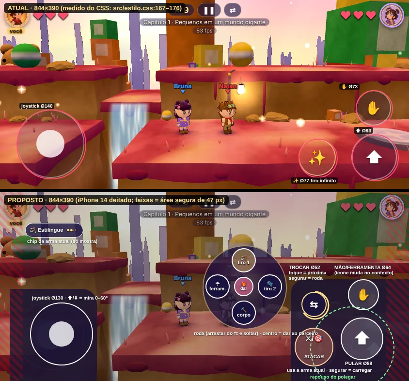

# Design de armas, equipamentos e ferramentas

Autor: design-armas (game designer de combate e equipamentos). Data: 2026-11-24. Base: commit `ed9fe6f`, medido numa
cópia isolada (worktree, já apagada). Nenhum arquivo de `src/`, `test/`, `public/` ou `index.html` foi alterado.

Pedido do jogador coberto aqui: **(3)** trocar os "poderes mágicos" por armas, equipamentos e ferramentas coletáveis.
Também toca o movimento **(4)**, o modo solo e o companheiro **(5–9)**, o casal **(10)** e o desempenho **(11)**.

---

## 0. Resumo

1. **Nenhum puzzle ou travessia dos 7 capítulos usa o tiro hoje.** O Lança-Estrelas (`src/core/sim.ts:39`, `:235–240`,
   `:252–267`) só serve para três coisas: ferir bichinhos, estourar esporos e acertar o ponto fraco do Rei-Pesadelo.
   As 17 placas, as 11 portas, os 4 trechos de Fio Vermelho, as 2 argolas e as 29 plataformas especiais não reagem
   ao tiro.
   Por isso a troca do tiro por armas **não quebra nenhum puzzle**. O risco está no combate: hoje a munição é
   infinita, e com munição finita alguns trechos ficam sem saída.
2. **Medido com os bots cooperativos** (`tools/revisao/design-armas/`, §1.2):
   - **sem nenhum tiro**, os bots não terminam os capítulos **3, 5 e 7**;
   - com **10 tiros por jogador**, terminam os capítulos 1 a 6;
   - o **capítulo 7 não termina nem com 20 tiros cada**: o Rei só leva dano com o ponto fraco aberto, e
     **27 dos 80 tiros** dos bots batem nele fechado.

   Os bots são roteirizados e não desviam. "Bot não terminou" não prova que uma pessoa não consiga, mas mostra onde a
   munição finita vira uma parede.
3. **Na Arena, os poderes fazem 41–45 % do dano no Rei** (Corte Cometa 20–23 %, Jardim de Luz 18 %, Golpe do Fio
   3–5 %). São também **o único jeito de quebrar o escudo da fase 2** (15–17 quebras por luta). O golpe corpo a corpo
   faz 50–53 % e o tiro só 5–6 %. Logo, os poderes não podem simplesmente sumir. A proposta (§9) troca cada poder por
   um **equipamento com os mesmos números e os mesmos eventos do núcleo**. Isso não mexe no balanceamento, e os testes
   `test/arena_balanceamento.test.ts` continuam valendo sem mudança.
4. **Regra que impede o "impossível" — a regra do recurso infinito.** Todo obstáculo obrigatório (bichinho que não
   se pode contornar, alvo, mecanismo, chefe) tem de ter solução com um **recurso que nunca acaba**:
   - o Estilingue de Xuxinha, com 3 pedrinhas que voltam sozinhas;
   - a arma corpo a corpo;
   - as ferramentas, cuja energia recarrega.

   Munição finita e armas raras **só** encurtam caminho, abrem segredos ou deixam a luta mais fácil. Um teste
   automático confere isso (§13, A2/A3).
5. **Catálogo:** 16 itens em estilo de brinquedo, um ou dois por mundo, nada militar (§4). Inventário de
   **4 espaços por jogador**: 1 corpo a corpo, 2 de tiro e 1 ferramenta. Raridades: comum, rara e "do casal"
   (lendária). Munição genérica que vai para a arma mais vazia. Dá para jogar munição e passar a arma ao parceiro.
6. **Controles no celular, 844×390** (§7, figura): os 3 botões de hoje continuam no mesmo lugar.
   - O ✨ vira **ATACAR**: usa a arma atual e, segurado, carrega o tiro.
   - Entra um botão pequeno **⇆ TROCAR**: um toque passa para a próxima arma; segurar abre uma roda de 4 espaços
     acima e à esquerda do polegar, nunca embaixo dele.
   - A ferramenta não ganha botão próprio: o ✋ muda de ícone quando há algo da ferramenta por perto.
7. **MVP (P0):**
   - Estilingue, Espada de Papelão e Martelo de Brinquedo;
   - inventário, troca, munição, dar munição ou arma, botões e HUD;
   - 3 elementos de puzzle novos: alvo-sino, barbante e bloco rachado;
   - a Arena com a troca de pele dos poderes;
   - 12 testes de aceite.

   As ferramentas (Pote de Vaga-lumes, Chave de Corda, Guarda-sol, Vara-Gancho, Ímã) e as armas de mundo entram em
   P1. As raras e lendárias e a Arena com o arsenal escolhido ficam em P2 (§12).

---

## 1. O que existe hoje (lido no código e medido)

### 1.1 Código
| Parte | Onde | O que faz |
|---|---|---|
| Entrada | `src/core/types.ts:5–16` | `Input.shoot` (segurado = dispara na cadência) |
| Tiro 2.5D | `src/core/sim.ts:39` | `TIRO = { vel: 14, alcance: 8, cadencia: 1/3, altura: 0.6 }`, sem munição |
| Disparo | `src/core/sim.ts:235–240` | faísca reta na direção em que se olha |
| Faíscas | `src/core/sim.ts:252–267` | some na parede, estoura esporo, `ferir(n, k, 1)` no 1º bichinho |
| Pisão | `src/core/sim.ts:269–290` | derrota (Rei só aberto, 1 de dano), espinhudo machuca |
| Vida dos bichinhos | `src/core/inimigos.ts:8–14` | bolotinha 1, morcego 1, cogumelo 2, espinhudo 2, Rei 20 |
| Botões do celular | `src/estilo.css:170–176` | ⬆ Ø93, ✨ Ø77, ✋ Ø73 em 844×390 (medido, figura do §7) |
| Teclado | `src/input/controles.ts:94–95` | J atira, E/Shift mão |
| Arena: armas e poderes | `src/core/arena/numeros.ts:36–76` | `ARMAS` (Espada/Lança), `TIRO`, `PODER` (cometa, jardim, fio) |
| Arena: uso do poder | `src/core/arena/sim.ts:254–304` | `usarPoder`, janela do Fio Vermelho (3 s), Jardim |

### 1.2 Medições (bots cooperativos de `test/fases/planos`, simulação real)
Ferramenta: `tools/revisao/design-armas/medir_armas.ts`. Saída bruta: `tools/revisao/design-armas/medidas.json`.

Cenários:
- **atual:** tiro infinito automático, como hoje;
- **sem tiro:** só pisão e desvio;
- **N tiros:** cada jogador tem N faíscas, sem recarga.

| Cap. | Bichinhos (vida somada) | Tiros dos bots, atual (N+B) | Termina sem tiro? | Com 10/jog. | Com 5/jog. | Dano sem tiro (N, B) |
|---|---|---|---|---|---|---|
| 1 | 5 (5) | 11 | sim | sim | sim | 4, 3 |
| 2 | 8 (10) | 25 | sim | sim (1 bolha) | sim (2 bolhas) | 4, 4 |
| 3 | 9 (13) | 26 | **não** (rua do relojoeiro) | sim | **não** (plataformas que caem) | 3, 4 |
| 4 | 9 (11) | 19 | sim | sim | sim | 6, 6 |
| 5 | 16 (20) | 46 | **não** (biscoitos e chuva) | sim (3 bolhas) | **não** | 6, 10 |
| 6 | 8 (11) | 26 | sim | sim | sim | 6, 5 |
| 7 | 10 (31, Rei 20) | 80 (27 no Rei fechado) | **não** (Rei) | **não** | **não** | 3, 4 |

**Causas, por capítulo:**
- **Cap. 3 — confirmada por geometria:** o espinhudo de x = 87 (`cap3_relogio.ts:68`) patrulha a rua por baixo das
  tábuas 84,2–91,5. A tábua de 89,5–91,5 tem a face de baixo a 1,3 m (`:41`). O jogador mede 1,1 m e o espinhudo
  0,8 m, então ali não dá para pular por cima dele. É um ponto de **combate forçado** ou de espera. A sonda
  (`sonda.ts`) registrou a Bruna levando dano em (84,2; 0) com o espinhudo em 84,9 e virando bolha aos 33,8 s.
- **Cap. 5 — hipótese:** os bots param em x ≈ 113,8, no começo da "chuva". Ali há 6 bichinhos entre 116 e 138
  (3 morcegos, cogumelo e espinhudo). Os bots não desviam e viram bolha.
- **Cap. 7 — confirmada no código:** o Rei só toma dano com `aberto` (`sim.ts:282–283` e `inimigos.ts`). O pisão
  tira 1, e o plano do bot não pisa nele.

**Arena** (bots de `test/arena_bot.ts`, 3 sementes por perfil): origem do dano no Rei, de 3400.

| Perfil | Tempo | Golpe | Tiro | Corte Cometa | Jardim de Luz | Golpe do Fio | Poderes usados | Escudo quebrado |
|---|---|---|---|---|---|---|---|---|
| Mediana (60 %/70 %) | 250–265 s | 50–53 % | 5 % | 20–23 % | 18 % | 3–4 % | 40–42 | 16–17 |
| Perfeita | 218 s | 51 % | 6 % | 21 % | 18 % | 5 % | 39 | 15 |

**Conclusões:**
- Cada jogador usa o poder **a cada ~12 s**. É um botão central da luta, não um extra.
- O tiro da arena é quase decorativo: 5 % do dano.

---

## 2. Princípios (o que guia cada decisão)

1. **Brinquedo, não arma.** Tudo parece feito em casa, de loja de brinquedos ou de cozinha: elástico de cabelo,
   papelão, rolha, bolha, pirulito, travesseiro. O bichinho que leva o golpe **estoura em brilho e vira estrelinha**,
   como hoje: ninguém "morre". Fica de fora qualquer coisa militar: fuzil, granada, sangue, mira telescópica,
   munição em forma de bala.
2. **Cada item serve para duas coisas:** combate e travessia/puzzle. Se não abre caminho nenhum, não entra.
3. **A regra do recurso infinito** (§0.4) vale para todo obstáculo obrigatório.
4. **Ferramentas só agem no que a fase marca** (anzol, bloco de metal, parede de doce, área escura, vento). Assim o
   grafo de alcance (`test/fases/alcance.ts`) continua analisável. E uma ferramenta não pula, sem querer, um trecho
   que a fase quer cooperativo (mãos dadas, placas do outro lado, Fio Vermelho).
5. **Complementar, não substituir.** Mãos dadas, Fio Vermelho, placas e pisão continuam sendo o coração do jogo. As
   armas acrescentam **combos de casal**, em que o item de um prepara a jogada do outro (§4.3). É a lição de
   *It Takes Two*, onde no galpão um crava o prego e o outro usa o martelo, e de *Trine 4*, onde o escudo devolve
   projéteis e o objeto criado vira plataforma.
6. **Leitura no celular.** Mira assistida por padrão, nenhum gesto de precisão obrigatório e nada que exija dois
   dedos na direita ao mesmo tempo.
7. **Determinismo.** Nada sorteado. A munição que o bichinho solta segue o índice dele e o pote do baú é fixo. A
   simulação continua reproduzível, como exigem a rede, os bots e `window.__edm.roteiro`.

---

## 3. O sistema

### 3.1 Unidade de dano
**1 = uma faísca de hoje.** A vida dos bichinhos não muda (bolotinha 1, morcego 1, cogumelo 2, espinhudo 2, Rei 20).
A Arena mantém a escala dela (Rei 3400, golpe 3): `numeros.ts` não muda no MVP.

### 3.2 Inventário (por jogador)
| Espaço | Quantos | Exemplos |
|---|---|---|
| Corpo a corpo | 1 | Espada de Papelão, Martelo de Brinquedo, Travesseiro de Penas |
| Tiro | 2 | Estilingue de Xuxinha (sempre num deles no começo), Revólver de Bolhas, Lançador de Confeitos… |
| Ferramenta | 1 | Pote de Vaga-lumes, Chave de Corda, Guarda-sol Planador, Vara-Gancho, Ímã de Geladeira |

**Desbloqueio:**
- Armas encontradas ficam **desbloqueadas para o casal**, no progresso salvo (`src/ui/progresso.ts`, bitmask de 16 bits).
- Quem pega usa na hora. O outro pode equipar a sua cópia **em qualquer lanterna**: tocar ✋ na lanterna abre o
  "baú da lanterna", que é a mochila do casal.
- Itens **raros e do casal existem em uma única cópia**. Para os dois usarem, um precisa **entregar ao outro**
  (§3.5). É de propósito: obriga os dois a combinar.

**Raridade** (cor do contorno e da etiqueta):
- **comum** (branco): achada no caminho;
- **rara** (azul): baú de segredo ou desafio;
- **do casal** (dourada): chefes e história.

### 3.3 Munição e recarga
- **Munição genérica: "miçangas"**, contas coloridas de pulseira, como no elástico de cabelo.
- Um **pote de miçangas** enche **1 carga completa da arma de tiro com a menor porcentagem**. Assim ninguém fica com
  munição "da arma errada".
- A Lança-Cometas usa uma munição especial, os **cristais de estrela**: só ela, só no capítulo 7.
- **Recarga** automática:
  - a carga esvazia → recarrega no tempo da arma;
  - 1,5 s sem atirar com a carga incompleta → também recarrega;
  - no PC, R força a recarga.

  Não há botão de recarga no celular.
- **Fontes, todas determinísticas:**
  - **bichinho derrotado:** solta a estrelinha, como hoje, e, se o **índice for par**, também um pote pequeno
    (meia carga);
  - **baús:** de munição, ao lado de cada lanterna, enchendo a reserva ao acender e de novo a cada volta ao
    checkpoint; de arma, no caminho; raros, nos segredos;
  - **água:** o Revólver de Bolhas enche na água do cap. 4;
  - **tiro defendido:** a pedrinha que bate no Rei fechado **ricocheteia e cai como miçanga coletável**. Não se gasta
    munição "à toa", que foi o problema medido no cap. 7.
- **Estilingue:** 3 pedrinhas que voltam sozinhas, 1 a cada 0,6 s. Nunca acaba. É o recurso infinito de tiro.

### 3.4 Troca
- **Celular:**
  - um toque em ⇆ passa à próxima arma, na ordem corpo → tiro 1 → tiro 2;
  - segurar ⇆ por 0,25 s abre a roda (§7);
  - deslizar do ⇆ numa direção e soltar troca direto, sem esperar a roda.
- **PC:** Q (próxima), 1–4 (direto), Tab (roda), roda do mouse.
- **Tempo:** a troca leva 0,15 s, com a animação de tirar o item da mochila. Não é instantânea, para ler bem, mas
  não pune.

### 3.5 Compartilhar (o casal)
- **Jogar munição:** na roda, o centro é 🎁 **dar**.
  - Com uma arma de tiro selecionada, joga um **saquinho com metade da reserva** num arco até o parceiro.
  - O parceiro pega sozinho a até 8 m. Mais longe, o saquinho cai no chão como pote, para ele pegar depois.
- **Entregar a arma:** com corpo a corpo ou ferramenta selecionada, 🎁 joga **o item**.
  - Se o espaço do parceiro estiver ocupado, os dois **trocam**: o item dele volta no mesmo arco.
  - Animação de jogar e pegar, com uma piscadela. Vira um momento do casal (§10 do pedido).
- **Aviso automático:** se um está com 0 % em todas as armas de tiro e o outro tem mais de 50 %, aparece uma vez
  "Jogue miçangas para a Bruna 🎁" no HUD de quem tem munição.
- **Sem fogo amigo.** Nenhuma arma fere o parceiro. Bolha, rolha e travesseiro têm efeitos de brincadeira (§4).

---

## 4. Catálogo (16 itens)

Medidas em metros e segundos. "Carga/Reserva" = munição pronta / guardada. A física de base vem de `sim.ts:20–31`:
pulo 10,5 m/s, gravidade 30, andar 5,2 m/s; pulo normal ≈ 1,84 m de altura e 3,6 m de distância.

### 4.1 Tabela
| # | Item (mundo) | Tipo | Raridade | Dano | Cadência | Alcance | Carga / Reserva | Recarga |
|---|---|---|---|---|---|---|---|---|
| 1 | **Estilingue de Xuxinha** (1) | tiro | comum, inicial | 1 (carregado 0,6 s: 2, atravessa 1 bichinho) | 2,5/s | 9 (em arco: 15 m/s, gravidade 6) | 3 / ∞ (volta 1 a cada 0,6 s) | — |
| 2 | **Espada de Papelão** (1) | corpo | comum, inicial | combo 1 + 1 + 2 | 0,30 s por golpe; 0,25 s de pausa | 1,3, arco 120° | — | — |
| 3 | **Martelo de Brinquedo** (1) | corpo | comum | 2 (martelada caindo: 3 numa área de 1,5) | 0,55 s | 1,2 | — | — |
| 4 | **Pote de Vaga-lumes** (2) | ferramenta | comum | 0 (morcego-sono no cone dorme 2 s) | — | cone de 6 m e 40° | energia 100: −20/s aceso, +25/s apagado | nunca zera de vez |
| 5 | **Bumerangue de Graveto** (2) | tiro | rara | 1 na ida + 1 na volta | volta em ~1,1 s | 7, horizontal ±15° | 1 / ∞ | — |
| 6 | **Chave de Corda** (3) | ferramenta | comum | 0 (bichinho vira brinquedo parado por 2 s) | — | 1,4 | 1 uso | 6 s |
| 7 | **Revólver de Rolha** (3) | tiro | comum | 1 + puxa 2 m | 1,5/s | 7, reto | 1 / ∞ (a rolha volta presa no barbante) | 0,5 s |
| 8 | **Ímã de Geladeira** (3) | ferramenta | rara | 0 (puxa e vira o espinhudo: 3 s vulnerável a pisão) | — | 5 | — | 1 s |
| 9 | **Guarda-sol Planador** (4) | ferramenta | comum | 0 (aberto à frente bloqueia esporo; aberto ≤ 0,2 s antes, devolve) | — | — | — | — |
| 10 | **Vara de Pescar-Gancho** (4) | ferramenta | rara | 0 (puxa morcego para o chão) | — | 7 até um anzol | — | 0,8 s |
| 11 | **Revólver de Bolhas** (4) | tiro | comum | 0 (prende o bichinho 3 s numa bolha; preso, cai com 1 golpe ou pisão) | 2/s | 6 (6 m/s, lento) | 6 / 30 | 1,2 s; na água, enche tudo |
| 12 | **Lançador de Confeitos** (5) | tiro | comum | 3 × 1 em leque de 30° | 1,2/s | 6 | 8 / 48 | 1,5 s |
| 13 | **Arco de Pirulito** (5) | tiro | rara | 2, atravessa | 1,2/s | 14 | 1 / 15 | 0,8 s |
| 14 | **Travesseiro de Penas** (6) | corpo | comum | 1 + empurrão de 4 m | 0,45 s | 1,5, arco 150° | — | — |
| 15 | **Lança-Cometas** (7) | tiro | do casal | 4 (carregado 1 s: 8, estouro de 1,5) | 0,8/s | 12 | 1 / 10 cristais de estrela | 1,0 s |
| 16 | **Armas do Coração**: Espada da Aurora (Natan) e Lança de Pétala (Bruna) (7 e Arena) | corpo | do casal | 2,5D: 2 + 2 + 3; Arena: como `numeros.ts` (3 + 3 + 3 / 3 + 3 + 4) | Arena: 0,30 / 0,42 s | 1,5 / 2,4 | — | — |

**Notas da tabela:**
- **Ferramentas com energia que volta:** o Pote de Vaga-lumes (energia que recarrega) e a Chave de Corda (recarga de
  6 s).
- **"Volta presa" e "volta em":** a rolha (7) e o bumerangue (5) nunca se perdem; voltam à mão.
- **Armas do Coração (16):** a Espada da Aurora é a **evolução** da Espada de Papelão (papelão forrado de papel
  laminado dourado). A Lança de Pétala é uma lança de brinquedo com ponta de flor de feltro.

### 4.2 Fichas: função em combate e em travessia/puzzle
1. **Estilingue de Xuxinha.** Feito com a forquilha e a xuxinha da Bruna; é o que a Dona Lume entrega no lugar do
   Lança-Estrelas.
   - **Combate:** a arma de base. Mira assistida num cone de ±25° e joystick ⬆/⬇ para mirar de 0 a 60° (pega o
     morcego no alto). Estoura esporos, como a faísca.
   - **Puzzle:** acerta o **alvo-sino**, que abre uma porta por 4 s ou derruba uma ponte levadiça; derruba fruta ou
     ninho com estrelinhas; acerta interruptores do outro lado de grades.
2. **Espada de Papelão.**
   - **Combate:** combo rápido; rebate esporos.
   - **Puzzle:** corta **barbantes**, que soltam uma caixa, baixam uma ponte ou abrem um pacote com estrelinhas, e
     abre caixas de papelão, os segredos pequenos.
3. **Martelo de Brinquedo** (faz "pó-pó").
   - **Combate:** golpe pesado que atordoa 1 s; a martelada no ar para baixo é um pisão em área.
   - **Puzzle:** quebra **blocos rachados**; afunda **pinos gigantes**, que viram degrau ou abrem caminho; toca o
     sino grande.
   - **Combo:** martelar a ponta de uma **gangorra** lança o parceiro que está na outra ponta, a 2,5 m de altura.
4. **Pote de Vaga-lumes.**
   - **Combate:** o morcego-sono no cone **adormece** 2 s e cai devagar, pronto para o pisão.
   - **Puzzle:** revela **pontes de luz** e plataformas pintadas com tinta invisível; o feixe **reflete em
     espelhos** (cap. 6).
   - **Combo:** um ilumina e o outro atravessa. A ponte só existe enquanto a luz está nela.
   - O nome "lanterna" já é dos checkpoints; por isso "pote".
5. **Bumerangue de Graveto.**
   - **Combate:** acerta na ida e na volta.
   - **Puzzle:** corta **cipós** a até 7 m e **pega estrelinhas e miçangas** no caminho. É só horizontal (±15°): não
     alcança os segredos altos de mãos dadas, que continuam sendo do casal.
6. **Chave de Corda.**
   - **Combate:** dá corda ao contrário no bichinho, que fica parado 2 s como brinquedo de corda.
   - **Puzzle:** **para** um ponteiro, uma plataforma móvel ou uma engrenagem por 5 s, ou faz girar 2× mais rápido.
     É acessibilidade para os pulos "na hora certa" do cap. 3.
   - **Combo:** um para o ponteiro e o outro pula.
7. **Revólver de Rolha.**
   - **Combate:** a rolha presa num barbante bate e puxa o bichinho 2 m para perto.
   - **Puzzle:** **puxa alavancas** do outro lado de grades; traz uma chave ou estrelinha de lugar fechado; puxa uma
     caixa para perto, para usar de degrau.
8. **Ímã de Geladeira.**
   - **Combate:** o espinhudo "de alfinetes" é puxado e cai de costas: 3 s em que o pisão vale. É a primeira resposta
     ao espinhudo que não é tiro.
   - **Puzzle:** puxa ou empurra **blocos de metal**, gira engrenagens à distância e segura uma plataforma metálica no
     lugar.
   - **Combo:** um segura o bloco no ar e o outro pula nele.
9. **Guarda-sol Planador** (guarda-sol de praia).
   - **Travessia:** segurando o pulo no ar, abre: a queda máxima cai para 2,5 m/s, e uma **corrente de vento** (das
     cachoeiras e ventiladores) faz subir. Cálculo com a física do núcleo: o pulo plano vai de **3,6 m para ≈ 6 m**, e
     uma descida de 2 m vai de ≈ 4,5 m para ≈ 10 m.
   - **Combate:** aberto à frente, segura esporos; abrir no instante certo **devolve** o esporo.
   - **Combo:** aberto no chão, é **trampolim do parceiro** (+30 % no pulo dele).
10. **Vara de Pescar-Gancho.**
    - **Travessia:** prende em **anzóis**, que incluem as argolas de hoje, a até 7 m, em vez do ✋ a ~1 m. Puxa quem
      atira até o anzol ou começa o balanço, reaproveitando a física de `fio.ts`.
    - **Ajudar o outro:** **pesca o parceiro** que está pendurado ou caindo a até 7 m e puxa barcos e caixas.
11. **Revólver de Bolhas.**
    - **Combate:** prende o bichinho numa bolha que sobe devagar. Preso, ele estoura com qualquer golpe.
    - **Puzzle:** a **bolha com bichinho vira plataforma** por 3 s e apaga velas e fogo.
    - **Combo:** um prende, o outro pisa na bolha e pula mais alto.
12. **Lançador de Confeitos.**
    - **Combate:** leque contra grupos e morcegos (a "chuva de confeitos" do cap. 5).
    - **Puzzle:** acerta 3 alvos-sino de uma vez (portas de "três sinos").
13. **Arco de Pirulito.**
    - **Combate:** alcance longo e atravessa.
    - **Travessia:** a flecha **gruda em paredes de doce marcadas** e vira um degrau de pirulito por 8 s, até 3 ao
      mesmo tempo.
    - **Combo:** um planta os degraus e o outro sobe.
14. **Travesseiro de Penas.**
    - **Combate:** empurra bichinhos para os vãos.
    - **Puzzle:** **gira espelhos** e empurra blocos.
    - **Casal:** acertar o parceiro solta penas, faz rir e empurra 1 m, sem dano. No palco do cap. 6 vira o minigame
      "guerra de travesseiro" (lembrança da primeira briga).
15. **Lança-Cometas** (o Lança-Estrelas da história volta como um canhão de confete estrelado).
    - **Combate:** o tiro do chefe 2,5D. Cada cometa tira 4 do Rei, que cai com 5 cometas no ponto fraco.
    - **Puzzle:** quebra **cristais de névoa** que fecham segredos do cap. 7.
16. **Armas do Coração.** Combate da Arena (§9). No cap. 7 em 2,5D, aparecem só depois de o Rei fugir, já no corte
    para a Arena.

### 4.3 Combos de casal (o momento cooperativo dentro do combate)
| Quem prepara | Quem completa | Resultado |
|---|---|---|
| Bolhas prende o bichinho | Martelo ou Travesseiro rebate | a bolha vira bola de boliche: 2 de dano em quem ela atravessa |
| Ímã segura o bloco de metal no ar | o outro pula nele | plataforma viva |
| Guarda-sol aberto no chão | o outro pula nele | trampolim (+30 %) |
| Pote de Vaga-lumes ilumina | o outro atravessa a ponte de luz | travessia só em dupla (com a IA no solo) |
| Chave de Corda para o ponteiro | o outro pula | pulo sem pressa |
| Vara-Gancho pesca o parceiro | — | resgate: cancela a queda e o leva até a beira |
| Os dois acertam o mesmo bichinho em 0,5 s | — | "estouro duplo": solta 2 estrelinhas e o HUD mostra 💞 |

---

## 5. Onde se acha cada item, por capítulo (com posições), e a curva

Regra:
- o item que um puzzle **obrigatório** usa fica **no caminho principal, antes** desse puzzle;
- itens raros ficam em segredos ou desafios, que continuam opcionais.

As posições x/y vêm de `src/core/fases/capN_*.ts`.

| Cap. | Item novo | Onde | Por quê ali |
|---|---|---|---|
| 1 | Estilingue + Espada de Papelão | início (x 1,5), entregues pela Dona Lume | tutorial: bolotinha em x 20 |
| 1 | **Martelo de Brinquedo** (comum) | baú no topo da pirâmide (bloco 82–84, topo y = 3) | degraus de 1 m: só pulo normal; bloco rachado opcional em x ≈ 100 |
| 1 | cosmético (adesivo) | prateleira secreta 113,5–116,5, y 5,2 (mãos dadas) | o segredo de casal continua de casal |
| 2 | **Pote de Vaga-lumes** (comum) | clareira, ao lado da lanterna de x 95 | revela uma ponte de luz opcional de 150 a 158 (estrelinhas) |
| 2 | **Bumerangue de Graveto** (rara) | baú no galho alto 100–104, y 3,2 (mãos dadas) | raro em segredo de casal |
| 3 | **Chave de Corda** (comum) | lanterna de x 30, antes do relógio 1 (38–64) | ajuda nos ponteiros (opcional) |
| 3 | **Revólver de Rolha** (comum) | baú na rua do relojoeiro (x ≈ 66) | alavanca opcional atrás da grade da sacada |
| 3 | **Ímã de Geladeira** (rara) | baú no telhado do portão do tempo (160–162, y 4,2) | é onde já há estrelinhas de casal |
| 4 | **Vara-Gancho** (rara, mas no caminho) | píer alto, lanterna de x 47 | a argola de 59,6 vira anzol: dá para pegá-la de longe |
| 4 | **Revólver de Bolhas** (comum) | mastro 134–138, y 7,6 (já obrigatório pela placa) | enche na água do oceano |
| 4 | **Guarda-sol Planador** (comum) | cais, lanterna de x 148 | a travessia final (cais 162 → ilha 169) ganha um 3º caminho, além da argola e do barquinho |
| 5 | **Lançador de Confeitos** (comum) | lanterna de x 94, antes dos biscoitos e da chuva (104–140) | é o trecho que os bots não passam sem tiro |
| 5 | **Arco de Pirulito** (rara) | nuvem de algodão-doce 161–165, y 9 (gelatina do segredo) | paredes de bolo marcadas no fim do capítulo (atalho) |
| 6 | **Travesseiro de Penas** (comum) | sala de espelho 2 (x 66) | espelhos giratórios opcionais e a guerra de travesseiro no palco (172–180) |
| 7 | **Lança-Cometas** (do casal) | lanterna de x 150 | antes do Rei (180–216); o Rei solta 2 cristais cada vez que abre |
| 7 | **Armas do Coração** | corte para a Arena | §9 |

**Curva do arsenal** (espaços ocupados por jogador ao **começar** cada capítulo, jogando só o caminho principal):

| Começo do cap. | Corpo | Tiro | Ferramenta | Novidade de jogo das armas |
|---|---|---|---|---|
| 1 | Espada | Estilingue | — | mirar, combo, alvo-sino, barbante |
| 2 | Espada ou Martelo | Estilingue | — | bloco rachado, pino, gangorra |
| 3 | idem | Estilingue | Pote de Vaga-lumes | luz, ponte de luz, morcego dormindo |
| 4 | idem | Estilingue + Rolha | Chave de Corda | puxar, parar o tempo |
| 5 | idem | + Bolhas | Gancho ou Guarda-sol | planar, pescar, bolha-plataforma |
| 6 | idem | + Confeitos | idem | grupos, 3 sinos |
| 7 | + Travesseiro | + Lança-Cometas | idem | chefe com munição especial |

A partir do cap. 4 há mais itens que espaços. Escolher o que levar é uma decisão que se toma nas lanternas.

---

## 6. Economia de munição (números a partir da medição)

Base: os tiros que os bots gastam (§1.2) e a vida somada dos bichinhos. Meta:
- munição finita **≥ 2× o que os bots gastam** com tiro infinito;
- mesmo assim, o capítulo **fecha sem nenhum pote** (só o Estilingue). Teste A2.

| Cap. | Tiros dos bots (dupla) | Vida a tirar | Potes de bichinho (índice par) | Baús de munição (1 por lanterna) | Miçangas disponíveis (aprox.) |
|---|---|---|---|---|---|
| 1 | 11 | 5 | 3 | 5 | ≈ 40 |
| 2 | 25 | 10 | 4 | 5 | ≈ 50 |
| 3 | 26 | 13 | 5 | 5 | ≈ 55 |
| 4 | 19 | 11 | 5 | 6 | ≈ 60 + água à vontade |
| 5 | 46 | 20 | 8 | 5 | ≈ 100 |
| 6 | 26 | 11 | 4 | 5 | ≈ 50 |
| 7 | 80 (27 no Rei fechado) | 31 | 5 | 6 | ≈ 60 + 2 cristais por abertura do Rei; o tiro defendido volta como miçanga |

"Miçangas" = 1 por tiro de arma de munição. Valores por pote: pote de baú = 1 carga completa da arma mais vazia
(6–8); pote de bichinho = meia carga.

**Pontos de combate forçado** (sem desvio possível; precisam de recurso infinito; a lista vai para o teste A3):
- cap. 3, rua sob as tábuas, 84–92: o espinhudo debaixo de um teto de 1,3 m;
- cap. 7: o Rei-Pesadelo.

Os demais bichinhos dá para contornar com um pulo: a altura deles (≤ 0,9 m) fica bem abaixo dos 1,84 m do pulo.

---

## 7. Controles, HUD e seleção



*Em cima: hoje, medido do CSS (`src/estilo.css:167–176`) sobre uma captura do cap. 1 em Média. Embaixo: a proposta
(maquete), com a área segura do iPhone 14 deitado (47 px de cada lado). A roda aparece aberta só como exemplo.*

### 7.1 Celular (844×390 CSS; Redmi Note 11 ≈ 873×393)
Coordenadas a partir do canto de baixo à direita da **área segura**: `right` = `max(3vw, safe-area-inset-right)`,
como hoje. A coluna "centro" diz quantos px o centro fica da borda direita e da de baixo.

| Botão | Ø | Centro (da direita, de baixo) | Toque | Segurar | Observação |
|---|---|---|---|---|---|
| ⬆ PULAR | 88 | 50, 75 | pula | pulo alto; no ar, abre o Guarda-sol | mesmo lugar de hoje |
| ⚔/🎯 ATACAR | 80 | 150, 60 | usa a arma atual | tiro carregado (0,6–1 s) ou combo segurado | substitui o ✨; o ícone é o da arma |
| ✋ MÃO/FERRAMENTA | 64 | 40, 180 | dar a mão, fio, argola, como hoje | segurar o fio | com algo da ferramenta perto, o ícone vira o dela e o anel pisca |
| ⇆ TROCAR | 52 + anel de munição | 150, 155 | próxima arma | ≥ 0,25 s abre a roda | o anel mostra a carga da arma atual |

**A roda:**
- **Forma:** Ø 170, com 4 espaços nos pontos cardeais (tiro 1 em cima, tiro 2 à direita, corpo embaixo,
  ferramenta à esquerda) e 🎁 **dar** no centro.
- **Posição:** o centro fica **120 px à esquerda e 60 px acima** do ⇆. Nunca embaixo do polegar, que continua
  sobre PULAR e ATACAR.
- **Como escolher:** arrastar do ⇆ na direção e soltar. Um toque no espaço também escolhe.
- **Tempo:** no online o jogo não pausa (a simulação é uma só para os dois); no solo e no treino, o tempo cai a 30 %
  com a roda aberta.

**Medidas mínimas:**
- alvos ≥ 52 px, o que dá 11 mm no iPhone 14 (460 ppi, DPR 3) e passa da recomendação de 44 pt;
- ≥ 10 px entre bordas;
- nada no terço de cima à direita, onde ficam o rosto e os corações da Bruna.

**Mira:**
- mira assistida **ligada por padrão**, cone de ±25° a até 9 m, com prioridade para o bichinho mais perto e depois o
  alvo-sino;
- o joystick ⬆/⬇ mira de 0 a 60° enquanto ATACAR está segurado;
- sem o joystick, atira para a frente.

**HUD:**
- um chip abaixo do rosto de cada um, com o ícone da arma atual e a munição ("●●○ · 18");
- o chip do parceiro aparece menor, para saber a quem jogar miçangas;
- pote pego: "+6" sobe do personagem;
- raridade pela cor do contorno do ícone.

### 7.2 PC
| Ação | Tecla |
|---|---|
| Andar / mirar | setas ou WASD (⬆/⬇ mira) |
| Pular / planar | Espaço (segurar no ar = Guarda-sol) |
| Atacar (segurar = carregar) | J ou botão esquerdo do mouse |
| Mão / ferramenta | E ou Shift |
| Próxima arma / direto / roda | Q / 1–4 / Tab (roda do mouse também troca) |
| Dar ao parceiro | G |
| Recarregar | R (opcional) |

### 7.3 Arena (3D)
Os 5 botões de hoje (`estilo.css:227–236`) continuam. Muda só o que aparece neles:
- ⚔ golpe da arma do coração;
- ✨ Estilingue;
- ★ o equipamento especial de cada um, com a "bomba de ar" em volta (§9);
- ↻ esquiva;
- ⬆ pulo.

---

## 8. Revisão de todos os puzzles e travessias

Legenda:
- **usa o tiro?** = se hoje depende do Lança-Estrelas;
- **muda** = o que a troca afeta;
- **solo** = o que o companheiro controlado pelo jogo precisa fazer.

Nenhum puzzle de hoje usa o tiro. Os únicos usos dele são combate, esporos e o Rei.

### Capítulo 1 — Pequenos em um mundo gigante
| Trecho | Mecânica | Usa o tiro? | Muda / adaptação | Solo |
|---|---|---|---|---|
| 0–26 blocos e bolotinha (x 20) | tutorial de tiro | combate | tutorial do Estilingue e da Espada; alvo-sino opcional em x 13 (estrelinhas por cima do cubo) | IA ataca o que estiver a < 6 m |
| 28–64 tampa (placas 35 e 43,6) | placa dos dois lados | não | nada | IA segura a placa |
| 52 caixa alta | mãos dadas | não | nada | IA dá a mão |
| 64–72 trenzinho | plataforma móvel | não | nada | — |
| 72–104 pirâmide e bolotinha (x 93) | pulos | combate | baú do Martelo no topo; bloco rachado em ~100 com estrelinhas (opcional) | — |
| 104–124 blocos sobre o vão e prateleira secreta | pulos e mãos dadas | não | baú cosmético no segredo | IA dá a mão |
| 124–152 prateleira com placa (142,5 / 151,2) | placa abre o portão do outro | não | nada | IA sobe e segura |

### Capítulo 2 — A floresta dos sonhos
| Trecho | Mecânica | Usa o tiro? | Muda / adaptação | Solo |
|---|---|---|---|---|
| 0–38 bolotinha (14) e morcego (30, y 2,8) | combate | sim (morcego no alto) | o Estilingue mira para cima (⬆); morcego também cai com pisão | — |
| 36–63 Fio Vermelho 1 | um segura, o outro balança | não | nada; a Vara-Gancho (cap. 4) não age aqui (sem anzol) | IA ancora ou balança |
| 63–92 cogumelo (72,8) e folhas que caem | esporos e plataformas que caem | estoura esporos | a Espada rebate esporos, o Estilingue estoura | — |
| 92–116 clareira e galho alto secreto (mãos dadas) | segredo | não | Pote de Vaga-lumes na lanterna de 95; baú raro do Bumerangue no galho | IA dá a mão |
| 112–134 Fio Vermelho 2 e parede de 3 m | fio e mãos dadas | não | nada | IA |
| 130–200 espinhudo (142) e raízes | espinhudo: hoje só tiro | **sim** | Estilingue (∞) ou Espada (1,3 m de alcance, fora do contato); ponte de luz opcional 150–158 | — |

### Capítulo 3 — A cidade do tempo
| Trecho | Mecânica | Usa o tiro? | Muda / adaptação | Solo |
|---|---|---|---|---|
| 0–38 bolotinha e espinhudo (28) | combate | sim (espinhudo) | Estilingue ou Espada | — |
| 38–64 relógio 1 (ponteiros, 8 s por volta) | pulo na hora certa | não | **Chave de Corda** (na lanterna de 30) para o ponteiro 5 s: opcional, é acessibilidade | IA usa a chave se o jogador errar 2× |
| 64–100 porta dupla e sacada | 2 placas e placa do lado de lá | não | **combate forçado**: espinhudo (87) sob a tábua de 1,3 m (§1.2) → regra do recurso infinito; Rolha puxa a alavanca opcional atrás da grade (x ≈ 92) | IA mata ou espera o espinhudo |
| 100–128 engrenagens, dois ponteiros, plataformas que caem | pulos | não | Chave de Corda para o relógio de dois ponteiros (114); bloco de metal opcional (Ímã) | — |
| 128–186 portão do tempo (porta dupla colada) | mãos dadas e placas | não | baú raro do Ímã no telhado (160) | IA |
| 186–214 relógio grande | ponteiros | não | estrelinhas 2,5 m acima da tela (auditoria de movimento): a câmera precisa mostrar; o Bumerangue não alcança (horizontal) | — |

### Capítulo 4 — O oceano das lembranças
| Trecho | Mecânica | Usa o tiro? | Muda / adaptação | Solo |
|---|---|---|---|---|
| 0–40 caranguejo-bolotinha e gaivota-morcego | combate | sim | nada | — |
| 40–58 bolha-elevador | plataforma bolha | não | nada | — |
| 58–84 argola (59,6; 7,4) | argola; o parceiro empurra | não | a **Vara-Gancho** prende a argola a 7 m; o **empurrão continua do parceiro** (`empurrarArgola`) | IA empurra |
| 82–103 fio do píer à jangada | fio | não | nada | IA |
| 104–162 bolha do cais, mastro e comporta (placa 135,6 / 143,1) | placa abre a comporta para o outro | não | baú do Revólver de Bolhas no mastro (obrigatório pela placa); Guarda-sol na lanterna de 148 | IA |
| 162–220 argola (164,4), barquinho e ilha | 3 caminhos | não | **o Guarda-sol cria um 3º caminho** (cais y 4 → ilha y 2, vão de 7 m: ≈ 10 m planando); não há trava de casal aqui (o barquinho já é o caminho de quem está sozinho) → **rodar de novo o grafo de alcance** com o planar | — |

### Capítulo 5 — O reino dos doces
| Trecho | Mecânica | Usa o tiro? | Muda / adaptação | Solo |
|---|---|---|---|---|
| 0–40 bolotinhas e cogumelo | combate | sim | nada | — |
| 40–48 gelatina do poço | quique | não | as estrelinhas do arco de gelatina pedem precisão (auditoria de movimento): o Guarda-sol dá controle na descida (opcional) | — |
| 48–104 portão de pirulito (placa na torre 81, y 7,5) | gelatina, placa | não | as paredes de bolo da torre **não** são marcadas para o Arco (a torre continua pela gelatina) | IA quica e segura |
| 104–140 biscoitos e chuva (6 bichinhos em 116–138) | combate denso | **sim** | Lançador de Confeitos na lanterna de 94; 2 potes; morcegos baixos; os bots sem tiro param aqui (§1.2) | IA cobre o jogador |
| 140–175 muro de chocolate (mãos dadas) e gelatina do segredo | mãos dadas | não | baú raro do Arco na nuvem | IA |
| 175–210 gelatinas sobre o poço e o bolo | quique | não | paredes de bolo marcadas perto do fim (atalho para segredos, não para o pedaço) | — |

### Capítulo 6 — O labirinto dos espelhos
| Trecho | Mecânica | Usa o tiro? | Muda / adaptação | Solo |
|---|---|---|---|---|
| 0–30 sala de entrada | tábuas | não | nada | — |
| 30–64 placa de cada porta no corredor do outro | caminhos separados | não; espinhudo (47, em cima) é combate | Estilingue ou Espada; o corredor de baixo tem teto de 4,2 m, dá para pular | IA vai pelo outro corredor |
| 64–70 sala de espelho 2 | troca de corredor | não | Travesseiro aqui; **espelho giratório** opcional (Travesseiro gira, o feixe do Pote reflete) → baú | — |
| 70–98 trecho espelhado | placas cruzadas | não; espinhudo (84, embaixo) | nada | IA |
| 98–190 salão, muro (mãos dadas) e palco | plataforma móvel, mãos dadas | não | **guerra de travesseiro** no palco (minigame, 60 s, não bloqueia o pedaço) | IA joga o minigame |

### Capítulo 7 — O coração do universo
| Trecho | Mecânica | Usa o tiro? | Muda / adaptação | Solo |
|---|---|---|---|---|
| 0–176 fio o tempo todo, ilhas móveis, ponte de luz, ilha alta | fio e mãos dadas | morcegos e bolotinhas: combate | cristais de névoa opcionais (Lança-Cometas) fecham segredos | IA presa no fio |
| 180–216 Rei-Pesadelo (20 de vida, só aberto) | chefe | **sim**: é o maior gasto (80 tiros; 27 no Rei fechado) | Estilingue (∞) e Lança-Cometas; o Rei solta 2 cristais ao abrir; o tiro no Rei fechado **ricocheteia e vira miçanga**; o pisão continua valendo 1 | IA mira no ponto fraco e pede "agora!" |

### Arena do Coração
| Momento | Hoje | Usa poder/tiro? | Adaptação (§9) |
|---|---|---|---|
| Fase 1 (bolotinhas, onda, esporos) | golpe, tiro, pulo | sim | só renomear e trocar a arte |
| Fase 2: escudo de névoa | **só o poder ou o Fio quebram** | **sim** | os equipamentos especiais quebram o escudo (mesmo código) |
| Fase 3: dois cristais ao mesmo tempo | golpe ou tiro acende (2 s; 4 s com o Jardim) | sim | os cristais viram **sinos de cristal**; qualquer arma toca; a Toalha de Piquenique dá os 4 s |

**Conclusão da revisão:**
- **Nenhum puzzle fica impossível com a troca.** O que pode travar é combate com munição finita: os 2 pontos de
  combate forçado e o Rei. A regra do recurso infinito resolve os três.
- **O que pode quebrar a cooperação** são 3 ferramentas de travessia: Guarda-sol, Arco e Vara-Gancho. Daí a regra
  "só age no que a fase marca", e o grafo de alcance e o teste "cooperativa" têm de rodar de novo com os movimentos
  novos (A4).

---

## 9. Arena do Coração: trocar os poderes por equipamentos sem perder o momento cooperativo

**Ideia:** a **"barra de poder" vira a "bomba de ar"** do equipamento especial. Ela enche do mesmo jeito: golpes,
esquiva no último instante e ficar perto do parceiro, que é o "laço". Cheia, o equipamento está "bombeado" e pronto.
O efeito, o dano, o atordoamento, a quebra do escudo e a janela de 3 s **são os mesmos números de `PODER`**
(`numeros.ts:59–70`). Os eventos `cometa:0`, `jardim:1` e `fio-vermelho` continuam no núcleo. Mudam só o desenho,
os nomes e o som (`src/render/arena/efeitos.ts`, `herois.ts`, `src/ui/hudArena.ts`).

**Coordenação:** a outra equipe está mexendo nessas pastas agora. Este documento é a especificação para ela;
nenhuma mudança de número é pedida.

| Hoje (mágico) | Equipamento (brinquedo) | Como fica na tela | Números (sem mudança) |
|---|---|---|---|
| Lança-Estrelas | **Estilingue de Xuxinha** | pedrinha colorida em arco curto | `TIRO`: 1 de dano, 18 m/s, 16 m, 3/s |
| Espada da Aurora (lâmina de luz) | **Espada da Aurora** de papelão com papel laminado dourado | brilho só no rastro do golpe | `ARMAS[0]` |
| Lança de Pétala | **Lança de Pétala** de brinquedo com ponta de flor de feltro | pétalas de pano no rastro | `ARMAS[1]` |
| **Corte Cometa** (Natan) | **Foguete de Garrafa**: mochila de garrafa PET bombeada; o Natan dispara para a frente com a espada esticada | jato de água e confete, rastro de gotas | `PODER.cometa`: 8 m a 22 m/s, 30 de dano, atordoa 2 s, quebra o escudo |
| **Jardim de Luz** (Bruna) | **Toalha de Piquenique + Canhão de Pétalas**: a Bruna estoura o canhão (30 de dano) e estende a toalha de 4,5 m; sobre ela, o lanche cura o parceiro (+1 coração) e a bolha renasce | toalha xadrez com cesta; pétalas de papel | `PODER.jardim`: 30 de dano, raio 4,5 m, 5 s, +1 coração; cristais acesos 4 s |
| **Golpe do Fio Vermelho** | **Estilingue Gigante do Fio Vermelho**: se o segundo equipamento entra a ≤ 3 s do primeiro, o Fio Vermelho estica entre os dois como o elástico de um estilingue gigante e lança a **Estrela de Pelúcia** no Rei | os dois puxam juntos e soltam; câmera curta de lado | `PODER.fio`: +15 de dano, atordoa 3 s, quebra o escudo e, na fase 3, a parede |
| Barra de poder (anel em volta do ★) | **Bomba de ar**: o anel vira um manômetro que enche | ★ vira o ícone do equipamento | `PODER.max` 100 e as mesmas fontes |
| Cristais da fase 3 | **Sinos de cristal** | toca e acende | `CRISTAIS` |

**Por que o momento cooperativo continua:**
- a janela de 3 s e a recompensa (+15, atordoar, derrubar a parede) não mudam;
- o gesto fica **mais físico e mais do casal**: os dois puxando o mesmo elástico, que é o próprio Fio Vermelho;
- na fase 3, com a parede de névoa no meio, o Estilingue Gigante é o "reencontro": o fio atravessa a parede e a
  derruba.

**Depois (P2):** levar à Arena o arsenal escolhido na campanha (1 corpo + 1 tiro por jogador).
- **Normalização:** o dano da Arena = dano 2,5D × (DPS da Espada da Aurora na Arena ÷ DPS da Espada de Papelão).
- **Teto:** nenhum arsenal pode baixar a luta mediana de 180 s.
- **Teste:** rodar o balanceamento com cada combinação (16 combinações de 4 × 4 itens permitidos).

**Texto da história** (`docs/HISTORIA.md`):
- a Dona Lume entrega "o Estilingue de Xuxinha e a Espada de Papelão" em vez do "Lança-Estrelas";
- no final, o Rei é "atingido pela Estrela de Pelúcia lançada pelo Fio Vermelho".

---

## 10. Companheiro controlado pelo jogo e treino (o que muda por causa das armas)

**Companheiro (campanha solo):**
- **No combate:** usa corpo a corpo e Estilingue em bichinhos a < 6 m.
- **Munição:** **nunca gasta munição de arma rara nem cristais**, a menos que o jogador mande ("usar especial").
  Joga miçangas sozinho quando o jogador cai abaixo de 20 % e ele tem mais de 50 %.
- **Ferramentas:** usa quando o plano da fase marca um "ponto de ferramenta", com os mesmos dados que o grafo de
  alcance usa. Ilumina a ponte de luz, para o ponteiro, pesca o jogador caindo.
- **Comandos de contexto** (no ✋ com o companheiro perto): "vem", "espera", "segura a placa", "ilumina", "ataca".
- **Revive:** o jogador virou bolha → o companheiro para e espera (a bolha voa até ele, `VIDA.velBolha` 3,5 m/s).
- **Trocar de personagem:** o arsenal é de cada personagem, não de cada pessoa. Ao trocar, a pessoa assume o
  arsenal do outro.

**Segundo jogador entrando:** assume o arsenal do companheiro como está. Se sair, a IA reassume com o mesmo arsenal
(os espaços são estado da simulação, não da interface).

**Treino** ("Quintal de Treino", na casa compartilhada):
- os 16 itens liberados;
- munição infinita ligada por padrão, com chave;
- bonecos de pano com vida 99 e número de dano;
- alvos-sino, barbantes, blocos rachados e de metal, anzóis, vento, área escura, espelho giratório e uma gangorra;
- **não grava** progresso: outra chave no armazenamento; o teste A11 compara o `localStorage` antes e depois.

---

## 11. Núcleo, rede e salvamento (para quem for implementar)

**`src/core/types.ts`:**
- **`Input`:** `atk` (no lugar de `shoot`), `troca?: 0 | 1 | 2 | 3 | 4` (0 = nada, 1–4 = espaço; "próxima" é
  resolvida na interface) e `dar?: boolean`. `normalizarInput` (`sim.ts:376`) aceita `shoot` como `atk` (rede
  antiga).
- **`EstadoJogador`:** `arsenal: { itens: [c, t1, t2, f]` (id 0–15 ou −1)`, atual, carga[4], reserva[4],
  espera[4], energia }`. O `recarga` de hoje vira `espera[atual]`.
- **`Estado`:**
  - `faiscas` → `projeteis` (com `tipo` e `vy`);
  - `potes` (miçangas soltas e saquinhos jogados);
  - `presos` (bichinhos em bolha);
  - `degraus` (flechas de pirulito, até 3).
- **`Fase`** (todos opcionais, então as fases de hoje continuam válidas): `baus`, `alvos` (sino: `abre`, `tempo`),
  `barbantes`, `rachados`, `pinos`, `gangorras`, `anzois` (as argolas contam), `metais`, `ventos`, `pontesLuz`,
  `espelhos`, `paredesDoce`.

**`src/core/sim.ts`:**
- o trecho do tiro (`:235–240`) vira `usarArma(e, i, inp)`;
- o laço das faíscas (`:252–267`) vira `passoProjeteis` (com arco, atravessar, prender, puxar);
- os **alvos funcionam como placas temporárias**: abrem `portas[id]` por `tempo` s, reaproveitando o fechamento a
  `velPorta`;
- "defendeu" vira miçanga solta.

**Rede (`src/core/instantaneo.ts`):**
- +~20 bytes por jogador (4 ids, atual, 4 cargas, energia, arredondados) e 3–6 bytes por projétil a mais (tipo);
- medir em `test/e2e/dupla.mjs` com a meta: instantâneo médio ≤ +15 % do de hoje.

**Salvamento (`src/ui/progresso.ts`):**
- `armas: number` (bitmask de 16 bits), `arsenal` de cada personagem no último checkpoint e `baus` abertos por
  capítulo;
- o treino grava noutra chave.

**Desempenho:**
- todos os projéteis num único `InstancedMesh` por tipo, como as partículas de hoje (`particulas.ts`, 2 chamadas);
- os itens na mão são geometria simples, de ≤ 1,5 mil triângulos cada;
- orçamento da Média (≤ 80 chamadas e ≤ 250 mil triângulos) com folga: +3 a +5 chamadas.

---

## 12. MVP e o que vem depois

| Prioridade | Entrega | Critério de aceite | Esforço (dias de dev.) |
|---|---|---|---|
| **P0** | Núcleo do arsenal: 4 espaços, troca, munição genérica, recarga, potes por índice, dar munição e arma, sem fogo amigo | A1, A2, A3, A10, A12 passam; os testes de hoje (`npm test`) continuam passando | 4–5 |
| **P0** | Estilingue (substitui o Lança-Estrelas, ∞ regenerável), Espada de Papelão, Martelo | os 7 capítulos fecham com os bots só com esses 3 (A2) | 2 |
| **P0** | Elementos alvo-sino, barbante e bloco rachado, mais 1 uso opcional de cada no cap. 1 | A5; o grafo de alcance sem armadilha (A4) | 2 |
| **P0** | Botões ATACAR e ⇆, roda, chip no HUD, teclado | A9 em 844×390 e 873×393 | 2–3 |
| **P0** | Arena: troca de pele dos poderes (§9), números iguais | `test/arena*.test.ts` sem mudança e A7 | 2 (arte) |
| **P0** | Rede e salvamento do arsenal | A8 no `dupla.mjs` | 1–2 |
| **P1** | Ferramentas: Pote de Vaga-lumes, Chave de Corda, Guarda-sol, Vara-Gancho, Ímã, e os elementos de fase que usam cada uma | A4 com os movimentos novos; A6 com a IA | 8–10 |
| **P1** | Armas de mundo comuns: Rolha, Bolhas, Confeitos, Travesseiro; combos de casal | A1 por capítulo com o arsenal até ali | 5–6 |
| **P1** | Companheiro IA usando armas e ferramentas; Quintal de Treino | A6, A11 | junto com o modo solo |
| **P2** | Raras: Bumerangue, Arco de Pirulito; Lança-Cometas; guerra de travesseiro | A1 mantido; minigame não bloqueia o capítulo | 4–5 |
| **P2** | Arena com o arsenal escolhido; melhorias de arma e cosméticos de arma | balanceamento por combinação (§9) | 4–6 |

**Fora do MVP de propósito:**
- dano por arma diferente na Arena;
- mira manual livre (só a assistida mais ⬆/⬇);
- recarga manual no celular;
- munição por tipo.

---

## 13. Testes de aceite

Todos em vitest no núcleo (determinísticos), salvo os marcados com e2e. Os bots de `test/fases/bot.ts` ganham
`arsenal` e `atk` automático (o `autoTiro` de `bot.ts:154` vira `autoAtaque` com a arma atual).

| Id | Teste | Como |
|---|---|---|
| A1 | **Cada capítulo fecha com o arsenal disponível até ali** e a munição finita dos potes definidos | bots com o arsenal da curva (§5) e a munição real; `concluida` e 0 recomeços de checkpoint |
| A2 | **Cada capítulo fecha só com recurso infinito** (Estilingue ∞ + corpo a corpo, nenhum pote) | igual ao A1, com os potes desligados; hoje o "sem tiro" falha nos caps. 3, 5 e 7 (§1.2) |
| A3 | **Nenhum obstáculo obrigatório exige munição finita ou item raro** | varre os dados da fase: todo `alvo`/`barbante`/`rachado` do caminho principal declara `requer` ∈ {estilingue, corpo, qualquer}; os pontos de combate forçado (§6) têm o Estilingue ou o corpo a corpo à mão |
| A4 | **Sem armadilha e ainda cooperativa** com os movimentos novos (planar, gancho, degrau de pirulito, trampolim, bloco no ímã) | `test/fases/alcance.ts` com as arestas novas; o teste "cooperativa" (sozinho não chega ao fim) continua verdadeiro |
| A5 | Todo baú alcançável; todo item usado num obrigatório está **antes** dele no caminho principal | grafo de alcance + ordem por x da lanterna |
| A6 | Solo com o companheiro IA fecha os 7 capítulos e a Arena | bot jogador + IA de verdade (não o plano roteirizado) |
| A7 | Arena: mesmas durações e dano (§1.2) depois da troca de pele | `arena_balanceamento.test.ts` sem mudança; `medir_armas.ts` com as mesmas porcentagens por origem |
| A8 | Rede: munição, espaços e projéteis iguais no anfitrião e no convidado; instantâneo médio ≤ +15 % | e2e `dupla.mjs` (capítulo 1 inteiro) |
| A9 | Botões: sem sobreposição, Ø ≥ 52 px (ATACAR ≥ 72), ≥ 10 px entre bordas; a roda não cobre o retângulo do polegar (o quadrado de 170 px no canto de baixo à direita) | e2e Playwright em 844×390 e 873×393, com `getBoundingClientRect` |
| A10 | Determinismo: a mesma entrada dá o mesmo arsenal e os mesmos potes; nenhum `Math.random` em `src/core` | duas execuções e comparação do estado; `grep` no teste |
| A11 | Treino libera tudo e não grava progresso | e2e: `localStorage` antes e depois |
| A12 | Sem fogo amigo: nenhuma arma tira coração do parceiro | teste com os dois lado a lado atirando um no outro com cada item |

**Medidas de "o combate complementa":** os bots registram os ticks com bichinho vivo a < 8 m. Metas:
- **combate ≤ 25 % do tempo** de cada capítulo;
- nenhum bichinho a menos de 2 m de uma beira de pulo de precisão. A lista sai do grafo de alcance: arestas com
  folga baixa da auditoria de movimento.

---

## 14. Riscos, causas confirmadas e hipóteses

**Confirmados** (código ou medida):
- nenhum puzzle usa o tiro (leitura das 7 fases e de `sim.ts`);
- os bots sem tiro não fecham os caps. 3, 5 e 7; com 10 tiros por jogador fecham os caps. 1–6; o cap. 7 não fecha
  nem com 20 (§1.2);
- 27 de 80 tiros no Rei fechado;
- o espinhudo do cap. 3 fica sob um teto de 1,3 m (geometria);
- na Arena, os poderes fazem 41–45 % do dano e são o único jeito de quebrar o escudo.

**Hipóteses** (precisam de teste com gente ou de implementação):
- uma pessoa passa os caps. 3 e 5 sem tiro desviando; os bots não desviam;
- 2,5 tiros/s com 3 pedrinhas que voltam é bom de sentir (pode pedir 4 pedrinhas);
- a roda sem pausa no online não atrapalha (alternativa: só o toque no ⇆ no online);
- o planar não deixa o cap. 4 fácil demais.

**Riscos:**
- **Inchaço de botões:** mitigado com a ferramenta no ✋.
- **Ferramentas pulando os trechos de casal:** mitigado com os elementos marcados e o A4.
- **Arena sendo feita agora:** a §9 pede só arte e nomes, nenhum número.
- **Os bots de teste dependem do tiro automático:** o A1 e o A2 precisam do `autoAtaque`.

---

## 15. Arquivos desta entrega e como reproduzir

| Arquivo | O quê |
|---|---|
| `docs/revisao/DESIGN_ARMAS.md` | este documento |
| `docs/revisao/img/design-armas/controles_atual_vs_proposto.webp` | botões de hoje (medidos) × proposta, 844×390 |
| `tools/revisao/design-armas/medir_armas.ts` | mede os tiros e a dependência do tiro (caps.) e a origem do dano (Arena) |
| `tools/revisao/design-armas/sonda.ts` | onde e por que os bots sem tiro levam dano (caps. 3, 5 e 7) |
| `tools/revisao/design-armas/rodar.sh` | empacota com o rolldown do projeto e roda |
| `tools/revisao/design-armas/medidas.json` | saída bruta da medição |

```sh
git worktree add <dir> HEAD && ln -s <repo>/node_modules <dir>/node_modules
cp -r tools/revisao/design-armas <dir>/tools/revisao/
cd <dir> && tools/revisao/design-armas/rodar.sh --json medidas.json     # cerca de 1 min
node_modules/.bin/rolldown tools/revisao/design-armas/sonda.ts --platform node --format esm -o /tmp/sonda.mjs && node /tmp/sonda.mjs
```

A captura de fundo da figura saiu de
`tools/revisao/capturas.mjs --caps 1 --q media --tam 844x390@1 --pontos 0.12 --hud`. A maquete da proposta foi
desenhada em HTML por cima da captura: é uma maquete, não o jogo.
