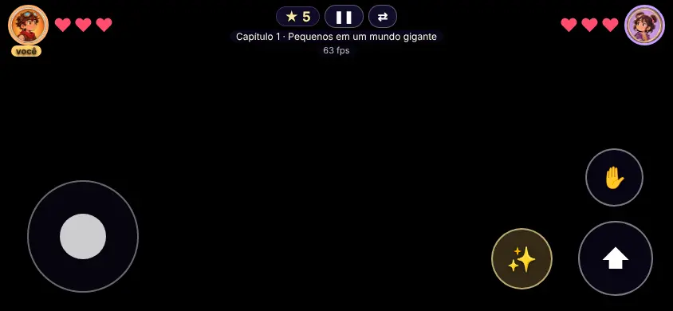
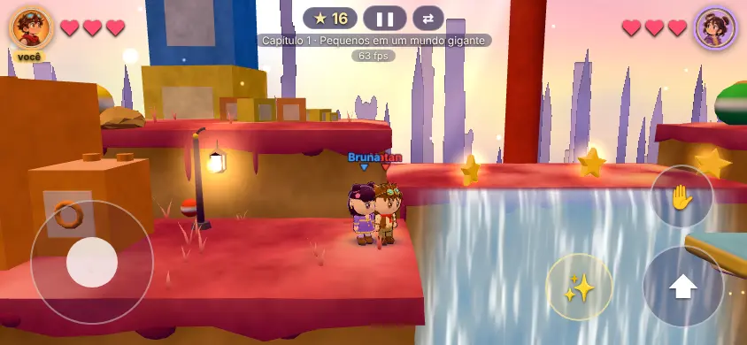
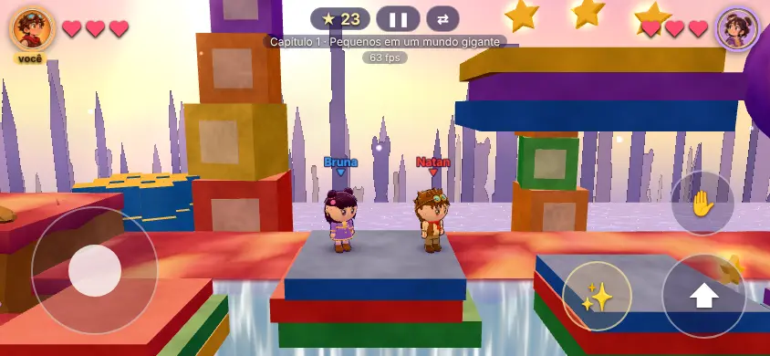
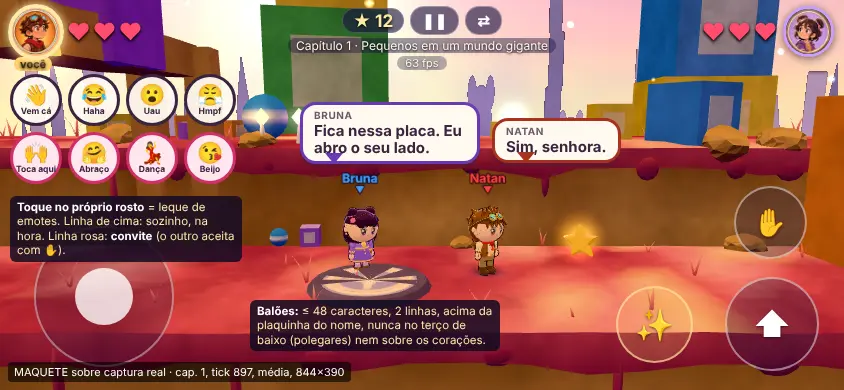
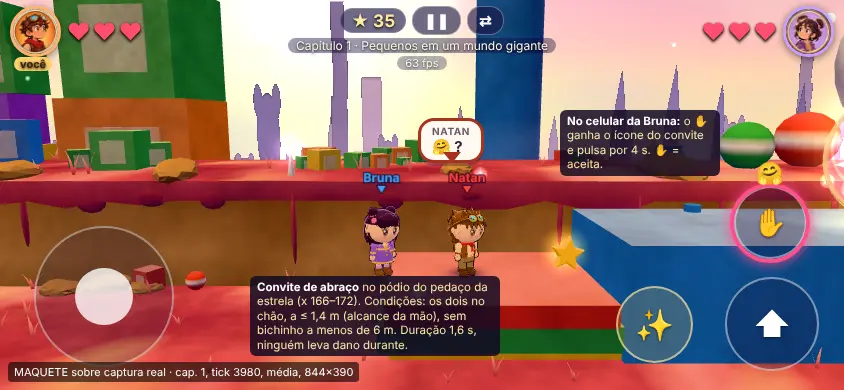
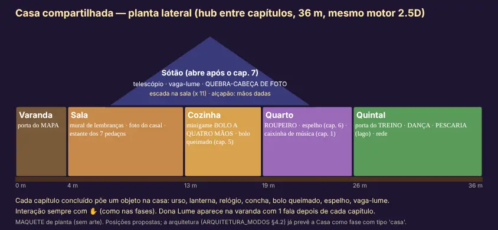

# Narrativa e experiência do casal

Autor: **narrativa-casal** (roteirista e designer de experiência do casal) · 2026-11-24 · base: commit `4792bcc`.
Etapa de diagnóstico e design. Nada em `src/`, `test/`, `public/` ou `index.html` foi alterado. As capturas foram
feitas numa cópia isolada (worktree, já apagada). Os arquivos da Arena (`src/core/arena`, `src/render/arena`,
`src/ui/partidaArena.ts`) não foram tocados. Para eles só há sugestões, em §12.

Pedido do jogador coberto aqui: **(10)** identidade do casal (abraços, beijos, danças, personalização, minigames,
momentos engraçados e emocionantes, lugares secretos, casa compartilhada, lembranças, equilíbrio). Também toca os
itens (5–9) (falas e emotes do companheiro no solo), (3) (armas no roteiro) e (11) (custo no celular).

Convenção: **[confirmado]** = lido no código ou medido. **[proposta]** = desenho desta revisão. **[REAL]** = detalhe que
só o Natan sabe e deve trocar pelo verdadeiro: um texto genérico fica no lugar até ele trocar.

---

## 0. Resumo

1. **Hoje a história só aparece fora do jogo.** [confirmado] Todo o texto narrativo está em `src/ui/historia.ts`:
   - 6 quadros de prólogo (`:54–67`);
   - 2 quadros por lembrança (`lembranca()`, `:91–98`);
   - 3 de fuga (`:81–88`);
   - 4 de final (`:69–78`).

   Durante as fases, os dois **não dizem nenhuma palavra**. Fora o título do capítulo, o único texto na tela durante o
   jogo são três avisos da Arena (`partidaArena.ts:323–325`). A Dona Lume só existe no quadro 5 do prólogo. O casal
   não tem nenhum gesto de carinho: as "mãos dadas" (`maos:i`, `sim.ts:5`) são só uma mecânica de impulso.
2. **O que já existe e serve.**
   - **Eventos da simulação** (`sim.ts:4–12`): `pulo`, `maos`, `derrota`, `placa`, `porta-abriu`, `fio-preso`,
     `renasce`, `lanterna`, `pedaco`… São os gatilhos para falas e momentos. Já vão para o convidado no instantâneo,
     então os dois celulares podem decidir **a mesma fala sem tráfego novo**.
   - **Rosto em textura de canvas, com 4 expressões** (`personagem.ts:258`).
   - **Esqueleto de 8 ossos animado por código** (`personagem.ts:36–45`).

   Abraço, beijo, dança e "toca aqui" saem **sem arte paga**: são poses procedurais mais 4 expressões novas no canvas.
3. **Proposta em 5 peças.** Todas cabem no motor atual, com custo de desenho ≈ 0 (balões em DOM e corações nas
   partículas instanciadas que já existem).
   - **(a) Balões de fala durante o jogo**, ligados a eventos e zonas: ~45 falas por capítulo, todas não bloqueantes.
   - **(b) Leque de emotes**: toque no **próprio rosto**.
     - 4 emotes rápidos;
     - 4 **convites** (toca aqui, abraço, dança, beijo) que o outro aceita com ✋. O consentimento faz parte da mecânica.
   - **(c) 3 momentos roteirizados por capítulo**: 1 emocionante, 1 engraçado e 1 segredo do casal (tabela §6).
     O capítulo 1 tem roteiro completo (§5).
   - **(d) A Casa compartilhada** como hub entre capítulos (planta §7).
   - **(e) 5 minigames baratos**, que reaproveitam a arte que já existe (§9).
4. **Tom: "mostrar, não declarar".** Carinho em ação (esperar, voltar para ajudar, segurar o fio) e humor de situação.
   Sem "eu te amo" no roteiro: essa frase fica reservada para a **carta pessoal do Natan**, guardada cifrada (§10.3),
   porque o site é público.
5. **Risco de privacidade [confirmado].** O jogo está publicado em `natan130905-spec.github.io`, e todo texto do
   repositório vai junto, legível no pacote JS. Detalhes íntimos [REAL] não devem entrar no código em texto claro.
   Ficam num pacote cifrado com uma senha que só a Bruna sabe (§10.3).
6. **Arte nova.** O essencial (P0) não precisa de crédito. Para o P1, a lista em §11 tem:
   - 9 imagens no Higgsfield;
   - 8 modelos no Meshy (imagem→3D);
   - 12 efeitos sonoros e 3 músicas.

   **Nada foi gerado.** Cada geração precisa da autorização do responsável, com teto em créditos.

---

## 1. Diagnóstico: o que existe hoje

| Peça | Onde | Estado | Observação |
|---|---|---|---|
| Prólogo (6 quadros) | `historia.ts:54–67` | bom, curto | quadro 5: a Dona Lume entrega o Lança-Estrelas. Se as armas (DESIGN_ARMAS §4) entrarem, vira "estilingue de xuxinha + espada de papelão" |
| Lembrança ao concluir | `historia.ts:91–98` | 2 quadros: arte + frase | a frase não diz **quem** fala. A do cap. 3 ("Eu esperaria de novo") depende de quem esperou [REAL] |
| Final | `historia.ts:69–78` | bom ("Algumas coisas a gente não precisa lembrar sozinho.") | manter |
| Falas no jogo | — | **nenhuma** | os dois são mudos por 2 a 4 min de cada capítulo |
| Dona Lume no jogo | — | **ausente** | só no quadro do prólogo; não tem modelo |
| Gestos do casal | `sim.ts` `maos:i` | só mecânicos | sem abraço, beijo, dança nem emote |
| Expressões | `personagem.ts:258` | 4 quadros: normal, piscando, alegre, surpresa | faltam apaixonado (^^), beijo (biquinho), "hmpf" (bochecha cheia), emocionado (olho brilhando) |
| Ossos | `personagem.ts:36–45` | quadril, tronco, cabeça, 2 braços, 2 pernas, "cauda" | dá para fazer todas as poses do §3.3 |
| Salvamento | `progresso.ts:15–23` | só capítulos e estrelinhas | precisa de `momentos`, `polaroids`, `bilhetes`, `roupas` (casa com o slot v2 de ARQUITETURA_MODOS §5) |
| Segredos de casal | cap. 1 (prateleira 113,5–116,5, y 5,2), cap. 2 (galho 100–104, y 3,2), cap. 5 (nuvem 161–165, y 9) | só estrelinhas | caps. 3, 4, 6 e 7 **não têm segredo** (grep "segredo" em `src/core/fases/`) |

Capturas do capítulo 1 como está hoje (média, 844×390, HUD ligado, tick dos bots). Estes são os lugares onde §5 põe
as falas:

| x ≈ 13 (cubos, tick 264) | x ≈ 63 (trenzinho, tick 1388) | x ≈ 112 (antes da prateleira secreta, tick 2596) |
|---|---|---|
|  |  |  |

---

## 2. Bíblia de tom (regras para quem escreve)

### 2.1 Personagens [proposta; o Natan confirma ou corrige]
- **Natan** (P1, lenço vermelho, óculos de aviador):
  - confiante demais com caminhos ("eu sei onde estamos");
  - faz piada ruim de propósito;
  - protetor, mas metade das vezes é ele quem precisa ser salvo.
- **Bruna** (P2, roxo, coquinhos):
  - prática e observadora: é **ela que vê o segredo primeiro**;
  - competitiva com estrelinhas;
  - ri primeiro e provoca com carinho;
  - **nunca é donzela**: lidera metade dos puzzles.
- **Dona Lume** (vovó-coruja):
  - erra ditados e se corrige ("Quem espera sempre… chega atrasado? Não. Alcança.");
  - cochila no meio da frase;
  - chama os dois de "meus filhotes".
- **Bichinhos-pesadelo**: emburrados, nunca maus. Ao estourar, alguns soltam um "…obrigado" pequeno, 1 em cada 6, por
  hash do tick (determinístico).

### 2.2 Regras de escrita
1. **Mostrar, não declarar.** O carinho vem do que fazem: esperar, voltar, segurar. "Eu te amo" **não aparece no
   roteiro**. Fica para a carta pessoal (§10.3), e por isso pesa quando chega.
2. **Humor de situação e de mania**, nunca de humilhação. Proibido: piada com corpo ou aparência, ciúme possessivo,
   "eu mando".
3. **Curto e falado.** Português do Brasil coloquial ("a gente", "tá"), sem gíria datada.
   - Até **48 caracteres** por balão, 2 linhas no máximo.
   - Leitura: 1,2 s + 0,06 s por caractere, teto de 4,5 s.
4. **Específico vence genérico.** Um nome de urso verdadeiro vale mais que dez "meu amor". Por isso os [REAL].
5. **Equilíbrio de voz.** Por capítulo, cada um fala entre 40 % e 60 % das falas do casal. Quem salva quem também se
   alterna. Um teste confere (§13).
6. **Nada romântico é obrigatório.** Beijo, dança e abraço nunca travam o caminho. Só o **segredo** do capítulo 1 pede
   uma dança, e ele é opcional.
7. **Arco.** Do 1 ao 7, de "nostalgia do primeiro dia" (provocação leve) para "cumplicidade" (frases mais curtas,
   menos piada). No 6, a briga é tratada com respeito: ninguém tem "razão".

---

## 3. Interações do casal (mecânica)



*Maquete desenhada sobre uma captura real (cap. 1, tick 897, média, 844×390). Script:
`tools/revisao/narrativa-casal/maquetes.mjs`.*

### 3.1 Onde fica no celular
- **Seu rosto** (canto de cima à esquerda, Ø 48 px; hoje mostra "você") abre o **leque de emotes**:
  - um toque abre e fecha;
  - arrastar e soltar também escolhe.
- **O rosto do parceiro** (canto de cima à direita) continua com os **comandos do companheiro** (ARQUITETURA_MODOS
  §6.4).
- Seu rosto = o que **eu** sinto; o rosto dele = o que **peço** a ele. Os polegares não saem de joystick, ⬆, ✨/⚔ e ✋.
- Os botões do leque têm Ø 52 px e 6 px de espaço entre si, de y = 74 a y = 190. Ficam acima do joystick, cujo topo
  está em y ≈ 227 na captura.
- **PC:** `T` abre o leque e `1–8` escolhe.

### 3.2 Emotes e convites
| # | Emote | Tipo | Condição | Efeito no jogo | Animação (8 ossos) + rosto |
|---|---|---|---|---|---|
| 1 | 👋 Vem cá | rápido | — | o ícone aparece também na **borda da tela** do outro, quando ele está fora do quadro | aceno com o braço D |
| 2 | 😂 Haha | rápido | — | — | tronco treme 0,6 s, rosto "alegre" |
| 3 | 😮 Uau | rápido | — | — | pulinho de 0,15 m, rosto "surpresa" |
| 4 | 😤 Hmpf | rápido | — | — | braços cruzados, rosto **novo** "bochecha cheia" |
| 5 | 🙌 Toca aqui | convite | os dois no chão, a ≤ 1,4 m (`FISICA.alcanceMao`, `sim.ts:28`) | estrelinhas de brilho (partículas) | braço sobe e bate; impacto com quadro congelado de 60 ms |
| 6 | 🤗 Abraço | convite | idem e sem bichinho a < 6 m | **+1 coração para cada um que tem menos de 3, uma vez por lanterna** (a cota volta ao acender a próxima). Os dois ficam invencíveis durante o abraço | os dois se encostam (0,35 m); braços fecham; rosto **novo** "^^" |
| 7 | 💃 Dança | convite | idem | abre os **segredos musicais** (caixinha do cap. 1, conchas do cap. 4, telescópio do cap. 7) | 3 passos em laço (balanço, giro sob o braço alternando quem gira, pose final) |
| 8 | 😘 Beijo | convite | idem | no pedaço da estrela: o pedaço brilha rosa e entra um adesivo no álbum ("beijos estrelados" 0/7). **Nunca é obrigatório** | o que pediu se inclina; o outro levanta o pé de trás ("pé de novela"); rosto **novo** "biquinho"; um coração estoura |
| (P2) | 🫶 Colo | convite | idem | quem carrega anda a 70 % (3,6 m/s) e pula 70 %; **quem está no colo pode atirar** | quem carrega põe os braços à frente; quem é carregado gira 90° no grupo `giro` (`personagem.ts:407`) |

**Convite.**
1. Quem convida fica com um balão com o ícone e um "?".
2. No celular do outro, o ✋ ganha o ícone e pulsa por 4 s. ✋ = aceita.
3. Se o tempo acabar, o balão murcha com um "…" (é engraçado e não pune).

O ✋ só muda de função se houver um convite pendente **e** nada para agarrar por perto. Fio, argola e mãos dadas têm
prioridade, então nenhuma mecânica é roubada.



### 3.3 Interações automáticas (sem botão)
| Gatilho (evento) | Interação |
|---|---|
| `renasce:i` (a bolha encostou) | abraço curto de 0,8 s, sem trava. Fala do pool "resgate" |
| `porta-abriu:<id>` de porta dupla ou de placa do outro lado, com os dois a ≤ 3 m | "toca aqui" automático quando os dois param ≥ 0,5 s |
| `lanterna:k` com os dois a ≤ 2 m | os dois olham um para o outro e sorriem (só o rosto, 1 s) |
| os dois parados ≥ 8 s, juntos e sem perigo | encostam o ombro; depois de 15 s, a cabeça da Bruna ou do Natan (alternando) no ombro do outro |
| `volta-checkpoint` (os dois viraram bolha) | caem sentados na lanterna, se olham e riem (rosto "alegre") |

### 3.4 Rede e determinismo [proposta]
- `Input` (`types.ts:5`) ganha `emo?: number` (0 = nada; 1–8 = emote; 9 = aceitar). São 4 bits na mensagem de
  entrada. `normalizarInput` (`sim.ts:373`) limita o valor.
- O anfitrião valida distância, chão e bichinhos e emite os eventos:
  - `emote:i:t`;
  - `convite:i:t`;
  - `interacao:t:ini` e `interacao:t:fim`.

  Durante a interação (0,8–2,4 s), o movimento dos dois é ignorado e eles ficam invencíveis. A interação **cancela
  sozinha** se um bichinho chegar a < 3 m. O núcleo continua puro e determinístico.
- A animação é só de render. Os corações reaproveitam `particulas.ts` (2 chamadas de desenho já existentes), então
  **nenhuma chamada nova**. O balão é DOM.

### 3.5 Com o companheiro do jogo (solo)
- Aceita convites depois de 0,3–0,8 s (tempo tirado do hash do tick). Com perigo perto, recusa com graça
  ("Agora não, tem bichinho olhando!") e aceita sozinho quando o perigo passa.
- **Toma a iniciativa** no máximo uma vez a cada 90 s:
  - toca aqui depois de porta dupla;
  - abraço ao renascer;
  - aceno quando o jogador fica > 12 m à frente.

  Opção "Companheiro carinhoso: ligado / discreto / desligado".
- As falas são as **mesmas do roteiro**. O companheiro fala como o personagem que ele é, não como "IA". As dicas de
  ARQUITETURA_MODOS §6.6 ("Eu seguro aqui, você passa!") passam a vir do pool `dica` de cada trecho (§5.2).
- Quando a pessoa entra numa campanha solo: toast "A Bruna entrou!" e a fala "Chegou bem na hora." Depois, convite de
  abraço automático (aceito por ela com ✋, ou ignorado).

---

## 4. Balões de fala durante o jogo (sistema)

- **Onde.** O balão fica acima da plaquinha do nome (`rotulo`, `personagem.ts:456`), projetado na tela a cada quadro.
  É DOM, um por personagem, com 2 nós no máximo.
  - Nunca no terço de baixo da tela (polegares) nem sobre os corações.
  - Com o personagem fora do quadro, o balão encosta na borda com a setinha apontando para ele. A câmera por celular de
    PESQUISA_ARTE_CAMERA §3 deixa o parceiro fora do quadro muitas vezes.
- **Gatilhos.**
  - `zona(x0, x1, quem?)`: primeira entrada;
  - `evento(nome)`: lista de `sim.ts:4–12`, mais os eventos novos de §3.4;
  - `primeiraVez(evento)`: guardado no salvamento;
  - `ocioso(s)`;
  - `ambosEm(x0, x1, s)`.

  Os dois celulares avaliam os gatilhos com o mesmo estado e os mesmos eventos. A variante sai de `hash(tick, id)`,
  então os dois mostram **a mesma fala sem mensagem nova**.
- **Prioridade.** história > dica > reação > ociosidade.
  - Cada fala tem um tempo de espera próprio (padrão 20 s).
  - Há no máximo 1 balão por pessoa.
  - **Nenhuma fala durante perigo** (bichinho a < 4 m ou chefe em ataque), salvo as do pool `perigo`.
- **Som sem voz.** "Murmúrio" de sílabas sintetizadas: Natan grave, Bruna aguda, Dona Lume com "hu" no fim.
  - Feito por WebAudio em `som.ts`, com 1 oscilador e envelope: custo ≈ 0 e nenhum arquivo.
  - Sem dublagem: evita custo e "cringe", e deixa a Bruna "ouvir" o próprio jeito.
- **Opções.** Balões todos / só história / desligados; velocidade ×1, ×1,5.
- **Dados.** `src/ui/roteiro/capN.ts` (só UI; o núcleo não depende dele):

```ts
export interface Fala {
  id: string;                         // 'c1-21'
  gatilho: Gatilho;                   // { zona: [33, 36] } | { evento: 'maos', primeira: true } | { ocioso: 12 } ...
  quem: 'P' | 'O' | 'N' | 'B' | 'L';  // quem disparou, o outro, Natan, Bruna, Dona Lume
  texto: string | { N: string; B: string };  // variante por personagem (concordância: "obrigado/obrigada")
  depois?: string;                    // id da resposta (encadeia)
  pool?: 'dica' | 'reacao' | 'ocioso' | 'resgate' | 'perigo';
  solo?: string;                      // texto alternativo quando o outro é o companheiro
}
```

---

## 5. Capítulo 1 — roteiro completo (amostra)

Mapa do capítulo (de `cap1_brinquedos.ts:4–11`):
- cubos (8, 13);
- bolotinha (20);
- vão (25,6–28,4);
- lanterna (31);
- tampa (40) com as placas (35 e 43,6);
- caixa alta (52, 2,8 m);
- lanterna (60);
- trenzinho (64–72);
- pirâmide (78–86);
- lanterna (96);
- blocos sobre o vão (104–124);
- prateleira secreta (113,5–116,5, y 5,2);
- prateleira da placa (141–145) e portão (150);
- lanternas (127, 156);
- pódio (166–172).

**Novos no cenário** (posições propostas):
- **Seu Algodão**, o urso de pelúcia gigante, sentado no fundo em x 89–92 (não bloqueia o caminho);
- a **caixinha de música** na prateleira secreta.

Legenda: `P` = quem disparou, `O` = o outro, `N` = Natan, `B` = Bruna, `L` = Dona Lume. `{N|B}` = texto muda conforme
quem fala.

### 5.1 Abertura (x 0–6; os controles já respondem, os balões vão correndo junto)
| id | Gatilho | Quem | Fala |
|---|---|---|---|
| c1-01 | início | B | A gente… encolheu? |
| c1-02 | ↳ | N | Ou a loja cresceu. Prefiro essa versão. |
| c1-03 | ↳ (a Dona Lume entra voando) | L | Hu-hu! Primeira lembrança, meus filhotes. |
| c1-04 | ↳ | L | Tomem: um estilingue e uma espada. De papelão, mas valente. *(sem as armas: "Tomem o Lança-Estrelas.")* |
| c1-05 | ↳ | L | A névoa virou lembrança em bichinho. Devolvam com carinho… |
| c1-06 | ↳ | B | Eu cuido da pontaria. |
| c1-07 | ↳ | N | Então eu cuido do carinho. |
| c1-08 | ↳ | L | E não se separem. Aqui, sozinho ninguém chega ao fim. Zzz… hu? |

### 5.2 Aprender (x 6–31)
| id | Gatilho | Quem | Fala |
|---|---|---|---|
| c1-10 | zona 5–8 sem `pulo` por 4 s (dica) | O | Segura o pulo que vai mais alto. |
| c1-11 | primeiro `pulo` de cada um | O | Isso! Agora é só não cair. |
| c1-12 | zona 14–17 (bolotinha em 20 à vista) | B | Olha. Ele tem cara de quem perdeu o ônibus. |
| c1-13 | primeira `derrota:k` | P | Virou estrelinha! |
| c1-14 | ↳ | O | Só precisava de um carinho. De pedra. |
| c1-15 | primeiro `caiu:i` (vão de 25,6) | P | Ninguém viu isso. |
| c1-16 | ↳ | O | Eu vi. Vou lembrar pra sempre. |
| c1-17 | primeira `lanterna:k` (31) | B | Uma lanterna. Se der ruim, a gente volta aqui. |

### 5.3 A tampa da caixa (x 33–48): a primeira ajuda
| id | Gatilho | Quem | Fala |
|---|---|---|---|
| c1-20 | zona 33–36 | P | Uma placa… e a tampa tá fechada. |
| c1-21 | 6 s na zona sem ninguém na placa (dica) | O | Um segura a placa, o outro passa? |
| c1-22 | `placa:placa-tampa-a` com B em cima | B | Fica nessa placa. Eu abro o seu lado. |
| c1-23 | ↳ | N | Sim, senhora. |
| c1-24 | os dois depois de x 41 | quem ficou esperando | {N: Obrigado por voltar.  \| B: Obrigada por voltar.} |
| c1-25 | ↳ | O | Não ia te deixar numa caixa de brinquedos. |
| c1-26 | ↳ **automático** | — | "toca aqui" automático (§3.3) |

### 5.4 A caixa alta (x 48–60): mãos dadas
| id | Gatilho | Quem | Fala |
|---|---|---|---|
| c1-30 | os dois em 48–51.5 por 5 s | P | Alto demais pra pular sozinho. |
| c1-31 | ↳ (o ✋ pisca) | O | Me dá a mão. Pula comigo. |
| c1-32 | primeiro `maos:i` | O | Viu? De mão dada a gente quase voa. |
| c1-33 | um em cima (y ≥ 2,8) e o outro embaixo, 3 s | quem está em cima | Segura ✋ que eu te puxo. |
| c1-34 | o de baixo chega em cima | N, se a Bruna puxou | Você é mais forte do que parece. |
| c1-35 | ↳ | B | Eu sou exatamente tão forte quanto pareço. |
| c1-34′ | idem, se o Natan puxou | B | Nem precisava. Mas gostei. |

### 5.5 Trenzinho (x 60–72)
| id | Gatilho | Quem | Fala |
|---|---|---|---|
| c1-40 | zona 61–64 | N | Piuí! Todo mundo a bordo! |
| c1-41 | ↳ | B | É um trenzinho de brinquedo, Natan. |
| c1-42 | ↳ | N | E eu sou um passageiro de brinquedo. |
| c1-43 | os dois em cima do trenzinho ao mesmo tempo (apito) | B | …tá, foi fofo. |

### 5.6 Momento ENGRAÇADO — "Seu Algodão" (x 86–92)
Um urso de pelúcia gigante sentado no fundo, com a plaquinha "SEU ALGODÃO — NÃO ESTÁ À VENDA" [REAL: o nome do urso
verdadeiro].
- **Interação:** ✋ a ≤ 1,5 m dele.
- **O que acontece:** o urso **abraça quem apertou** (squeak), aperta por 1,5 s e o lança num arco até o topo da
  pirâmide (x 83, y 3), onde está o baú do Martelo (DESIGN_ARMAS §5).
- **Por que serve:** é atalho e piada ao mesmo tempo. Ninguém é obrigado a usar.

| id | Gatilho | Quem | Fala |
|---|---|---|---|
| c1-50 | zona 86–90 | B | Olha o tamanho desse urso! |
| c1-51 | ↳ | N | É ele. O urso da vitrine! |
| c1-52 | ✋ no urso (quem apertou é abraçado) | P | Ele… não… solta… |
| c1-53 | ↳ | O | Ei! Esse abraço era MEU. |
| c1-54 | P cai no topo da pirâmide | P | Melhor elevador da loja. |
| c1-55 | ninguém usou o urso até x 95 (uma vez) | O | A gente não vai abraçar o urso? Que desfeita. |

### 5.7 Blocos e o SEGREDO do casal — a caixinha de música (x 96–124)
A prateleira secreta (113,5–116,5, y 5,2) hoje só tem 3 estrelinhas (`cap1_brinquedos.ts:78`). A AUDITORIA_MOVIMENTO
mostra que elas **só saem com mãos dadas**. A proposta põe ali uma **caixinha de música**: com os dois em cima, o
emote 💃 Dança (convite) dá corda nela.
- **Toca:** 12 s da "nossa música" [REAL: título; versão instrumental de caixinha, ver §11].
- **Desbloqueia:**
  - **Polaroid 1 "A vitrine"**;
  - o minigame **Dança das Estrelas** na Casa;
  - o objeto "caixinha de música" no quarto.

| id | Gatilho | Quem | Fala |
|---|---|---|---|
| c1-60 | zona 104–106 | O | Bloco em bloco. Eu vou atrás. |
| c1-61 | zona 111–118, embaixo da prateleira, 3 s | B | Tem alguma coisa brilhando lá em cima… |
| c1-62 | ↳ 6 s sem subir (dica) | N | Mão dada de novo? |
| c1-63 | os dois na prateleira | B | Uma caixinha de música! |
| c1-64 | ↳ (o 💃 pisca no leque) | N | Dá corda? Precisa… dançar? |
| c1-65 | convite de dança aceito, música tocando | B | É a nossa música. |
| c1-66 | ↳ | N | Eu sei a letra inteira. Você sabe metade. [REAL] |
| c1-67 | ↳ | B | Metade, mas cantada com vontade. |
| c1-68 | fim da música (toast "Polaroid 1: A vitrine") | — | — |
| c1-69 | solo: o companheiro chega à prateleira | O | Vem, me dá a mão que eu te puxo. *(o companheiro faz a parte das mãos dadas: ARQUITETURA_MODOS §6.5)* |

### 5.8 Portão da prateleira (x 124–156)
| id | Gatilho | Quem | Fala |
|---|---|---|---|
| c1-70 | zona 136–140 | P | Um sobe na prateleira e abre o portão pro outro. |
| c1-71 | `porta-abriu:portao` com um na placa de cima | quem está na placa | Pode passar. A porta é sua. |
| c1-72 | ↳ | O | {N: Que dama. \| B: Que cavalheiro.} |

### 5.9 Momento EMOCIONANTE — "O urso da vitrine" (pódio, x 160–172)
| id | Gatilho | Quem | Fala |
|---|---|---|---|
| c1-80 | zona 162–166 | B | O primeiro pedaço da estrela! |
| c1-81 | ↳ | N | Juntos, no três? |
| c1-82 | ↳ | B | No dois. Eu sou ansiosa. [REAL: trocar se não for verdade] |
| — | `pedaco` | — | **Vislumbre**, 6 s, pulável segurando ✋ 0,8 s. A câmera se aproxima 15 %. Do pedaço saem dois **personagens de luz** (os mesmos modelos com material emissivo translúcido; nenhuma arte nova) diante de uma vitrine de luz com um urso pequeno. Os dois apontam para o urso ao mesmo tempo |
| c1-83 | vislumbre: Bruna de luz | B (itálico) | *Ele tem cara de quem perdeu o ônibus.* |
| c1-84 | vislumbre: Natan de luz | N (itálico) | *(risada)* |
| c1-85 | volta ao presente | N | Foi isso que você disse. No dia. Igualzinho. |
| c1-86 | ↳ | B | E você riu tanto que derrubou a prateleira. [REAL] |
| — | quadro da lembrança (`historia.ts:95`) | B | "Você riu do mesmo urso de pelúcia que eu. Foi ali que tudo começou." |
| c1-87 | quadro novo de resposta | N | "E eu nunca mais parei de rir com você." |

A fala c1-12 ("cara de quem perdeu o ônibus") planta a piada no começo do capítulo e o vislumbre a devolve. Esse
**eco** é o mecanismo emocional do capítulo. O jogador não precisa saber disso: ele sente.

### 5.10 Pools (todo o capítulo; espera de 60 s por pool)
| Pool | Falas (quem: texto) |
|---|---|
| resgate (`renasce:i`) | quem salvou: "Te peguei." / "De nada, viu?" · quem foi salvo: "Sabia que você vinha." / "Demorou, hein." |
| os dois bolha (`volta-checkpoint`) | P: "De novo. Juntos." · O: "Essa não conta." |
| ocioso 12 s | N: "Se a gente parar, a névoa ganha." · B: "Tô pensando. Pensar é andar com a cabeça." · L (de longe): "Zzz… hu? Tô acordada!" |
| perigo (o companheiro recusa convite) | "Agora não, tem bichinho olhando!" · "Depois! Prometo." |
| estrelinha ×10 (B) | "Tô na frente." · (N) "Não é competição." · (B) "Pra quem tá perdendo, não." |
| bichinho "…obrigado" (1 em 6) | bichinho: "…obrigado." |

**Contagem do capítulo 1** (contada nas tabelas acima):
- **59 falas fixas + 14 de pool**;
- entre as fixas: 14 do Natan, 18 da Bruna, 4 da Dona Lume e 23 "P/O", que saem de quem disparar. Entre as nominais,
  dá **44 % × 56 %**, dentro da regra 2.2.5;
- numa passada típica disparam ≈ 45, porque dicas, alternativas (34′), "não usou o urso" (55) e a fala do solo (69)
  só saem às vezes;
- com 3 s por balão, são ≈ 135 s de balão em 2–4 min de fase, em paralelo e **sem travar o controle**. Pode ser
  demais: o alvo é ≤ 90 s, cortando depois da primeira sessão com o casal (§13, validação humana);
- única trava: o vislumbre (6 s, pulável).

---

## 6. Os outros capítulos (tabela)

Cada capítulo tem 3 momentos (emocionante, engraçado, segredo) e ~35–45 falas no padrão do §5. As posições vêm do
comentário no topo de cada `src/core/fases/capN_*.ts`. "**novo**" = precisa de geometria nova no arquivo da fase.

| Cap. | Emocionante | Engraçado | Segredo do casal → recompensa | Falas-âncora |
|---|---|---|---|---|
| **2 Floresta** (perderam-se na trilha) | **"O caminho errado"** (antes da casa na árvore, ~190): o Fio Vermelho brilha e desenha no chão o percurso que os dois fizeram na fase, com voltas e quedas. É o rastro real das posições, gravado a cada 1 s (≤ 200 pontos) | **Placa giratória** (x ~30, **novo**): a seta gira e aponta errado a cada passagem. N: "Confia. Eu sei o caminho." B: "Você disse isso há 40 minutos." | galho alto 100–104, y 3,2 (mãos dadas): **ninho com 2 corujinhas** (netas da Dona Lume) que dormem quando os dois dançam → **Polaroid 2 "Perdidos"** + acessório "pena de coruja" | B: "A gente andou em círculo três vezes." N: "E eu faria de novo." (antes da frase do pedaço) |
| **3 Relógio** (um esperou o outro) [REAL: quem esperou?] | **"Você voltou"** (portão do tempo, 128–186). Quem passa por cima precisa voltar para abrir. Quem ficou senta no banco (pose); ao abrir, o sino da torre toca. Quem esperou: "Você voltou." O outro: "Eu sempre volto." | **O cuco** (relógio 1, ~40, **novo**: adereço animado): grita "ATRASADO!" para o **segundo** a chegar a cada lanterna. Conta no álbum ("Natan 4 × 2 Bruna") | telhado do portão 160–162, y 4,2: **banco com dois cafés** e um bilhete [REAL] → **Polaroid 3 "A espera"** | L: "Quem espera sempre… chega atrasado? Não. Alcança." |
| **4 Oceano** (primeira praia) | **"O castelo de areia"** (fim, 210–220). Ao tocar o pedaço, uma onda leva o castelo; os dois riem (rosto "alegre" 2 s) e o pedaço fica brilhando na areia. Liga com a frase que já existe | **A gaivota** (gaivota-morcego, 0–40): rouba os óculos de aviador do Natan. Só o visual: o óculos some da cabeça e volta quando ela é derrotada. N: "Meus óculos!" B: "Ficou melhor sem." | **novo**: gruta sob o píer alto (44–56, y −1), pela Vara-Gancho ou mãos dadas: **duas conchas iguais** que tocam quando os dois dançam → **Polaroid 4 "Sal na pele"** + minigame **Pescaria** | B: "O mar levou o castelo." N: "Mas não levou a gente." |
| **5 Doces** (bolo queimado) | **"Queimou. Perfeito."** (bolo do pedaço, 175–210). O bolo gigante solta fumaça. Os dois sentam, comem uma fatia (pose e rosto "^^") e tossem fumacinha juntos | **"NÃO LAMBA"** (muro de chocolate, 140–150): placa na parede. Quem fica 3 s parado ao lado **lambe** e fica com o rosto sujo de chocolate por 20 s (textura). O outro: "Era só ler a placa." | nuvem de algodão-doce 161–165, y 9: **duas cerejas** → **Polaroid 5 "Fumaça"** + minigame **Bolo a Quatro Mãos** | L (receita): "Duas xícaras de… sal? Hu. Óculos." |
| **6 Espelhos** (primeira briga) | **"Desculpa"** (palco, 172–180). Um espelho rachado separa os dois. Cada um aperta ✋ do seu lado (só pede os dois; não é difícil). Os dois balões dizem "Desculpa." **ao mesmo tempo**, o espelho se remenda e o abraço é automático. É a frase existente, dividida: um diz a primeira parte, o outro completa | **Espelho troca-roupa** (sala de espelho 1, 22–30): o reflexo de um aparece com o acessório do outro (clone do modelo com as peças trocadas). N: "Fica bem em mim." B: "Fica melhor em mim." | **novo**: atrás do espelho da sala 2 (x 66): **bilhete dobrado** [REAL] → **Polaroid 6 "Depois da chuva"** + acessório | **Mecânica de tom**: entre x 30 e 98 (corredores separados), as falas de um aparecem **abafadas** ("…") para o outro até a porta abrir. É a briga "sem se ouvir". Ao reabrir: "Agora eu te ouço." |
| **7 Cosmos** (a noite da estrela) | **"Lá embaixo"** (ponte de luz, 64–72): o fio brilha e, lá embaixo, aparece o morro de casa com os dois dormindo encostados. N: "A gente tá dormindo lá embaixo." B: "Então vamos acordar juntos." | **"Faz um pedido!"** (cometas, 124–180). N: "Faz um pedido!" B: "Já fiz. Não conto." N: "Era pizza?" B: "…Era pizza." | **novo**: ilhota acima da lanterna de 116: **telescópio** que mostra a data do primeiro encontro em estrelas [REAL; cifrado, §10.3] → **Polaroid 7 "O pedido"** + música final da Dança | antes do Rei: B: "Tá com medo?" N: "Um pouco. Mas é o mesmo medo que você." |

**Ritmo por capítulo [proposta, a medir com gente]:**

| Atividade | Alvo |
|---|---|
| plataforma e aventura | 40 % |
| exploração e segredos | 15 % |
| combate | 15–20 % |
| puzzles cooperativos | 15 % |
| romance e humor | ≤ 10 % do tempo, quase todo em paralelo com o jogo (balões não travam) |

Trava total por capítulo ≤ 15 s (o vislumbre e o urso).

---

## 7. A Casa compartilhada (hub)



A ARQUITETURA_MODOS §4.2 já prevê a Casa como uma fase com `tipo: 'casa'`, de 30–40 m, entre o menu e o mapa. A
planta acima é de 36 m e usa o mesmo motor 2.5D, com interação sempre pelo ✋.

| Lugar (x) | O que tem | Interação | Cresce com |
|---|---|---|---|
| Varanda (0–4) | porta do **mapa**; a Dona Lume pousa no parapeito depois de cada capítulo | ✋ na porta = mapa; ✋ na coruja = 1 fala do capítulo | — |
| Sala (4–13) | **mural de lembranças** (7 molduras + 7 polaroids); **foto do casal**; estante com os pedaços da estrela (troféus) | ✋ na moldura = vê a lembrança (`public/arte/06…12`) e lê o bilhete; **trocar a ordem** das fotos (decorar) | 1 pedaço e 1 objeto por capítulo: urso (1), lanterna da floresta (2), relógio (3), concha (4), bolo queimado (5), espelho remendado (6), vaga-lume no pote (7) |
| Cozinha (13–19) | fogão → **Bolo a Quatro Mãos** | ✋ no fogão | depois do cap. 5 |
| Quarto (19–26) | **roupeiro** (roupas, acessórios, cores); espelho; caixinha de música | ✋ no roupeiro = tela de personalização com os dois de frente (como a "Personalização" de `conceito.png`) | roupas pelas ★ (§8) |
| Quintal (26–36) | **porta do Treino** (Quintal de Treino); pista de **dança**; laguinho (**Pescaria**); rede de balanço | ✋ na rede com os dois = cena de descanso (os dois deitados, câmera recua, música da Casa) | — |
| Sótão (escada x 11; alçapão com mãos dadas) | telescópio, quebra-cabeça de foto, **carta** | — | abre depois do cap. 7 |

**Modo foto** (na sala, ✋ na câmera do tripé):
- os dois escolhem pose (os 8 emotes mais 4 poses de "foto") e moldura (uma por capítulo concluído);
- a foto sai do canvas do WebGL (`toDataURL`, com `preserveDrawingBuffer` só neste modo);
- ela fica **só no aparelho**: é baixada como PNG e pendurada na parede, com até 8 por slot no `localStorage`, em
  ~60 KB WebP cada.

Custo: com cenário simples, a Casa pede ≤ 45 chamadas na média (meta). Os móveis-herói vêm de §11 e o resto é
procedural.

---

## 8. Personalização

- **Regra de identidade:** o lenço vermelho do Natan e os coquinhos da Bruna **nunca saem**. Só mudam de cor dentro
  de uma faixa, para os dois continuarem reconhecíveis na câmera pequena.
- O Fio Vermelho continua vermelho.
- **Desbloqueio** (como ARQUITETURA_MODOS §7):
  - 1ª ★ do capítulo = acessório;
  - 3ª ★ = roupa;
  - segredo = acessório de casal.
- **Implementação:** as roupas são a mesma montagem procedural (`montarP1` e `montarP2`, `personagem.ts:142+`) com
  outra tabela de cores e 1–3 peças novas de geometria. **Não exige modelo novo.**

| Cap. | Natan (roupa / acessório) | Bruna (roupa / acessório) | De casal (segredo) |
|---|---|---|---|
| 1 | macacão de vendedor de loja / chapéu de papel dobrado | jardineira de listras / laço de pelúcia | adesivo "Seu Algodão" na mochila e na bolsa |
| 2 | capa de chuva verde / galhinho no óculos | capa de chuva amarela / flor no coquinho | pena de coruja (um de cada cor) |
| 3 | colete de relojoeiro / monóculo | vestido de época / relógio de bolso no pescoço | cachecóis iguais |
| 4 | camisa havaiana / óculos de sol por cima do de aviador | maiô e saída de praia / estrela-do-mar no cabelo | colares de concha |
| 5 | avental de confeiteiro / chapéu de cozinheiro torto | avental de bolinhas / colher de pau nas costas | rosto sujo de chocolate (permanente, opcional) |
| 6 | blusão roxo da Bruna (troca!) / coquinhos falsos | jaqueta e lenço do Natan (troca!) / óculos de aviador | pulseiras de fio vermelho |
| 7 | traje de astronauta de brinquedo / capacete-aquário | vestido de constelação / tiara de estrela | vaga-lume no ombro (o Rei redimido) |

**Cores:** 6 paletas por personagem, aplicadas como tom na roupa e não na pele.

---

## 9. Minigames cooperativos (curtos e baratos)

Todos têm 60–120 s e controles de 1–2 botões. Funcionam online (o anfitrião simula), com o companheiro do jogo (regra
de IA na tabela) e no PC. Nenhum precisa de arte grande nova: reaproveitam músicas, artes e modelos existentes.

| # | Minigame | Libera | Como joga | Cooperação | IA (solo) | Arte e som que reaproveita / novo | Esforço [estimativa] |
|---|---|---|---|---|---|---|---|
| 1 | **Quebra-Cabeça de Foto** | desde o início (cada capítulo acrescenta sua arte) | 12 peças (4×3) da lembrança `06…13.webp`; arrastar com o dedo; peça encaixada trava | os dois arrastam ao mesmo tempo no mesmo tabuleiro; peça "segurada" por um fica com o contorno da cor dele | coloca 1 peça certa a cada 6–9 s | 100 % reaproveitado (DOM e canvas 2D) | 2 dias |
| 2 | **Bolo a Quatro Mãos** | cap. 5 | receita de 6 passos mostrada em cartões; um **segura a tigela** (✋ segurado), o outro **joga ingredientes** no tempo (⬆) | sem os dois não dá; **errar 3 vezes queima o bolo, e o bolo queimado também vale** ("Queimou. Perfeito.", troféu à parte) | segura a tigela ou joga com 85 % de acerto | sprites de 8 ingredientes (1 folha, §11) + `sfx_*` | 3 dias |
| 3 | **Dança das Estrelas** (ritmo) | segredo do cap. 1 | 4 setas por pista (joystick ou os 4 botões); cada um tem a sua pista | **sincronia**: as notas "duplas" (as duas pistas no mesmo tempo) valem ×2 e soltam corações | 90 % de acerto | as 10 músicas que já existem (`public/som/musica_*.mp3`) com **mapa de batidas gerado offline** (BPM detectado por script; ferramenta livre) + 2 músicas novas com BPM fixo (§11) | 4 dias |
| 4 | **Pescaria no Laguinho** | cap. 4 | lança a linha (⬆), espera a boia afundar, puxa (✋) no tempo | peixe grande: **os dois puxam juntos** (✋ a ≤ 0,3 s um do outro); "bota velha" é piada | puxa junto, sempre | 1 folha de 8 peixes-lembrança + bota (§11); laguinho com `agua.ts` | 3 dias |
| 5 | **Corrida de Carrinhos no Tapete** (P2) | cap. 1 concluído | vista de cima, 2D em canvas; o joystick vira, ⬆ acelera; 3 voltas no tapete da sala | **revezamento**: cada um faz 1 volta e meia e o placar é do casal (contra o relógio, não um contra o outro) | dirige numa linha ideal gravada | 2 carrinhos (sprites de §11) e o tapete desenhado em canvas | 4–5 dias |

Recompensas dos minigames: só cosméticas (molduras, adesivos, cores). Nenhum minigame é necessário para a campanha.
O treino não mexe nelas (ARQUITETURA_MODOS §4.1).

---

## 10. Colecionáveis-lembrança, álbum e carta

### 10.1 Por capítulo
- **1 Polaroid** (no segredo do casal);
- **2 bilhetes** escondidos fora do caminho principal (não obrigatórios);
- as estrelinhas de sempre (★ grandes em 50/75/100 %).

Total do jogo: **7 polaroids, 14 bilhetes e 7 objetos da Casa**.

### 10.2 Bilhetes
- Texto de ≤ 140 caracteres, mostrado em papel no mural da Casa.
- **São a alavanca do presente.** O jogo entrega 14 bilhetes genéricos e bonitos, e o Natan troca pelos de verdade.
- Exemplos genéricos (tom):
  - "Você ri antes da piada acabar. É o meu som favorito.";
  - "Eu decorei o caminho da sua casa antes de decorar o meu CEP.";
  - "Obrigado por esperar quando eu demorei.".

### 10.3 Privacidade [confirmado + proposta]
- Hoje todo texto do repositório vai para o pacote público em `github.io`.
- **Detalhes [REAL] íntimos** (datas, a carta, os bilhetes de verdade, o nome da "nossa música") devem ir num
  `public/cartas.bin` **cifrado**:
  - AES-GCM, com chave derivada por PBKDF2 (WebCrypto, nativo, sem biblioteca) de uma senha que só a Bruna sabe;
  - exemplo de senha: a data do primeiro encontro, ddmmaaaa.
- Sem a senha, o jogo usa os textos genéricos. Com ela (pedida uma vez no sótão), ela fica guardada no aparelho.
- O script para cifrar (`tools/cartas/cifrar.mjs`) roda só no computador do Natan e o texto original **não entra no
  git**: vai para `.gitignore`.
- A **carta final** fica no sótão, depois do cap. 7 e dos créditos. É o único "eu te amo" do jogo.

### 10.4 Lembrança ao concluir (`historia.ts:91–98`) [proposta]
- Passa de 2 para 3 quadros: arte → frase de um → **resposta curta do outro**.
- Quem fala alterna: o 1, o 3 [REAL] e o 5 a Bruna; o 2 e o 4 o Natan; o 6 **os dois**, dividindo a frase ("Desculpa."
  / "Brigar com você me ensinou a abraçar mais forte."); o 7 os dois em uníssono.
- Depois do quadro, um cartão "Na Casa: + Seu Algodão na sala".

---

## 11. Arte e áudio novos (lista para gerar; NADA foi gerado)

Referência de estilo em todas as gerações: `docs/arte/conceito.png`, como na rodada anterior (`docs/arte/RECURSOS.md`).

**Custo estimado.** Tomando a rodada anterior como base, para a imagem→3D:
- ≈ 2 créditos por imagem gpt_image_2_6 de 1k (7 imagens ≈ 14);
- 38 créditos por modelo estático;
- 47,5 por modelo com esqueleto.

**Antes de pedir autorização, cote com `estimate_image_cost`.** Saldos registrados: Higgsfield ≈ 249,63 depois da
Arena; Meshy 521.

### 11.1 P0 — sem crédito (código)
- 4 expressões novas no canvas do rosto: "^^", biquinho, bochecha cheia, emocionado. Muda `QUADROS = 4 → 8` em
  `personagem.ts:258`.
- Poses procedurais: abraço, beijo, toca aqui, dança (3 passos), sentar, deitar na rede, colo e as 4 de foto.
- Ícones de emote em SVG no código. Balões em CSS. Murmúrio de voz em WebAudio.
- **Seu Algodão** procedural (esferas e cápsulas, ~1,5 mil triângulos), enquanto o modelo de §11.3 não vem.
- **Personagens de luz** do vislumbre: os modelos atuais com material emissivo translúcido.
- Roupas e acessórios de §8: montagem procedural.

### 11.2 Imagens (Higgsfield, gpt_image_2_6) — P1
| # | Imagem | Uso | Tamanho |
|---|---|---|---|
| I1 | **Dona Lume**: folha de personagem (frente, perfil, voando, cochilando, lendo a receita) | referência e base para a imagem→3D (M1) | 2k |
| I2 | **Casa compartilhada em corte lateral** (5 cômodos e sótão, à noite, luzinhas) | alvo de arte da Casa e fundo das janelas | 2k |
| I3 | **7 polaroids** (uma por capítulo: vitrine e urso, perdidos na trilha, banco com 2 cafés, conchas, bolo queimado, espelho remendado, telescópio), estilo foto desenhada | álbum e mural | 7 × 1k |
| I4 | **Folha de expressões** Natan e Bruna (6 cada: alegre, rindo, envergonhado(a), hmpf, surpresa, emocionado(a)) | rostinhos do HUD nos balões e no leque; referência para o canvas | 2 × 1k |
| I5 | **Figurinos** (os 7 trajes de §8, por personagem, lado a lado) | referência para a montagem procedural | 2 × 2k |
| I6 | **Folha de ingredientes** (8) + **folha de peixes-lembrança** (8 + bota velha) | minigames 2 e 4 (sprites) | 2 × 1k |
| I7 | **2 carrinhos de brinquedo** (vermelho do Natan, roxo da Bruna), vista de cima | minigame 5 (P2) | 1k |
| I8 | **Seu Algodão** (urso gigante sentado, plaquinha) | base para M2 | 1k |
| I9 | **Caixinha de música** aberta, com bailarinos que lembram os dois | base para M3 | 1k |

### 11.3 Modelos 3D (Meshy, imagem→3D a partir das imagens acima; a lição de RECURSOS.md diz que texto→3D sai pior) — P1
| # | Modelo | Uso | Tipo |
|---|---|---|---|
| M1 | Dona Lume | abertura dos capítulos, Casa, dicas | com esqueleto (asas e cabeça) |
| M2 | Seu Algodão | momento engraçado do cap. 1, sala da Casa | estático (abraço com ossos procedurais nos braços) |
| M3 | Caixinha de música | segredo do cap. 1, quarto | estático |
| M4 | Sofá + estante de troféus | sala | estático |
| M5 | Fogão com bolo queimado | cozinha e cap. 5 | estático |
| M6 | Roupeiro com espelho | quarto | estático |
| M7 | Telescópio | segredo do cap. 7 e sótão | estático |
| M8 | Rede de balanço entre duas árvores | quintal | estático |

### 11.4 Áudio (Higgsfield; `mirelo_text_to_audio` e `elevenlabs_music`, como em RECURSOS.md) — P1
- **12 efeitos sonoros:**
  - beijinho estalado e fofo;
  - abraço ("fum" macio);
  - toca aqui (palma);
  - squeak do urso;
  - apito do trenzinho;
  - cuco "ATRASADO" (sem voz humana: o cuco mecânico);
  - "hu-hu" da Dona Lume;
  - clique de polaroid;
  - página do álbum;
  - corda da caixinha;
  - splash da pescaria;
  - bolo queimando (chiado).
- **3 músicas** (instrumentais, ~90 s em laço):
  - **Casa** (aconchegante, violão e caixinha);
  - **Dança das Estrelas A e B**, com BPM **fixo** (100 e 120) pedido no prompt, para o mapa de batidas ficar exato.
- **"Nossa música"** em versão caixinha [REAL]: se for uma música com direitos, **não gerar cópia**. Fazer uma
  melodia original "no clima" ou o Natan grava uma versão própria. Os direitos da música original não permitem pôr no
  site público.

---

## 12. Sugestões para a equipe da Arena (não alterei nada lá)

O roteiro sugere usar o `aviso()` que já existe (`partidaArena.ts:162`) como balão de fala nas trocas de fase:
- fase 2: B: "Ele tá com escudo!" / N: "Então a gente usa o laço.";
- fase 3, quando a parede separa os dois: N: "Não consigo te ver!" / B: "Mas eu te ouço. No três!";
- vitória, antes dos quadros: os dois em silêncio, só o rosto "emocionado" por 1,5 s.

Fica a critério da equipe da Arena.

---

## 13. Critérios de aceite e testes propostos

| Teste | Tipo | Critério |
|---|---|---|
| T-R1 roteiro.test.ts | vitest | toda fala ≤ 48 caracteres (≤ 2 linhas a 15 px em 230 px); toda `zona` dentro de `[0, fase.largura]`; todo `depois` aponta para id existente; ids únicos |
| T-R2 três momentos | vitest | cada capítulo tem ≥ 1 momento `emocionante`, ≥ 1 `engracado`, ≥ 1 `segredo` |
| T-R3 equilíbrio de voz | vitest | por capítulo, falas N/(N+B) entre 0,40 e 0,60 |
| T-R4 "te amo" | vitest | 0 ocorrências de "te amo" nos roteiros em texto claro (reservado à carta cifrada) |
| T-R5 segredo alcançável | vitest + `test/fases/alcance.ts` | cada segredo (incluindo os **novos** dos caps. 3, 4, 6 e 7) é alcançável a partir da lanterna anterior, e dele se volta ao caminho (sem armadilha) |
| T-R6 segredo no solo | vitest com o `Companheiro` (ARQUITETURA_MODOS T1) | o bot humano mais o companheiro chegam aos 7 segredos e completam a dança |
| T-E1 convite sincronizado | e2e `dupla.mjs` | o convidado convida, o anfitrião aceita; a interação começa no mesmo tick nos dois (via evento) e aparece em ≤ 300 ms nos dois celulares |
| T-E2 convite não rouba mecânica | vitest | com o fio ou a argola ao alcance, ✋ faz a mecânica, não aceita o convite |
| T-E3 abraço não é exploração | vitest | o +1 coração do abraço vale no máximo 1 vez entre duas lanternas; com bichinho a < 6 m, o convite é recusado; a < 3 m durante a interação, ela é cancelada |
| T-E4 IA aceita | vitest | no solo, convite aceito em ≤ 1 s sem perigo; com perigo, recusa e aceita depois |
| T-U1 balão fora dos polegares | e2e (844×390 e 873×393) | o retângulo de todo balão não cruza joystick, ⬆, ✨/⚔, ✋ nem os corações |
| T-U2 sem trava longa | e2e | nenhum momento tira o controle > 6 s; o vislumbre pula com ✋ segurado 0,8 s; momento visto não repete na volta à lanterna (`momentosVistos` no salvamento) |
| T-P1 custo | e2e `capitulos.mjs` com `?debug=1` | balões e emotes acrescentam **0 chamadas de desenho** (DOM + partículas existentes); a Casa fica ≤ 45 chamadas e ≤ 150 mil triângulos na média |
| T-C1 privacidade | script | `grep` no `dist/` não encontra nenhum texto do arquivo-fonte das cartas; `cartas.bin` só abre com a senha |
| Validação humana | sessão com o casal | o Natan lê o roteiro do cap. 1 em voz alta e marca o que "não soa como nós"; os [REAL] são trocados antes de a Bruna jogar |

---

## 14. Prioridades e dependências

| Pri. | Entrega | Depende de | Esforço [estimativa] |
|---|---|---|---|
| P0 | Sistema de balões (DOM, gatilhos, prioridade, murmúrio) + roteiro do cap. 1 | — | 3–4 dias |
| P0 | Leque de emotes + convites (toca aqui, abraço, dança, beijo) na rede + interações automáticas | `Input.emo` no núcleo | 4–5 dias |
| P0 | 4 expressões + poses procedurais | — | 2–3 dias |
| P1 | Momentos dos caps. 2–7 + segredos novos (geometria nos caps. 3, 4, 6, 7) | P0; arquivos de fase | 7–10 dias |
| P1 | Casa mínima (varanda, sala com mural e foto, quarto com roupeiro, quintal com a porta do Treino) | salvamento v2 (ARQUITETURA_MODOS §5) | 6–8 dias |
| P1 | Polaroids, bilhetes, álbum e lembrança em 3 quadros | salvamento v2 | 3 dias |
| P1 | Cartas cifradas + carta final no sótão | — | 1–2 dias |
| P1 | Minigames 1 (Quebra-Cabeça) e 2 (Bolo) | Casa | 5 dias |
| P1 | Arte e áudio de §11 (com autorização e teto) | autorização do responsável | — |
| P2 | Minigames 3 (Dança), 4 (Pescaria), 5 (Carrinhos) | Casa; músicas com BPM | 11–12 dias |
| P2 | Colo (carregar) com tiro de quem está no colo | armas (DESIGN_ARMAS) | 3 dias |
| P2 | Personalização completa (7 × 2 roupas, 6 paletas) e modo foto | Casa | 6–8 dias |

---

## 15. Arquivos desta entrega e como reproduzir
- Este documento: `docs/revisao/NARRATIVA_CASAL.md`.
- Imagens: `docs/revisao/img/narrativa-casal/`:
  - capturas reais `cap1_p004`, `cap1_p032` e `cap1_p062` (média, 844×390, HUD);
  - maquetes `mock_baloes_emotes`, `mock_convite_abraco` e `mock_casa_planta`.
- Ferramenta: `tools/revisao/narrativa-casal/maquetes.mjs`, que desenha as maquetes sobre as capturas.
- Capturas:
  ```
  node tools/revisao/capturas.mjs --raiz <worktree> --caps 1 --q media --tam 844x390@1 \
    --pontos 0.04,0.2,0.32,0.62,0.97 --hud --porta 4937 --saida <pasta>
  ```
  Ticks: 264, 897, 1388, 2596 e 3980; 26–30 chamadas e 47–54 mil triângulos.
- Maquetes: `node tools/revisao/narrativa-casal/maquetes.mjs <pasta> <saida>`. Depois converter para webp com
  `convert -quality 82`.
- **Limites:**
  - as maquetes são HTML sobre capturas, não o jogo;
  - os tempos de leitura e as porcentagens de ritmo são **estimativas** até haver sessão com o casal;
  - os [REAL] dependem do Natan.
