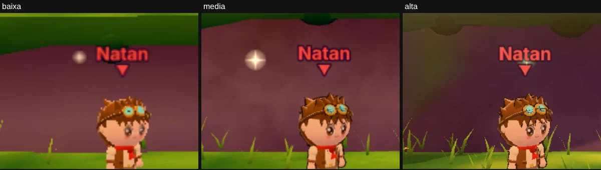

# Revisão técnica — desempenho e plataforma (tecnico-desempenho, 2026-11-24)

Escopo: o jogo 2.5D (7 capítulos) no celular — Redmi Note 11 e iPhone 14 em paisagem — medido no build de produção
(`dist/` do commit `cd6159b`), sem alterar `src/`. A Arena do Coração (em obra por outra equipe) entra só como retrato.
Ferramenta nova e reutilizável: `tools/revisao/tecnico-desempenho/medir.mjs` (+ `sonda.js`, `serrilhado.mjs`,
`proposta/qualidadeAuto.ts`, `proposta/diag.ts`, `proposta/teste_governo.mts`). Medidas brutas: seção 15.

**Versão medida.** Tudo foi medido e citado (arquivo:linha) no commit `cd6159b`. Durante esta revisão outra equipe
já está mexendo, sem commit, em `src/render/` (inclusive `pos.ts`: bloom seletivo por marca no alfa e a ¼ da
resolução — isso **corrige a parte de resolução do A2**). O A1 (alta sem antialias), o custo de passes do
compositor e o resto continuam valendo; refazer `medir.mjs cenas` quando o lote deles for commitado.

**Limite honesto.** Esta máquina não tem GPU (Chromium com SwiftShader, CPU Xeon 2,1 GHz de 4 núcleos). Por isso aqui
**não valem**: fps, tempo de GPU, aquecimento e bateria. **Valem**: chamadas de desenho, triângulos, programas de shader,
texturas/buffers vivos e memória de vídeo estimada, memória JS, bytes baixados, tempos de rede (proporções),
o que trava a linha principal (tarefas longas) e a divisão do tempo de CPU por módulo (proporção). Tudo o que depende da
GPU do aparelho vira **hipótese** e ganha um jeito de medir no celular de verdade (painel `?diag=1`, seção 13).

---

## 0. Resumo (o que importa)

| # | Achado | Situação | Efeito para o jogador |
|---|---|---|---|
| A1 | **"Bonito" perde o antialias**: a cena é desenhada no alvo do `EffectComposer` (sem MSAA); o `antialias:true` do canvas só vale para o retângulo final (`cena.ts:53`, `pos.ts:13`, `EffectComposer.js:69`) | **confirmado no código** + captura | serrilhado e "pixel" nas bordas justamente na qualidade alta |
| A2 | **Bloom em resolução cheia** (no commit medido; o lote em andamento em `pos.ts` já corrige a resolução): `bloom.resolution.set(w/2,h/2)` em `pos.ts:24` não tem efeito (o `UnrealBloomPass` só lê `resolution` no construtor; o `composer.setSize` já chamou `bloom.setSize(w×pr, h×pr)`) → 11 passes de tela + 2 alvos HalfFloat de tela cheia | **confirmado no código** | o maior custo de GPU e de memória da alta; e é o "véu branco" (ver ARTE_DIAGNOSTICO C1) |
| A3 | **Alta custa ~3× a memória de vídeo**: ~135–155 MB estimados contra ~48–59 MB (Normal) e ~20–27 MB (Leve) no Redmi; texturas vivas ~77 MB contra 15–20 MB (2 mapas 2048² de sombra = 32 MB, 2 alvos HalfFloat de tela cheia = 21 MB, cadeia do bloom ≈ 10 MB) | medido (estimativa por formato) | risco de o Chrome do Redmi (4 GB) perder o contexto WebGL; aquecimento |
| A4 | **Alta: 488 mil triângulos e 62 chamadas no cap. 2** (sombra redesenha a cena inteira); Normal 208 mil / 40; Leve 96 mil / 33 | medido | — |
| A5 | **Montar a fase trava a tela**: 0,9–1,6 s de JavaScript puro (Leve) aqui; perfil: ~40 % `mergeVertices`/matrizes do three, ~25 % `util.ts` (ruído por vértice, pintura). No Redmi (CPU ~2–3× mais lenta) ≈ 2,5–5 s parado, sem tela de carregamento | medido aqui; Redmi = estimativa | "o jogo congelou" ao entrar no capítulo |
| A6 | **24–46 programas de shader por capítulo, compilados de forma síncrona** (`checkShaderErrors` ligado por padrão, sem `compileAsync`); só 16–32 no 1º quadro — **8 a 10 programas são compilados no meio do jogo** (cap. 6: Leve 9 de 25, Normal 10 de 29, Bonito 8 de 40), quando aparece um efeito/bichinho novo | medido | engasgo no começo e quando aparece um efeito novo |
| A7 | **Sem limite de fps e sem pausa em segundo plano** (nenhum `visibilitychange` em `src/`); tela de 90 Hz do Redmi desenha até 90 quadros para uma simulação de 60 Hz; a música continua quando o app sai da frente; **o convidado que sai do app deixa o boneco andando** (a última entrada fica valendo no anfitrião; só zera na pausa, `partida.ts:110`) | **confirmado no código**; consumo = hipótese | bateria, calor, boneco "fugindo" |
| A8 | **Resolução dinâmica cai à metade com o iPhone em Modo de Pouca Energia** (o Safari limita o rAF a 30 fps; `cena.ts:238-240` lê <40 fps como "aparelho fraco") | lógica confirmada; LPM 30 fps = comportamento documentado do iOS | tela borrada sem ganho nenhum |
| A9 | **Primeira tela espera 270 KB gzip de JS** (three + peerjs + arena) para mostrar um menu que é só HTML/CSS: menu interativo em 0,65–1,1 s (4G) / 1,9–2,2 s (3G lento) | medido | ok em 4G; ruim fora de casa |
| A10 | **Service worker**: música nunca entra no cache (o `<audio>` pede por `Range`, o SW ignora), arquivos de nome fixo (arte/som/modelos) **nunca se atualizam** com o `edm-v2` fixo, cache cresce a cada versão | **confirmado no código** | 1 MB de música baixado de novo a cada sessão; arte velha depois de atualização |
| A11 | **Arena: 4,3 MB de GLB baixados ao entrar**, sem pré-carga; com meshopt cai para **1,6 MB** (−62 %, medido com gltf-transform) | medido | espera longa no 4G na hora mais emocionante |
| A12 | **Rede leve, mas latência alta para a Bruna**: instantâneo ~200 B a 20/s (≈4 KB/s); o convidado vê a própria ação depois de ida+volta + até 50 ms do passo de envio + 100 ms do buffer; canal confiável e ordenado = uma perda segura todos os seguintes. Medido (modelo de latência): apertar ⬆ → ver a Bruna pular = 216 ms (0 ms), 326 ms (60 ms de ida), 572 ms (150 ms), 707 ms (150 ms + 3 % de perda) | medido (tamanhos, reação) / modelo (latência e perda) | pulo da P2 "atrasado" no 4G |

**As 6 mudanças de maior retorno** (detalhes e critérios de aceite na seção 14): (1) Bonito sem bloom de tela cheia e
com MSAA no alvo (ou sem compositor); (2) limitador de fps + pausa/neutro em segundo plano; (3) compilar shaders
atrás de uma tela de carregamento (`compileAsync`) e montar a fase sem travar (worker ou geometria pronta no build);
(4) governo de qualidade por tempo de quadro medido no aparelho (substitui a resolução dinâmica atual); (5) painel
`?diag=1` para o Natan medir no Redmi e no iPhone; (6) meshopt nos GLB + pré-carga da arena durante o cap. 7.

---

## 1. Como foi medido

`tools/revisao/tecnico-desempenho/medir.mjs` serve o `dist/` num servidor estático próprio **com gzip** (como o GitHub
Pages) e abre o jogo no Chromium do Playwright (`chromium.launch()` sem opções) com a **sonda** `sonda.js` injetada
antes de tudo. A sonda não depende do código do jogo: embrulha os protótipos do WebGL e o `requestAnimationFrame` e
conta, por contexto (cada fase cria um canvas novo), chamadas de desenho e triângulos por quadro, texturas/buffers/
renderbuffers vivos com bytes estimados por formato (RGBA8 = 4 B/px, HalfFloat = 8 B/px, +1/3 com mipmap), programas
criados e o tempo síncrono gasto compilando/ligando shaders, o tempo de CPU de cada callback do rAF, tarefas longas
(`PerformanceObserver`) e os bytes de cada mensagem do canal de dados (WebRTC). Memória JS: CDP `Performance.getMetrics`
depois de `HeapProfiler.collectGarbage`. Perfil de CPU: CDP `Profiler` com amostragem de 200 µs, agrupado por arquivo de
origem pelo *sourcemap* (build com `--sourcemap`).

Aparelhos simulados (paisagem): **Redmi Note 11** 873×393 CSS, DPR 2,75 (tela 2400×1080, 90 Hz); **iPhone 14** 844×390,
DPR 3 (2532×1170, 60 Hz). `mini` (480×216, DPR 1) só para medir o custo de JavaScript por quadro sem a GPU de software
virar o gargalo. Rede: CDP `Network.emulateNetworkConditions` — "4g" = 9 Mbit/s, 70 ms; "3g" = 1,6 Mbit/s, 150 ms
(o "Slow 4G" do Lighthouse). O CDP não limita WebRTC, então latência/perda do jogo em dupla usam um **modelo** dentro da
página (atraso + perda com bloqueio de fila, como o SCTP confiável) — seção 10.

Sobre o aparelho: o **Redmi Note 11 global (2201117TG) é Snapdragon 680 / Adreno 610**; Mali-G57 MC2 é do Note 11S,
Note 11 Pro 4G e Note 11 5G. As duas GPUs são da mesma faixa (baixa); o painel `?diag=1` mostra qual é a do Natan
(`WEBGL_debug_renderer_info`). Os orçamentos abaixo valem para as duas.

---

## 2. Tamanho: o que existe e o que vai para o celular

| Pasta (`dist/`) | Arquivos | Tamanho | Transferido (gzip) | Quando baixa |
|---|---|---|---|---|
| `assets/index-*.js` | 1 | 947 KB | **264 KB** | antes do menu ficar interativo |
| `assets/arena-*.js` + `arenaEsboco` | 2 | 140 KB | 47 KB | só ao entrar na arena (import dinâmico — bom) |
| CSS + HTML + manifesto | 3 | 30 KB | 9 KB | primeira tela |
| `arte/` (19 WebP) | 19 | 4,1 MB | 4,1 MB | rostos no menu (46 KB); quadrinhos/mapa sob demanda |
| `som/` (10 músicas + 12 efeitos) | 22 | 10,3 MB | 10,3 MB | 1 música por tela (1,03 MB cada, 96 kbit/s estéreo, 90 s) |
| `modelos/` (19 GLB) | 19 | 10,4 MB | 7,0 MB se gzip / 10,4 MB sem | **só 7 são usados (arena, 4,3 MB)**; 12 GLB (6,2 MB) não são usados pelo jogo |

Composição do `index-*.js` (sourcemap): three núcleo ~454 KB, `src/render` 107 KB, webrtc-adapter + peerjs + sdp +
binarypack ~85 KB, `src/ui` 33 KB, `src/core/arena` 26 KB (entra no pacote principal porque `main.ts` importa
`PartidaArena` estaticamente), `src/core` 35 KB, pós-processo 13 KB.

Observações:
- Os 12 GLB não usados (cenário Meshy: `casa_arvore`, `torre_relogio`, …) só pesam no deploy, não no celular. Se forem
  entrar no jogo, entram com meshopt (seção 9).
- Áudio: 96 kbit/s estéreo para música de fundo em alto-falante de celular é generoso; **AAC-LC 64 kbit/s (m4a)** dá
  ~690 KB por faixa (−33 %) e toca em Safari e Chrome; Opus 48 kbit/s (webm) seria ~540 KB mas o suporte no Safari do
  iOS só é seguro a partir do 17 — manter MP3/AAC. Efeitos já estão em 64 kbit/s mono (8–24 KB): ok.

---

## 3. Carregamento: rede, primeira tela e entrada na fase

Cache frio, perfil Redmi, `medir.mjs carga` (medido sozinho, sem outra carga na máquina):

| Rede | FCP | Menu interativo (DCL) | KB até o menu | Treino → mapa | **Jogar → 1º quadro do cap. 1** | dos quais: montar a cena (JS) | compilar shaders (síncrono) |
|---|---|---|---|---|---|---|---|
| sem limite | 148 ms | 188 ms | 316 | 0,27 s | **3,7 s** | 1,0 s | 0,26 s |
| 4G (9 Mbit/s, 70 ms) | 380 ms | 654 ms | 316 | 0,32 s | 4,0 s | 1,0 s | 0,22 s |
| 3G lento (1,6 Mbit/s, 150 ms) | 532 ms | 1 942 ms | 316 | 0,24 s | 4,5 s | 1,1 s | 0,23 s |

Repetições (a máquina tinha outras equipes rodando — carga média 10 em 4 núcleos): "Jogar → 1º quadro" variou de
**3,7 a 6,6 s** e "montar a cena" de 1,0 a 1,7 s; iPhone 14 simulado em 4G: menu em 0,57 s, Jogar → 1º quadro 6,4 s.
Os números absolutos são desta máquina; a proporção (montar + compilar + 1º desenho ≫ rede) é o que vale.

O que bloqueia:
1. **Primeira tela**: o HTML/CSS pinta cedo (FCP 0,15–0,5 s), mas os botões só respondem depois do `index-*.js`
   inteiro (264 KB gzip, módulo único). O menu, o mapa e os quadrinhos não precisam de three/peerjs.
   Proposta: `main.ts` leve (telas, progresso, som) e `import()` de `Partida` (three + render + core) e de `rede`
   (peerjs) — o primeiro já disparado em segundo plano logo após o menu aparecer (`<link rel=modulepreload>`).
   Ganho esperado: ~0,4 s no 4G, ~1,4 s no 3G lento até o menu responder.
2. **Entrar na fase** (o pior): 3,7–4,5 s do toque em "Jogar" ao primeiro quadro, com **tarefas longas de 0,9–1,5 s**
   (a tela não responde e não há indicação de carregamento). A rede quase não pesa aqui (a fase é procedural; só a
   música, que é streaming). O tempo é CPU: montar geometria + compilar shaders + primeiro desenho. Ver seções 4–5.
3. **Música**: cada tela troca o `<audio>` e baixa 1 MB (o menu e o cap. 1 = 2,1 MB nos primeiros segundos). Não
   bloqueia o jogo, mas no 3G lento disputa banda e, sem cache (seção 8), é baixada de novo a cada sessão.

---

## 4. Por capítulo × qualidade (Redmi, paisagem)

`medir.mjs cenas --disp redmi`: abre cada capítulo pelo mapa do treino, joga a fase inteira com o roteiro dos bots
(o mesmo dos e2e) e registra o máximo. "VRAM est." = texturas + buffers + renderbuffers + quadro padrão (com MSAA 4×
estimado como 5× cor+profundidade; nos Adreno/Mali o Chrome costuma fazer o MSAA no próprio ladrilho, então o número
real do quadro padrão pode ser menor — é um teto).

| Cap. | Leve: chamadas / triângulos / programas / VRAM est. | Normal | Bonito (VRAM corrigida†) |
|---|---|---|---|
| 1 | 30 / 40 mil / 27 / 20 MB | 35 / 64 mil / 31 / 48 MB | 57 / 149 mil / 43 / ≈135 MB |
| 2 | 33 / 96 mil / 27 / 27 MB | 40 / **208 mil** / 31 / 59 MB | 62 / **488 mil** / 43 / ≈148 MB |
| 3 | **42** / 63 mil / 29 / 27 MB | **46** / 111 mil / 33 / 56 MB | **70** / 231 mil / 43 / ≈154 MB |
| 4 | 33 / 54 mil / 28 / 26 MB | 38 / 97 mil / 32 / 55 MB | 60 / 218 mil / 44 / ≈143 MB |
| 5 | 38 / 59 mil / 30 / 26 MB | 42 / 98 mil / 34 / 55 MB | 64 / 222 mil / 46 / ≈142 MB |
| 6 | 37 / 58 mil / 27 / 26 MB | 42 / 73 mil / 32 / 55 MB | 65 / 183 mil / 44 / ≈152 MB |
| 7 | 36 / 52 mil / 24 / 26 MB | 39 / 90 mil / 29 / 56 MB | 61 / 204 mil / 41 / ≈153 MB |

Resolução interna: Leve 873×393 (quadro padrão 2,6 MB), Normal 1309×589 (com MSAA, teto de 29 MB), Bonito 1746×786
(teto de 52 MB). † A primeira varredura superestimou em ~30 MB as texturas HalfFloat da alta (erro da sonda,
corrigido e remedido no cap. 6: 77 MB de texturas, 146 MB no total); a coluna já está corrigida.
Tempo de montar (contexto criado → 1º desenho): Leve 1,0–1,6 s; Normal 1,9–4,1 s; Bonito 2,0–12 s (Normal e Bonito
medidos com a máquina carregada; servem como ordem de grandeza). Maior tarefa longa por entrada de fase: Leve 1,6 s.

Leitura:
- **Chamadas e triângulos**: Leve e Normal estão bem dentro do orçamento da equipe (≤ 80 / ≤ 250 mil). A alta passa
  dos 250 mil no cap. 2 (488 mil) — a floresta é desenhada 2× (sombra + cena) e a sombra pega a fase inteira na faixa
  do frustum de 36 × 20 m.
- **Programas de shader**: 24–30 (Leve), 29–34 (Normal), 43 (Bonito). Cada variação de `materialMundo` com opções
  diferentes vira um programa (as constantes `escalaRuido`/`forcaRuido` são escritas no código do shader e entram na
  `customProgramCacheKey`, `materiais.ts:57,67`) — viram *uniforms* e economizam 2–4 programas.
- **Memória de vídeo**: a alta mais que triplica. Na alta, as texturas vivas pulam de ~20 MB para ~108–113 MB: dois
  alvos HalfFloat de tela cheia do compositor (1746×786×8 B ≈ 11 MB cada), a cadeia do bloom (≈ 10 MB), o mapa de
  sombra 2048² e o quadro padrão com MSAA que a alta nem usa (A1). Texturas do jogo em si (iguais nas três qualidades): faixa de silhuetas 2048×512 (5,3 MB com mipmaps), 6 folhas
  de rosto/bichinho 1024×256 (1,3 MB cada), atlas de luz 512×256 e pequenas — 15–20 MB. É pouco; o problema é só o
  pós-processo e as sombras da alta. As folhas de rosto poderiam ser 512×128 (−75 %) sem perda visível no tamanho
  em que aparecem — hipótese a conferir com a arte.
- **Memória JS**: pequena e estável. Heap no mapa 3,3 MB → fase aberta 6,8–7,9 MB → fim da fase 7,9–10,5 MB →
  de volta ao mapa 7,8–10,3 MB. Os ~4,5 MB que sobram depois de sair da fase são a última `Partida` presa pelo gancho
  de teste global `window.__edm` (fecha sobre `this`; `partida.ts:77`) — não acumula (a próxima fase substitui), mas
  em produção o gancho poderia existir só com `?debug`/`?teste`. Nós do DOM e ouvintes não crescem (55 → 56).
  Nenhum erro no console em 21 rodadas.

---

## 5. CPU: montar a fase e jogar

Perfil CDP (`medir.mjs cpu --disp mini`, build com sourcemap), tempo de JavaScript (sem contar o SwiftShader):

| Cap. / qualidade | Montar a fase (JS) | Maiores fatias na montagem | JS por quadro jogando |
|---|---|---|---|
| 2 Leve | 1,5 s | three núcleo 795 ms (mergeVertices, applyMatrix4, computeVertexNormals), `render/util.ts` 534 ms (fbm por vértice em `deformar`, `pintar`) | 0,7 ms |
| 2 Normal | 2,0 s | three 1 167 ms, util 724 ms | 1,3 ms |
| 2 Bonito | 3,7 s | three 1 973 ms, util 1 393 ms, compilar 697 ms | 3,1 ms* |
| 7 Leve | 0,9 s | three 462, util 293 | 0,8 ms |
| 7 Normal | 1,5 s | three 828, util 478 | 1,2 ms |
| 7 Bonito | 2,4 s | three 1 227, util 885, compilar 481 | 2,4 ms* |

\* na alta parte do tempo "por quadro" é compilação de shader no meio do jogo (aparece `shaderSource`/
`getProgramInfoLog` dentro da janela de jogo).

Leitura (o perfil infla o tempo absoluto ~1,5–2×; as proporções valem):
- **Jogar é barato na CPU**: simulação (`core/*`) < 0,1 ms por quadro; render JS 0,7–1,3 ms aqui. Num A73 de 2,4 GHz
  (Redmi), algo como 2–4 ms: cabe folgado em 16,7 ms. **O gargalo do celular vai ser GPU (pixels e passes), não CPU.**
- **Montar é caro e trava**: 70–80 % do tempo de montagem é geometria procedural que dá sempre o mesmo resultado
  (sorteio determinístico). Duas saídas: (a) **"assar" no build** — um script gera, por capítulo × qualidade, os
  buffers prontos (posição/normal/cor, índices) num `.bin` comprimido com meshopt (estimativa: 0,3–1 MB por capítulo);
  ou (b) **montar num Web Worker** (BufferGeometry não precisa do DOM; texturas de canvas via OffscreenCanvas) e
  transferir os `ArrayBuffer`s — a tela segue animando a carga. (a) é mais rápido no celular; (b) muda menos código.
  Em qualquer caso, **tela de carregamento** com progresso entre etapas.
- Pequenos custos por quadro que somem com cuidado: `alturaChao` cria arrays novos por jogador por quadro
  (`cena.ts:248`), o convidado faz `structuredClone` do estado inteiro por quadro (`instantaneo.ts:110`) e
  `estadoInicial` por instantâneo recebido (`restaurar`, 20/s). Baixo impacto; só mexer se o perfil no aparelho pedir.

---

## 6. Render: revisão (escolha de qualidade, resolução, AA, sombras, pós, fps)

### 6.1 Escolha da qualidade (`main.ts:23-30`)
`?q=` → valor salvo → **`media` fixo**. Não há detecção do aparelho nem medida. Quem nunca abriu o menu de gráficos
joga Normal no Redmi e no iPhone igual. Proposta na seção 12 (`qualidadeInicial()` pela GPU + governo por tempo de
quadro, salvando o degrau estabilizado por aparelho).

### 6.2 Resolução de render (`cena.ts:76`)
`pixelRatio = min(DPR, 1 | 1,5 | 2)`. Pixels internos por quadro:

| | Leve | Normal | Bonito | nativo |
|---|---|---|---|---|
| Redmi (873×393 CSS) | 873×393 = 0,34 Mpx | 1310×590 = 0,77 Mpx | 1746×786 = 1,37 Mpx | 2400×1080 = 2,59 Mpx |
| iPhone 14 (844×390) | 0,33 Mpx | 0,74 Mpx | 1,32 Mpx | 2532×1170 = 2,96 Mpx |

Normal no Redmi já é 2,3× o Leve em pixels, e cada pixel do Normal roda o ruído de 2 oitavas no `materialMundo`
(16 *hashes* por pixel, `materiais.ts:58`) mais a névoa e os halos aditivos por cima (sobreposição). Em GPU de faixa
baixa isso pesa mais que os triângulos. Proposta: pensar em **pixels alvo** por qualidade (Leve ≈ 0,35 Mpx, Normal
≈ 0,55–0,75, Bonito ≈ 1,0–1,3) com escala dinâmica 0,7–1,0 cuidada pelo governo, não em DPR.

### 6.3 Antialias perdido na alta (A1)
`WebGLRenderer({antialias: q !== 'baixa'})` dá MSAA ao **quadro padrão**. Na alta, `Pos` desenha a cena no
`renderTarget1` do `EffectComposer` (HalfFloat, **samples 0**) e só o `OutputPass` (um retângulo) vai ao quadro padrão.
Resultado: a cena da alta não tem antialias nenhum e o MSAA do canvas é memória (≈ até 50 MB estimados) desperdiçada.


*Cap. 2, mesmo tick, recorte ampliado 3× (Redmi simulado). Normal tem bordas suaves (MSAA); Bonito tem resolução
maior mas bordas em degrau na grama e no cabelo, como a Leve. Gerado por `serrilhado.mjs`.*

Correção: com compositor, `antialias:false` no canvas e `new WebGLRenderTarget(w, h, { type: HalfFloatType, samples: 4 })`
passado ao `EffectComposer` (WebGL2 suporta); ou — melhor ainda, ver 6.5 — Bonito **sem compositor**.

### 6.4 Sombras (`cena.ts:59-60, 86-93`)
PCF 2048², câmera de sombra fixa de 36 × 20 m seguindo a câmera, **toda a cena** com `castShadow` na alta (`cena.ts:108`).
Medido: +60 % de chamadas e 2,2–2,4× triângulos (cap. 2: 40 → 62 chamadas, 208 → 488 mil). Proposta para Bonito:
só personagens, bichinhos, peças móveis e adereços altos projetam sombra; o cenário fixo **recebe** e ganha oclusão
pintada na cor por vértice (já é procedural: dá para escurecer cantos e a base das paredes ao montar). Mapa 1024²
com frustum justo à tela (24 × 14 m): mesma nitidez, ~¼ dos pixels e ~⅓ dos triângulos da sombra.
No Redmi a sombra real deveria ser opcional mesmo no Bonito (degrau "Bonito sem sombra" do governo).

### 6.5 Pós-processo (A2)
`UnrealBloomPass`: 1 passe de brilho + 5 níveis × 2 desfoques (6 a 22 amostras) + composição = 12 desenhos de tela
(a partir de meia resolução **do quadro cheio**, não de um quarto como diz o comentário em `pos.ts:23`) — no lote em andamento (não commitado) o brilho já é seletivo e começa a ¼; continuam os 12 passes em alvos HalfFloat e a perda do antialias + RenderPass
em HalfFloat + OutputPass. Em GPU de ladrilho (Mali/Adreno/Apple), cada passe de tela cheia é uma ida e volta à memória
— é o que mais esquenta. Além disso é a causa do véu branco (ARTE_DIAGNOSTICO, C1).
Proposta: (1) Bonito sem `UnrealBloomPass`; brilho por **halos aditivos** como Normal já faz (custa quase nada) e, se
quiserem bloom, um **bloom seletivo barato** (máscara só dos emissivos marcados, ¼ de resolução, 4 passes "dual
Kawase") com limiar ≥ 1,0; (2) sem compositor, o tone mapping volta ao próprio renderer e o MSAA do canvas volta a valer.

### 6.6 Resolução dinâmica atual (`cena.ts:231-244`)
Problemas: (a) mede fps de quadro inteiro e não distingue **limite do sistema** (iOS Modo de Pouca Energia = 30 fps,
Android "economia de bateria" = 30–60) de GPU sobrecarregada: cai a 0,5 sem ganhar nada (A8); (b) passos de 0,15 a
cada 0,6 s realocam o canvas e os alvos do compositor a cada mudança (engasgo); (c) sobe com >57 fps — numa tela de
60 Hz que entrega 58–59 fica oscilando; (d) só mexe na resolução, nunca em sombra/bloom, que são o custo real da alta.
Substituir pelo governo da seção 12 (janela de 2 s, p90 do intervalo, histerese, trava contra oscilação, detecção de
teto de 30 fps do sistema: intervalos concentrados em 33,3 ms com CPU folgada = não rebaixar).

### 6.7 Fps, bateria e segundo plano (A7)
- **Sem limitador**: `requestAnimationFrame` direto (`partida.ts:93,192`). No Redmi com tela a 90 Hz o Chrome chama o
  rAF 90×/s: até 50 % mais trabalho de GPU que 60 fps, e como a simulação é de 60 Hz fixos, 1 em cada 3 quadros repete
  o estado anterior (tremido). Proposta: limitador por relógio-alvo (implementado e testado em
  `proposta/qualidadeAuto.ts`: 90 Hz → 60 quadros/s, 120 Hz → 60, e modo **"Economia: 30 fps"** opcional nas opções)
  e, depois, interpolação de render entre os dois últimos estados da simulação (`acumulado/DT`), que deixa o
  movimento liso em qualquer Hz.
- **Segundo plano**: nenhum `visibilitychange` em `src/`. Consequências confirmadas no código: o anfitrião que sai do
  app para a simulação (o rAF para) e o convidado vê tudo congelado sem aviso; o convidado que sai deixa a **última
  entrada valendo** no anfitrião (`entradaRemota` só zera na pausa, `partida.ts:110`) — se estava segurando →, a Bruna
  continua andando. Hipótese a confirmar no aparelho: no Android a música (`<audio>`) continua tocando com o app
  em segundo plano. Proposta: ao esconder → mandar entrada neutra, pedir pausa automática ("Bruna saiu do jogo por um
  instante"), pausar música e `AudioContext.suspend()`; ao voltar → retomar.
- `#ceu` (céu animado em CSS) é escondido durante o jogo (`estilo.css:50`): ok. No mapa e nos quadrinhos há várias
  animações CSS infinitas com `filter: blur(30px)`/`drop-shadow` — baratas em GPU boa, mas no Redmi parado no mapa
  esquentam à toa; desligar com `prefers-reduced-motion` e na qualidade Leve.

---

## 7. Áudio
- Música: `new Audio()` por troca de faixa (`som.ts:40`), `preload='auto'`, laço. Ok para memória (não decodifica tudo).
  Problemas: não entra no cache do SW (seção 8), não pausa em segundo plano (6.7), e a troca de capítulo↔chefe
  (`partida.ts:174-177`, avaliada a cada 16 quadros) recomeça a faixa do zero e baixa de novo se o cache HTTP expirou.
- Efeitos: `fetch` + `decodeAudioData` na primeira vez que o evento acontece (`som.ts:50`) → **o primeiro pulo/tiro
  sai sem som** (o arquivo ainda está baixando). Pré-carregar os 12 efeitos (194 KB, ~1,6 MB decodificados) ao entrar
  na fase.
- Compressão: músicas em AAC 64 kbit/s (−33 %) — só com aprovação de quem cuida do som; efeitos já estão bons.

## 8. Service worker e cache (`public/sw.js`)
Confirmado no código:
1. **Música fora do cache**: pedidos com cabeçalho `Range` vão direto à rede (`sw.js:12`), e o elemento `<audio>` do
   Chrome/Safari sempre pede com `Range`. Toda sessão nova baixa de novo 1 MB por faixa (o GitHub Pages manda
   `max-age=600`) e o treino offline fica sem música. Correção: o SW responde `Range` a partir de uma resposta inteira
   guardada (fatia o `Blob` e devolve 206) e pré-carrega a música do capítulo seguinte quando o mapa abre.
2. **Arquivos de nome fixo nunca se atualizam**: arte, som e modelos são "cache primeiro" num cache de nome fixo
   (`edm-v2`). Trocar `13_final.webp` por uma versão nova não chega a quem já jogou até alguém lembrar de mudar a
   constante. Correção: gerar a lista do SW no build com hash do conteúdo (precache com revisão) — um script de 30
   linhas no `vite build` ou o `vite-plugin-pwa`/Workbox.
3. **Cache cresce sem limite**: a cada versão entram novos `index-<hash>.js` e os velhos nunca saem (o `activate` só
   apaga caches de outro nome). Correção: vem junto com o item 2 (precache por manifesto apaga o que saiu).
4. **Abrir o app com 4G ruim espera a rede sem prazo** (navegação "rede primeiro" sem timeout). Correção: rede com
   prazo de 3 s, senão a cópia em cache.
5. O `index-*.js` não é pré-carregado na instalação (só `./` e ícones): o primeiro uso offline só funciona se a visita
   anterior já tiver aberto uma fase. Entra no precache do item 2.

## 9. Modelos 3D: meshopt, Draco, KTX2
Medido com `gltf-transform meshopt` (quantização + meshopt, padrão) nos 7 GLB da arena:

| Modelo | Original | gzip | **meshopt** | meshopt + gzip |
|---|---|---|---|---|
| natan | 1 253 KB | 674 KB | **457 KB** | 407 KB |
| bruna | 1 307 KB | 698 KB | **477 KB** | 426 KB |
| rei | 491 KB | 319 KB | 184 KB | 169 KB |
| bolotinha / morcego | 311 / 319 KB | 188 / 206 KB | 107 / 120 KB | 97 / 111 KB |
| espada / lança | 245 / 261 KB | 167 / 167 KB | 123 / 123 KB | 117 / 115 KB |
| **total da arena** | **4 187 KB** | 2 420 KB | **1 591 KB (−62 %)** | 1 442 KB |

- **meshopt: sim.** Decodificador de ~20 KB (`MeshoptDecoder` do three), decodifica mais rápido que Draco e comprime
  também esqueleto/animação (Natan e Bruna têm `Run_02`). **Draco: não** (wasm de ~300 KB, só geometria estática,
  decodificação lenta no celular).
- **KTX2: só se a memória de vídeo apertar.** As texturas (JPEG 1024² nos heróis, 512² nos bichinhos) viram RGBA8 na
  GPU: 1024² = 5,3 MB com mipmaps cada. Em KTX2/ETC1S ficariam ~1,4 MB na GPU, com tamanho de arquivo parecido com o
  JPEG, mas exigem o transcodificador Basis (~200 KB de wasm). Para 7 texturas não compensa agora; compensa se o
  cenário dos capítulos passar a usar texturas pintadas (a revisão de arte pede isso).
- Reencodar os JPEG como WebP dentro do GLB **aumentou** o tamanho (natan 468 → 630 KB): manter JPEG.
- **Pré-carga**: hoje os 7 modelos só começam a baixar quando a arena abre (`cena_arena.ts:100`). No 4G (9 Mbit/s)
  são ~4 s só de download; no 3G lento, ~21 s. Disparar `carregarModelo()` em segundo plano quando o cap. 7 começa.
- Retrato da arena (Normal, Redmi simulado, 2026-11-24, ainda em obra): 26 chamadas, 151 mil triângulos, 32
  programas, 13 texturas (17 MB: duas 1024² dos heróis, 5,3 MB cada), 1309×589, "pronta" em 8–9 s nesta máquina
  carregada. Fica dentro do orçamento de Normal; o que pesa é baixar e preparar os modelos.

## 10. Rede (PeerJS / WebRTC)
`medir.mjs rede`: dupla real (servidor PeerJS local), cap. 1, latência de ida e perda **modeladas** na página.
| Latência de ida (± 25 ms) | Perda | Instantâneos do anfitrião | Entradas do convidado | Convidado atrás do anfitrião (med / p95) | Desvio de posição p95 | **Apertar ⬆ → ver a Bruna pular** (mediana de 3) |
|---|---|---|---|---|---|---|
| 0 | 0 % | 20,7/s, 196 B (máx 272), 3,8 KB/s | 21/s × 39 B | 10 / 18 ticks | 0,2 m | 216 ms |
| 0 | 3 % | 20,8/s | 22,7/s | 11 / 16 | 0,3 m | 183 ms |
| 60 ms | 0 % | 20,1/s | 18,3/s | 16 / 22 | 0,3 m | 326 ms |
| 60 ms | 3 % | 20,1/s | 19,8/s | 17 / 27 | 0,3 m | 433 ms |
| 150 ms | 0 % | 20,4/s | 19,4/s | 22 / 28 | 0,3 m | 572 ms |
| 150 ms | 3 % | 20,5/s | 17,8/s | 22 / **37** | **0,9 m** | **707 ms** |

Condições: as duas páginas com área de desenho de 200×90 (sem GPU), cada uma a 15–18 quadros/s — então ~60–80 ms
de cada reação são quadro lento daqui; no celular a 60 fps a conta fica ≈ **2 × latência + 130 ms** (latência 0:
~130 ms; 4G típico, 40–60 ms de ida: ~230 ms; 4G ruim, 150 ms: ~430 ms, e até ~600 ms com perda). Nenhum
congelamento > 150 ms detectado na amostragem de 50 ms, mas com perda de 3 % e 150 ms o p95 do atraso sobe 9 ticks
(bloqueio de fila do canal confiável) e o desvio p95 da posição mostrada vai a 0,9 m. A "perda" é um modelo
(retransmissão = +2 × latência + 60 ms, segurando a fila); o comportamento real do SCTP do navegador pode ser pior
(tempo mínimo de retransmissão maior) — medir no 4G de verdade com o painel (maior buraco entre instantâneos).

Revisão (código):
- **Tamanho/frequência** (medido acima): instantâneo a cada 3 ticks (20/s) com ~196 B (binarypack), entrada do
  convidado de 39 B **a cada quadro do convidado** (60–90/s numa tela de 90 Hz, `partida.ts:135`), ping a cada 1,5 s. Total < 8 KB/s:
  irrelevante para o plano de dados (≈ 3 MB por hora) e para a bateria do rádio comparado à GPU. A entrada pode ir só
  quando muda + 10/s de batimento.
- **Latência percebida pela Bruna**: a ação dela só aparece depois de ida (entrada) + até 1 tick + até 3 ticks (próximo
  instantâneo) + volta + **100 ms fixos** de buffer de interpolação (`partida.ts:136`). Em 4G (ida e volta 60–120 ms)
  são ~220–300 ms entre apertar ⬆ e ver a Bruna pular — perceptível num jogo de plataforma. Propostas, em ordem de
  custo: (1) buffer adaptativo (2× o desvio do intervalo entre instantâneos, 50–120 ms); (2) instantâneo a cada 2 ticks
  (30/s, +2 KB/s); (3) **previsão local do próprio boneco** no convidado (a simulação é determinística e roda no
  navegador: o convidado roda `passo` só para a P2 com as próprias entradas e corrige suavemente pelo instantâneo).
- **Perda**: o canal é confiável e ordenado (`reliable: true`, `rede.ts:172`): um pacote perdido segura todos os
  seguintes até a retransmissão → o convidado vê o mundo parar e depois "pular". Proposta: dois canais — instantâneos e
  entradas num **não confiável e sem ordem** (`reliable:false`; o mais novo substitui o velho), fluxo de telas,
  progresso e eventos no confiável. Os eventos que hoje viajam dentro do instantâneo (`ev`) passam a ter número de
  sequência e confirmação (ou o convidado deriva o som/efeito da diferença de estado).
- **Reconexão**: queda declarada após 7 s de silêncio; anfitrião espera 20 s; convidado tenta de novo com botão. Falta:
  (a) a sala sobreviver ao **recarregamento** da página do convidado (iOS mata a aba em segundo plano) — guardar o
  código em `sessionStorage` e reentrar sozinho; (b) avisar em 2 s ("conexão instável") em vez de 7 s mudos;
  (c) o PeerJS público (sinalização e TURN) é dependência externa sem garantia — registrar como risco.

---

## 11. Orçamentos por qualidade

Metas por quadro **no aparelho** (a validar com `?diag=1`). "Pixels" = resolução interna; "progr." = programas de
shader; VRAM = estimativa da sonda. Os números atuais medidos estão entre parênteses (cap. pior).

**Redmi Note 11** (Adreno 610 ou Mali-G57 MC2; 4 GB; tela 90 Hz; meta 60 fps, 30 no modo economia)

| | Leve | Normal | Bonito |
|---|---|---|---|
| Pixels internos | ≤ 0,35 Mpx (0,34) | ≤ 0,6 Mpx, escala 0,7–1 (0,77) | ≤ 0,9 Mpx, escala 0,7–1 (1,37) |
| AA | nenhum ou FXAA barato | MSAA 4× | MSAA 4× (no alvo, se houver compositor) |
| Chamadas | ≤ 45 (42) | ≤ 60 (46) | ≤ 80 (70) |
| Triângulos | ≤ 120 mil (96 mil) | ≤ 220 mil (208 mil) | ≤ 300 mil (488 mil) |
| Passes de tela cheia | 0 | 0 | ≤ 1 (bloom seletivo ¼ res) |
| Sombra real | não | não | só dinâmicos, 1024² (ou desligada pelo governo) |
| Programas | ≤ 26 (30) | ≤ 32 (34) | ≤ 38 (46) |
| VRAM est. | ≤ 30 MB (27) | ≤ 50 MB (59) | ≤ 90 MB (≈ 154) |
| JS por quadro (no aparelho) | ≤ 4 ms | ≤ 5 ms | ≤ 6 ms |
| Toque em "Jogar" → jogando | ≤ 3 s, tela de carga animada | ≤ 4 s | ≤ 5 s |

**iPhone 14** (A15, GPU 5 núcleos; 6 GB; 60 Hz; Safari/WebGL2 sobre Metal)

| | Leve | Normal | Bonito |
|---|---|---|---|
| Pixels internos | ≤ 0,5 Mpx | ≤ 1,0 Mpx | ≤ 1,4 Mpx (DPR 2) |
| AA | MSAA 4× | MSAA 4× | MSAA 4× |
| Chamadas / triângulos | ≤ 60 / 150 mil | ≤ 80 / 300 mil | ≤ 120 / 500 mil |
| Sombra real | não | só dinâmicos 1024² | 2048², só dinâmicos |
| Passes de tela cheia | 0 | 0 | ≤ 2 |
| VRAM est. | ≤ 40 MB | ≤ 80 MB | ≤ 150 MB (o Safari derruba a aba perto de ~1,5 GB do processo) |

Regra para "Bonito ser mais bonito e não só mais efeito" (pedido do jogador): o orçamento extra do Bonito vai
primeiro para **resolução, AA e detalhe de geometria/vegetação perto da câmera** (mais tufos, folhas animadas,
silhuetas com mais camadas), depois sombra dos personagens, e só por último pós-processo.

---

## 12. Qualidade adaptável por fps medido (proposta implementada fora do jogo)

`tools/revisao/tecnico-desempenho/proposta/qualidadeAuto.ts` (TypeScript estrito, compila; simulação em
`proposta/teste_governo.mts`):
- O jogador escolhe o **teto** (Leve / Normal / Bonito). O `GovernoQualidade` começa no teto e anda numa escada de 7
  degraus finos: Bonito → sem bloom → resolução 85 % → Normal → Normal 85 % → Leve → Leve 80 %.
- **Limitador** por relógio-alvo: 60 fps (ou 30 em economia). Testado: 90 Hz → 60/s; 120 Hz → 60/s; 60 Hz → 60/s;
  meta 30 → 30/s. (Uma primeira versão "intervalo desde o último quadro" dava 45/s em 90 Hz — corrigido.)
- **Medida**: p90 do intervalo entre quadros desenhados em janelas de 2 s. Desce depois de 2 janelas lentas
  (p90 > 1,25× a meta) ou já se p90 > 2× a meta; sobe só com 16 s de folga, no máximo a cada 30 s, e **nunca volta**
  a um degrau que falhou 2 vezes (aquecimento). Simulação: aparelho que faz 35 fps no Bonito e 55 no Normal →
  Bonito sem bloom → 85 % → Normal → tenta 85 % uma vez → Normal e fica.
- **Qualidade inicial** (primeira vez): `qualidadeInicial(gpu, memória, tela)` — Apple GPU com tela ≥ 844 pt →
  Bonito; Adreno ≥ 640 → Bonito, ≥ 605 → Normal; Mali-G7xx → Bonito, G5x → Normal; senão Normal. **Limiares a
  calibrar** com as medidas reais do `?diag=1`. Salvar o degrau estabilizado por aparelho e começar dele na próxima vez.
- Mudanças de **resolução/sombra/bloom/partículas** aplicam na hora; descer de Bonito para Normal troca materiais
  (Standard → Lambert) — fazer na próxima lanterna/recarga, não no meio de um pulo (`exigeRecarga`).
- Em dupla, cada aparelho tem o seu governo (a imagem não precisa ser igual; a simulação é a do anfitrião).
- Detalhe a acrescentar na integração: se os intervalos ficam presos em 33,3 ± 1 ms com o JS do quadro < 8 ms, é
  limite do sistema (pouca energia) → não rebaixar.

## 13. Painel de diagnóstico `?diag=1` (proposta implementada fora do jogo)

`tools/revisao/tecnico-desempenho/proposta/diag.ts` (compila; integração: `src/ui/diag.ts` + 1 chamada por quadro
na `Partida` e na `PartidaArena`). Linha curta sempre visível (fps, 1 % pior, chamadas, triângulos); um toque abre:
tempo de quadro p50/p95, CPU da simulação e do desenho, resolução interna e pixelRatio, qualidade e degrau do
governo, texturas/geometrias/programas, **GPU real** (`WEBGL_debug_renderer_info`), núcleos, RAM, heap JS, bateria
(Chrome Android), ping, instantâneos/s, maior buraco entre instantâneos e "contexto perdido". Grava uma linha a cada
5 s por até 30 min e tem botão **Copiar relatório** (para colar no WhatsApp).

Roteiro para o Natan (10 min por aparelho): abrir `…/Jogo-casal/?diag=1` → Treinar sozinho → cap. 2 (o mais pesado)
→ jogar 3 min em cada qualidade (Leve, Normal, Bonito) **sem carregador** → no Bonito, continuar 10 min seguidos
(mostra o aquecimento: fps caindo com a mesma cena) → Copiar relatório e mandar. Repetir no iPhone. Com os dois
relatórios a equipe calibra os limiares da seção 12 e os orçamentos da seção 11.

---

## 14. Plano priorizado

| Prio | O quê | Arquivos | Critério de aceite (medível) |
|---|---|---|---|
| P0 | Painel `?diag=1` | `src/ui/diag.ts`, `partida.ts`, `partidaArena.ts` | relatório copiado nos 2 aparelhos com GPU, fps p50/p95 e degrau; custo do painel < 0,3 ms/quadro |
| P0 | Limitador de fps + segundo plano (entrada neutra, pausa automática, música e AudioContext parados) | `partida.ts`, `partidaArena.ts`, `som.ts`, `main.ts` | sonda: ≤ 60 quadros/s em tela de 90/120 Hz; teste e2e: convidado esconde a aba segurando → e a P2 para em ≤ 200 ms; anfitrião esconde → convidado vê "pausado" |
| P0 | Bonito sem `UnrealBloomPass` de tela cheia e com AA (sem compositor ou alvo com `samples:4`) | `pos.ts`, `cena.ts` | `serrilhado.mjs` sem degraus na alta; VRAM est. da alta ≤ 90 MB (era ~135–155); chamadas da alta ≤ chamadas da média + sombras |
| P0 | Shaders compilados atrás de tela de carregamento (`checkShaderErrors=false` em produção, `compileAsync`), materiais com constantes em uniform | `cena.ts`, `materiais.ts`, `partida.ts` | sonda: 0 compilações depois do 1º quadro em todos os capítulos × qualidades; programas ≤ orçamento da seção 11 |
| P1 | Montar a fase sem travar: geometria "assada" no build (ou Worker) + tela de carga com progresso | `cenario.ts`, `util.ts`, script novo, `partida.ts` | nenhuma tarefa longa > 200 ms entre "Jogar" e o 1º quadro (aqui); ≤ 3 s no Redmi medido com `?diag=1` |
| P1 | Governo de qualidade (substitui a resolução dinâmica) + qualidade inicial pela GPU | `src/render/qualidadeAuto.ts`, `cena.ts`, `main.ts` | teste em Node (`teste_governo.mts`) no `npm test`; no iPhone em pouca energia a escala não cai |
| P1 | Sombras só dos dinâmicos, 1024², frustum justo | `cena.ts`, `cenario.ts` | cap. 2 Bonito ≤ 300 mil triângulos e ≤ 80 chamadas |
| P1 | Service worker com precache por hash, Range a partir do cache, navegação com prazo de 3 s | `public/sw.js` → gerado no build | 2ª sessão: 0 bytes de música da rede (CDP); trocar um WebP chega ao cliente na próxima abertura; cache sem `index-*.js` velhos |
| P1 | Arena: meshopt + pré-carga durante o cap. 7 | `public/modelos/*.glb`, `render/arena/modelos.ts` (equipe da arena) | GLB da arena ≤ 1,7 MB; arena pronta ≤ 1 s depois da fuga em 4G simulado |
| P1 | Rede: instantâneos em canal não confiável, buffer adaptativo | `rede.ts`, `partida.ts`, `instantaneo.ts` | `medir.mjs rede` com perda 3 %: sem congelamento > 150 ms; reação do pulo da P2 ≤ RTT + 120 ms |
| P2 | Menu sem three/peerjs (import dinâmico + modulepreload) | `main.ts` | menu interativo ≤ 0,8 s no 3G lento simulado (era 1,9 s) |
| P2 | Efeitos sonoros pré-carregados; música AAC 64 kbit/s | `som.ts`, `public/som` | 1º pulo com som; música ≤ 700 KB/faixa |
| P2 | Previsão local da P2 no convidado | `partida.ts`, `core/sim.ts` | reação do pulo da P2 ≤ 1 quadro com 150 ms de latência modelada; desvio p95 ≤ 0,3 m |
| P2 | Apagar do deploy os 12 GLB não usados (ou converter quando entrarem) | `public/modelos` | deploy −6 MB |

Ordem sugerida de execução, um assunto por vez, com captura antes/depois nos mesmos enquadramentos
(`tools/revisao/capturas.mjs`) e `medir.mjs cenas` antes/depois: P0 diag → P0 fps/fundo → P0 bloom/AA → P0 shaders →
o resto.

## 15. Medidas brutas e como reproduzir

```sh
git -C /home/user/entre-dois-mundos worktree add <wt> HEAD && ln -s /home/user/entre-dois-mundos/node_modules <wt>/node_modules
cd <wt> && npx vite build                      # e, para o perfil: npx vite build --sourcemap --outDir <dist-map>
T=/home/user/entre-dois-mundos/tools/revisao/tecnico-desempenho
node $T/medir.mjs bundle
node $T/medir.mjs carga  --perfis sem,4g,3g --disp redmi
node $T/medir.mjs cenas  --q baixa,media,alta --disp redmi --acel 10 --seg 5     # ~1 h sem GPU (a alta é lenta)
node $T/medir.mjs cpu    --dist <dist-map> --caps 2,7 --q baixa,media,alta --disp mini
node $T/medir.mjs rede   --lat 0,60,150 --perda 0,3 --jitter 25
node $T/medir.mjs arena  --q baixa,media,alta --perfis sem,4g
node $T/serrilhado.mjs <wt>/dist saida.png
node --experimental-transform-types $T/proposta/teste_governo.mts
```
Saída em `test-out/desempenho/*.json` (ou `--saida`). Os JSON desta revisão estão em
`tools/revisao/tecnico-desempenho/medidas/`.

Nota: a tarefa pedia `tools/revisao/medir.mjs`, mas esse nome já é a ferramenta de medidas de imagem da revisão de
arte; para não sobrescrever, a ferramenta de desempenho ficou em `tools/revisao/tecnico-desempenho/medir.mjs`.

## 16. Hipóteses que ainda precisam do aparelho
- GPU é o gargalo no Redmi em Normal/Bonito (CPU por quadro medida é pequena) — confirmar com `?diag=1` (CPU do
  desenho vs intervalo de quadro).
- O Chrome do Redmi chama o rAF a 90 Hz (depende da opção "taxa de atualização" do aparelho).
- Música continua em segundo plano no Android.
- Memória real do quadro padrão com MSAA (a sonda dá o teto; Adreno/Mali podem resolver no ladrilho).
- Aquecimento: queda de fps depois de 5–10 min no Bonito (registro de 30 min do painel).
- Custo da compilação de shaders no Mali/Adreno (aqui, SwiftShader, 7–110 ms por programa).
