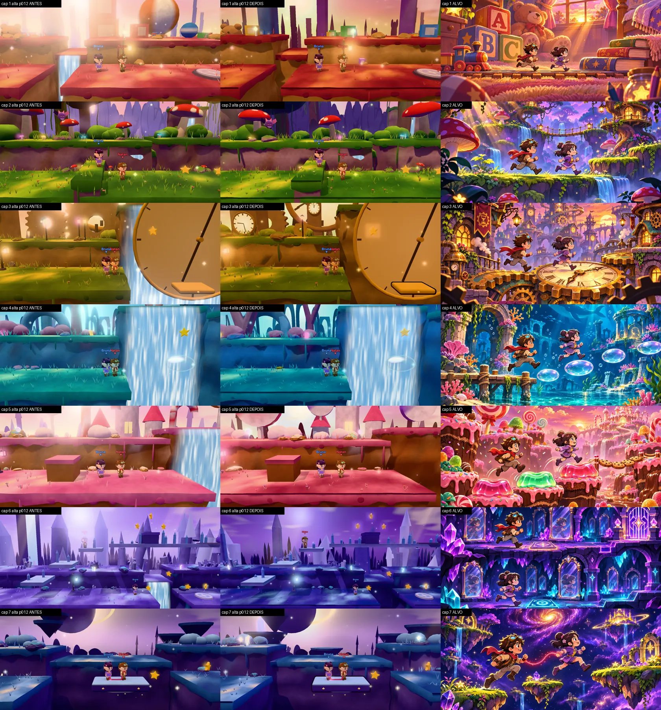

# Lote 0 · arte-luz — brilho seletivo, toon, oclusão, névoa e paleta

Autor: arte-luz (técnico de render + diretor de arte) · 2026-11-24 · base medida: `f362fe6` (antes) e a mesma base com
só os arquivos de `src/render/` deste lote (depois). As duas rodadas usam o mesmo núcleo e as mesmas fases, então
"mesmo ponto" = mesma cena e mesmo tick (salvo a exceção do cap. 7 p05, abaixo). Mudanças de outras equipes (câmera,
física, fases) **não** estão nestas imagens.

Commits: `f4ccace` (cor da água e vaga-lumes), `e6403eb` (toon, oclusão, névoa, paleta, composição, cascatas,
borda baixa, traço), `56027a0` (brilho seletivo da alta), `60e274c` (contorno das plataformas especiais).

## O que mudou
1. **Esbranquiçado da alta (P0)** — `pos.ts`: o brilho deixou de usar limiar de luminância. Os materiais de brilho
   (janelas, lanternas, cogumelos mágicos, cristais pequenos, estrelas, vidro das lanternas) gravam uma marca no
   **alfa** do alvo HalfFloat durante o render da alta; o filtro do bloom só deixa passar pixels marcados. Halos e
   raios de sol aditivos não marcam; mostradores, espelhos e cristais gigantes ficam fora (`semHalo`). Borrão a
   **¼ da resolução**, força 0,3, raio 0,3. Céu limitado a 0,8 (linear) fora do disco do sol e com a mesma curva
   Neutral em todas as qualidades (antes a alta comprimia o céu e a média não). `?bloom=0` desliga para medir.
2. **Hierarquia de valor** — `materiais.ts`/`tema.ts`/`cenario.ts`: névoa em gradiente (tom escuro perto/embaixo →
   cor de atmosfera do capítulo) **só para z < −2,5** e nos abismos (névoa por altura); nada na faixa de jogo;
   primeiro plano (z > 2,3) escurecido; bruma em quadros com as cores do tema (antes rosa/lilás fixos em todos os
   mundos) e a bruma da frente agora é escura. Paleta da tabela 6.2 do diagnóstico: silhuetas, céu, névoa, luz e
   chão por capítulo (caps. 1, 5, 6 sem fundo pastel; doces com chocolate escuro; espelhos índigo).
3. **Toon + oclusão** — `materialMundo` virou `MeshToonMaterial` em **todas** as qualidades (a alta deixou de usar
   Standard, que não dava ganho): rampa macia de 3 faixas (sombra = cor de sombra do capítulo × 0,42; face de lado
   para o sol 0,8; face ao sol 1). Oclusão **assada por vértice** (`JuntadorAO`, analítica pelas caixas de colisão,
   0 custo por quadro): pé de parede e base de adereços (até 0,6 m), fundo do tampo junto ao barranco, embaixo de
   plataformas elevadas (até 2,5 m). **Contorno**: traço escuro na aresta da frente do tapete das plataformas e casco
   invertido nas plataformas especiais (móvel e giratória), média/alta, dentro da mesma malha (0 chamadas).
4. **Cascatas** só na floresta e no oceano (`Tema.cascatas`); **borda da frente** do plano de jogo com grama
   ≤ 0,25 m (z > 0,6).
5. **Mesma composição nas três qualidades** (problema 4 do diagnóstico, causa confirmada: o sorteio era consumido em
   quantidades que dependiam da qualidade): cada grupo de peças recomeça de uma semente própria; árvores/raios/bruma
   em lugares fixos (a baixa usa um subconjunto). A alta só **acrescenta** (mais grama, 22 árvores contra 17).
6. **Cor da água e dos vaga-lumes** (C5): `setHex` sem `LinearSRGBColorSpace` — o lago volta a ser azul-marinho.

## Como medir de novo
```sh
git worktree add ../wt-antes f362fe6 && git worktree add ../wt-depois HEAD   # (ligar node_modules em cada uma)
node tools/revisao/capturas.mjs --raiz ../wt-antes  --rotulo antes  --medir --folha --tam 844x390@2
node tools/revisao/capturas.mjs --raiz ../wt-depois --rotulo depois --medir --folha --tam 844x390@2
node tools/revisao/capturas.mjs --raiz ../wt-depois --rotulo sem --medir --tam 844x390@2 --q alta --url bloom=0
```
Medidas cruas: `medidas_antes.json`, `medidas_depois.json`, `medidas_depois_alta_sem_brilho.json`.

## Imagens
- `antes_depois_alvo_<qualidade>_<ponto>.webp` — por capítulo: **antes | depois | alvo** (alvo recortado à proporção).
- `alta_com_e_sem_brilho_p012.webp` — caps. 1, 3, 6 na alta: com brilho | sem brilho (praticamente iguais; só
  lanternas, janelas e cristais pequenos ganham halo).
- `folha_antes_p012.webp` / `folha_depois_p012.webp` — 7 capítulos × 3 qualidades.
- `detalhe_cap2_media_antes.webp` / `detalhe_cap2_media_traco_ao.webp` — recorte: traço na aresta, grama da
  frente baixa, pé de parede escurecido.



## Tabela antes → depois (844×390@2, 7 capítulos × 3 qualidades × 2 pontos)
L\* médio, contraste (desvio de L\*), % quase branco (L\* ≥ 90), % sombra (L\* ≤ 30), saturação HSV, croma C\*.
Entre parênteses: alvo do capítulo (ARTE_DIAGNOSTICO §6.2).

| cap | ponto | qual. | L* antes→depois (alvo) | contraste | % branco | % sombra (alvo) | sat. | C* | chamadas / tri (depois) |
|---|---|---|---|---|---|---|---|---|---|
| 1 | p012 | baixa | 54.6 → 46.8 (46) | 24.9 → 21.7 | 14.7 → 2.0 | 17.2 → 25.4 (18–28) | 0.60 → 0.72 | 40.2 → 46.9 | 25 / 37 mil |
| 1 | p012 | media | 51.9 → 45.7 (46) | 23.0 → 21.6 | 11.7 → 2.1 | 17.3 → 28.6 (18–28) | 0.63 → 0.72 | 42.0 → 46.4 | 28 / 50 mil |
| 1 | p012 | alta | 62.4 → 45.7 (46) | 21.5 → 21.3 | 9.7 → 2.5 | 8.2 → 31.3 (18–28) | 0.47 → 0.69 | 33.5 → 44.9 | 50 / 116 mil |
| 1 | p05 | baixa | 62.1 → 54.3 (46) | 26.3 → 21.8 | 24.2 → 2.9 | 13.0 → 14.3 (18–28) | 0.53 → 0.65 | 38.4 → 44.8 | 24 / 33 mil |
| 1 | p05 | media | 62.2 → 49.9 (46) | 24.3 → 20.1 | 20.1 → 1.8 | 9.0 → 16.8 (18–28) | 0.54 → 0.71 | 39.3 → 47.3 | 28 / 56 mil |
| 1 | p05 | alta | 69.7 → 50.0 (46) | 19.0 → 19.9 | 18.4 → 1.5 | 1.5 → 16.9 (18–28) | 0.45 → 0.71 | 33.1 → 48.5 | 50 / 129 mil |
| 2 | p012 | baixa | 36.7 → 38.1 (41) | 16.8 → 15.7 | 0.3 → 0.0 | 42.1 → 29.0 (30–45) | 0.74 → 0.73 | 41.1 → 43.4 | 28 / 87 mil |
| 2 | p012 | media | 36.1 → 37.7 (41) | 17.2 → 15.9 | 0.2 → 0.1 | 43.6 → 31.2 (30–45) | 0.75 → 0.73 | 40.7 → 42.9 | 33 / 205 mil |
| 2 | p012 | alta | 38.4 → 36.3 (41) | 17.1 → 17.0 | 0.1 → 0.0 | 37.3 → 35.6 (30–45) | 0.68 → 0.72 | 38.6 → 41.8 | 54 / 439 mil |
| 2 | p05 | baixa | 44.9 → 42.9 (41) | 20.8 → 20.5 | 1.9 → 0.9 | 28.2 → 35.5 (30–45) | 0.58 → 0.60 | 34.8 → 37.1 | 25 / 74 mil |
| 2 | p05 | media | 45.2 → 43.0 (41) | 20.6 → 20.4 | 1.8 → 0.8 | 30.0 → 36.2 (30–45) | 0.58 → 0.59 | 34.2 → 35.8 | 28 / 163 mil |
| 2 | p05 | alta | 48.9 → 44.0 (41) | 23.9 → 22.8 | 4.4 → 1.3 | 30.4 → 37.5 (30–45) | 0.53 → 0.60 | 30.7 → 35.5 | 49 / 365 mil |
| 3 | p012 | baixa | 48.4 → 45.6 (42) | 19.5 → 18.8 | 6.4 → 3.0 | 19.5 → 22.5 (28–40) | 0.77 → 0.85 | 42.0 → 46.7 | 28 / 48 mil |
| 3 | p012 | media | 46.9 → 45.1 (42) | 18.2 → 19.1 | 3.9 → 2.7 | 16.5 → 24.1 (28–40) | 0.78 → 0.85 | 42.0 → 46.1 | 32 / 94 mil |
| 3 | p012 | alta | 50.2 → 45.3 (42) | 16.8 → 18.5 | 1.6 → 0.2 | 10.8 → 23.0 (28–40) | 0.69 → 0.85 | 39.7 → 46.4 | 52 / 179 mil |
| 3 | p05 | baixa | 54.9 → 48.5 (42) | 19.1 → 21.2 | 6.2 → 5.3 | 8.5 → 19.8 (28–40) | 0.66 → 0.80 | 39.7 → 46.8 | 30 / 63 mil |
| 3 | p05 | media | 56.1 → 47.6 (42) | 19.7 → 21.3 | 8.4 → 5.0 | 9.1 → 20.8 (28–40) | 0.63 → 0.81 | 38.7 → 46.5 | 33 / 103 mil |
| 3 | p05 | alta | 64.2 → 47.9 (42) | 17.0 → 19.2 | 7.0 → 0.1 | 3.0 → 17.3 (28–40) | 0.51 → 0.81 | 34.3 → 47.4 | 55 / 220 mil |
| 4 | p012 | baixa | 52.3 → 49.1 (48) | 22.0 → 20.3 | 6.0 → 1.6 | 16.7 → 21.3 (18–28) | 0.65 → 0.71 | 25.8 → 29.7 | 26 / 46 mil |
| 4 | p012 | media | 52.3 → 48.8 (48) | 22.1 → 20.5 | 5.6 → 1.7 | 20.3 → 22.4 (18–28) | 0.64 → 0.71 | 25.8 → 29.6 | 29 / 79 mil |
| 4 | p012 | alta | 55.0 → 50.7 (48) | 21.9 → 23.0 | 4.3 → 1.8 | 14.2 → 20.9 (18–28) | 0.59 → 0.67 | 24.1 → 28.0 | 50 / 169 mil |
| 4 | p05 | baixa | 47.6 → 45.8 (48) | 22.8 → 21.9 | 6.4 → 3.7 | 26.1 → 33.0 (18–28) | 0.70 → 0.77 | 27.5 → 31.3 | 24 / 39 mil |
| 4 | p05 | media | 48.1 → 45.2 (48) | 23.6 → 21.6 | 6.4 → 2.3 | 31.4 → 33.8 (18–28) | 0.69 → 0.77 | 26.5 → 31.2 | 27 / 67 mil |
| 4 | p05 | alta | 52.8 → 47.4 (48) | 23.2 → 22.8 | 6.7 → 2.5 | 17.4 → 25.5 (18–28) | 0.61 → 0.74 | 24.7 → 30.2 | 47 / 139 mil |
| 5 | p012 | baixa | 59.2 → 49.2 (53) | 22.2 → 21.8 | 13.3 → 5.3 | 5.8 → 21.9 (14–24) | 0.48 → 0.63 | 34.6 → 41.5 | 26 / 52 mil |
| 5 | p012 | media | 58.6 → 48.8 (53) | 22.1 → 21.9 | 12.4 → 3.8 | 8.2 → 23.3 (14–24) | 0.48 → 0.63 | 34.6 → 41.2 | 29 / 86 mil |
| 5 | p012 | alta | 59.7 → 48.9 (53) | 20.5 → 22.2 | 5.6 → 3.8 | 7.8 → 22.9 (14–24) | 0.46 → 0.63 | 33.3 → 41.5 | 50 / 188 mil |
| 5 | p05 | baixa | 64.2 → 52.7 (53) | 27.2 → 26.0 | 26.2 → 6.2 | 12.4 → 26.2 (14–24) | 0.43 → 0.59 | 27.7 → 34.8 | 35 / 59 mil |
| 5 | p05 | media | 64.3 → 52.4 (53) | 27.3 → 25.8 | 26.2 → 6.6 | 13.2 → 26.2 (14–24) | 0.43 → 0.59 | 27.5 → 35.0 | 39 / 96 mil |
| 5 | p05 | alta | 65.5 → 52.7 (53) | 24.0 → 26.2 | 16.8 → 6.2 | 11.0 → 28.4 (14–24) | 0.40 → 0.58 | 25.3 → 34.5 | 61 / 215 mil |
| 6 | p012 | baixa | 52.6 → 33.6 (31) | 27.2 → 18.8 | 10.3 → 0.4 | 27.0 → 46.9 (50–65) | 0.50 → 0.68 | 50.5 → 60.1 | 28 / 53 mil |
| 6 | p012 | media | 53.5 → 34.4 (31) | 26.9 → 19.0 | 10.0 → 0.4 | 25.4 → 45.1 (50–65) | 0.49 → 0.66 | 48.4 → 59.3 | 32 / 70 mil |
| 6 | p012 | alta | 49.4 → 34.7 (31) | 23.6 → 18.9 | 2.1 → 0.1 | 24.7 → 41.5 (50–65) | 0.50 → 0.65 | 48.9 → 57.1 | 54 / 165 mil |
| 6 | p05 | baixa | 51.3 → 33.3 (31) | 27.4 → 19.0 | 7.7 → 0.8 | 29.6 → 47.7 (50–65) | 0.52 → 0.68 | 50.4 → 58.5 | 27 / 43 mil |
| 6 | p05 | media | 50.9 → 35.5 (31) | 27.5 → 22.0 | 7.7 → 2.2 | 30.6 → 46.6 (50–65) | 0.52 → 0.65 | 50.1 → 56.0 | 30 / 56 mil |
| 6 | p05 | alta | 50.4 → 35.8 (31) | 25.7 → 21.2 | 1.8 → 0.1 | 28.4 → 45.9 (50–65) | 0.50 → 0.64 | 47.8 → 54.9 | 52 / 128 mil |
| 7 | p012 | baixa | 29.7 → 32.8 (31) | 27.5 → 25.7 | 1.3 → 0.6 | 61.4 → 57.4 (55–68) | 0.69 → 0.65 | 35.7 → 38.7 | 28 / 44 mil |
| 7 | p012 | media | 31.2 → 31.8 (31) | 27.6 → 25.3 | 1.3 → 0.7 | 59.2 → 58.5 (55–68) | 0.67 → 0.66 | 35.7 → 37.9 | 31 / 71 mil |
| 7 | p012 | alta | 30.9 → 33.6 (31) | 26.3 → 25.2 | 0.0 → 0.7 | 58.2 → 57.0 (55–68) | 0.65 → 0.61 | 35.2 → 37.5 | 52 / 143 mil |
| 7 | p05 | baixa | 11.1 → 26.8 (31) | 13.3 → 24.5 | 0.2 → 1.4 | 88.0 → 70.6 (55–68) | 0.82 → 0.70 | 32.0 → 38.2 | 25 / 42 mil |
| 7 | p05 | media | 13.1 → 11.7 (31) | 13.6 → 10.2 | 0.2 → 0.1 | 87.1 → 95.1 (55–68) | 0.77 → 0.81 | 32.0 → 36.6 | 31 / 80 mil |
| 7 | p05 | alta | 13.8 → 12.8 (31) | 13.3 → 11.6 | 0.1 → 0.2 | 87.6 → 93.2 (55–68) | 0.73 → 0.79 | 29.9 → 35.7 | 52 / 155 mil |

Critérios do brilho seletivo e de qualidade (mesma cena, mesmo tick):
| cap | ponto | alta × alta-sem-brilho: Δ mediana L* (≤ 5) | sat. alta/sem (≥ 0,9) | sombra alta/sem (≥ 0,8) | alta × média: ΔL* (\|·\| ≤ 3) | Δsat (≥ −0,03) | Δcontraste (≥ −1) |
|---|---|---|---|---|---|---|---|
| 1 | p012 | +1.8 ✓ | 0.96 ✓ | 0.89 ✓ | +0.0 ✓ | -0.029 ✓ | -0.3 ✓ |
| 1 | p05 | +1.0 ✓ | 0.99 ✓ | 0.91 ✓ | +0.1 ✓ | +0.005 ✓ | -0.2 ✓ |
| 2 | p012 | +0.6 ✓ | 0.98 ✓ | 0.96 ✓ | -1.4 ✓ | -0.012 ✓ | +1.1 ✓ |
| 2 | p05 | +0.8 ✓ | 0.98 ✓ | 0.97 ✓ | +1.0 ✓ | +0.005 ✓ | +2.4 ✓ |
| 3 | p012 | +3.0 ✓ | 0.99 ✓ | 0.85 ✓ | +0.2 ✓ | +0.000 ✓ | -0.6 ✓ |
| 3 | p05 | +2.1 ✓ | 0.99 ✓ | 0.84 ✓ | +0.3 ✓ | +0.005 ✓ | -2.1 ✗ |
| 4 | p012 | +0.4 ✓ | 0.98 ✓ | 0.97 ✓ | +1.9 ✓ | -0.037 ✗ | +2.5 ✓ |
| 4 | p05 | +0.5 ✓ | 0.99 ✓ | 0.96 ✓ | +2.2 ✓ | -0.029 ✓ | +1.2 ✓ |
| 5 | p012 | +2.0 ✓ | 0.97 ✓ | 0.93 ✓ | +0.1 ✓ | +0.000 ✓ | +0.3 ✓ |
| 5 | p05 | +1.9 ✓ | 0.98 ✓ | 0.97 ✓ | +0.3 ✓ | -0.006 ✓ | +0.4 ✓ |
| 6 | p012 | +1.6 ✓ | 0.96 ✓ | 0.92 ✓ | +0.3 ✓ | -0.014 ✓ | -0.1 ✓ |
| 6 | p05 | +0.9 ✓ | 0.97 ✓ | 0.97 ✓ | +0.3 ✓ | -0.012 ✓ | -0.8 ✓ |
| 7 | p012 | +3.3 ✓ | 0.92 ✓ | 0.95 ✓ | +1.8 ✓ | -0.043 ✗ | -0.1 ✓ |
| 7 | p05 | -6.2 ✗ | 1.08 ✓ | 1.29 ✓ | +1.1 ✓ | -0.029 ✓ | +1.4 ✓ |

Leitura dos critérios:
- **Brilho seletivo (critério do plano #1)**: alta × alta-sem-brilho passa em 13 de 13 pontos válidos (Δ mediana
  ≤ 3,3 em 100, saturação ≥ 0,92×, sombras ≥ 0,84×). Antes: Δ mediana até **+26**, saturação 0,67×, escuros 0,03×.
- **Alta × média**: |ΔL\*| ≤ 2,2 em todos (antes até +10); Δsat ≥ −0,03 em 11 de 13 (cap. 4 p012 −0,037 e cap. 7
  p012 −0,043: faíscas/vaga-lumes e estrelas florescem e somam branco); Δcontraste ≥ −1 em 12 de 13 (cap. 3 p05 −2,1).
- **cap. 7 p05 não vale como comparação**: a ferramenta de capturas parou em ticks diferentes nesse ponto (2424 na
  média/alta, 2452 na baixa e na alta-sem-brilho; o jogador está caindo no vazio). Limite da ferramenta, não do render.
- **Orçamento da média**: 27–39 chamadas e 50–205 mil triângulos (limite 80 / 250 mil). Antes: 27–39 / 49–185 mil.
  O aumento de triângulos vem das árvores em lugares fixos (17 na média, antes 16) e do traço; nenhuma chamada nova.
- **Faixas do guia ainda fora**: cap. 2 contraste 16 (alvo ≥ 20) e L\* 37–38 (41); cap. 3 sombra 17–24 (28–40);
  cap. 6 sombra 42–48 (50–65) e contraste 19; cap. 5 % branco 4–7 no p05 (glacê/nuvens); cap. 1 p05 L\* 50–54 (46).

## O que melhorou e o que ainda falta (honesto)
- O véu da alta sumiu e a alta não é mais clara que a média; a alta tem a mesma composição da média com mais
  densidade e sombras reais. Os temas claros (1, 5, 6) perderam o fundo pastel (% branco de 10–26 → 0–7).
- **Ainda longe dos alvos em forma**: chão continua o mesmo bloco por capítulo, sem primeiro plano composto, sem
  marcos; personagens pequenos (câmera é de outra equipe). A diferença com os alvos agora é de **desenho e
  enquadramento**, não de luz/cor.
- Contorno nas lajes é um traço na aresta da frente (não contorno de silhueta); peças pequenas e adereços sem contorno.
- A oclusão é analítica (caixas de colisão), não traçada por raios: não escurece cantos entre adereços.
- Sem GPU: fps, banda e temperatura do brilho seletivo não foram medidos (o borrão a ¼ deve custar menos que antes,
  a ½; hipótese a medir no Redmi). O bloom agora depende do alfa do alvo HalfFloat: em aparelho sem alvo float o
  three cai para outro tipo e a marca > 1 se perderia (sem halo, sem véu) — a medir.
