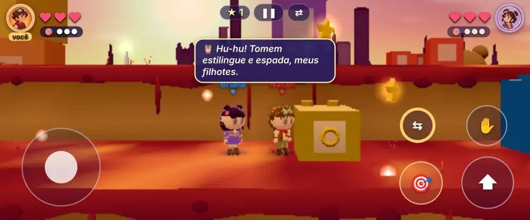
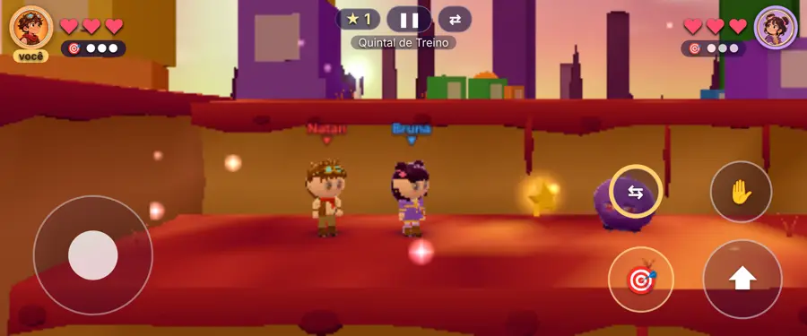
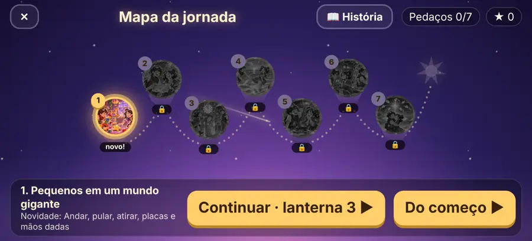

# L2b — Assentos, salvamento v2, retomar, campanha sem sala, Quintal mínimo

2026-11-24 · base `cc913e0` · commits do lote: `9219a50`, `6191def`, `d7c86a3`, `cf75eab`, `5edd2a6` e o deste
relatório (todos com "L2b" na mensagem). Corrige R22 (em parte: falta o companheiro do L6), R23 e R24; novos R83 e R84.
Máquina sem GPU (SwiftShader, carregada por outros agentes): fps não vale; ticks, estados e `localStorage` valem.

## O que mudou

| Assunto | Onde |
|---|---|
| **Assentos**: `ControladorAssento` (`pessoa`, `remoto`, `ia`); o laço da partida pede `assentos[i].entrada(f, e, i)` por tick. Treino = [pessoa, parado]; solo = [pessoa, companheiro]; anfitrião = [pessoa, remoto]. ⇄ no treino e no solo troca quem é a pessoa (no solo, bloqueado com alguém no fio, na argola ou no ar). `__edm.assentos()` e `__edm.eu()` para os testes | `src/core/assento.ts`, `src/ui/partida.ts` |
| **Seguidor** provisório do solo (até o L6): anda até o parceiro com histerese (2,4 m / 1,3 m), pula degrau, parede e vão quando o parceiro está do outro lado ou mais alto, desce quando ele está embaixo; não coopera. Determinístico. O L6 entra pela opção `companheiro` da `Partida` | `src/core/assento.ts` |
| **Campanha sem sala**: o menu tem 3 modos — **Jogar sozinho**, **Jogar juntos online** (Criar sala / código / Entrar) e **Treino** — e **Continuar** quando há jornada. Os ids antigos (`#bt-criar`, `#bt-entrar`, `#bt-treino`) continuam, então as ferramentas não mudam. Modo novo `solo` no fluxo; a arena no solo roda como no treino (sem aliado ainda) | `index.html`, `src/ui/menu.css`, `src/main.ts` |
| **Salvo v2** `edm-salvo-v2` = `{ v: 2, ativo, slots: Campanha[≤ 3] }`. Campanha do casal com `id` de 16 caracteres; por capítulo `concluido`/`fuga` (OU), `pegas`/`baus` (bitset, união), `melhorPassada`/`total` (máximo); desbloqueios (OU/união); `retomada` (a mais nova por `rev`) e `fimRetomada` (a conclusão apaga a retomada e a fusão não a traz de volta). `fundir` comutativa, idempotente e associativa | `src/ui/salvo.ts` (substitui `progresso.ts`) |
| **Migração do v1** na primeira abertura: grava o v2 já (id estável) e não apaga nem escreve mais o v1. `arena7` vira `fuga` do cap. 7 | `src/ui/salvo.ts` |
| **Quando grava** (só solo e anfitrião; o convidado grava o que chega; o treino nunca — R83): prólogo/final vistos, conclusão, fuga do cap. 7, vitória na Arena, **cada lanterna acesa**, ir ao mapa no meio da fase e `pagehide`/`visibilitychange` (com o estado da hora, então as estrelinhas pegas depois da lanterna voltam). `navigator.storage.persist()` uma vez | `src/main.ts`, `src/ui/partida.ts` (`aoLanterna`, `estadoParaGravar`) |
| **ResumoLanterna** (≈ 160 B) e **retomar**: estado inicial + lanterna, tick, estrelinhas pegas, bichinhos derrotados e placar; os dois renascem na lanterna. "Continuar" no menu e "Continuar · lanterna N" no mapa (ao lado de "Do começo") | `src/ui/salvo.ts`, `src/ui/telas.ts` |
| **Rede**: `'progresso'` vira `'salvo'` (nos dois sentidos) e `'mapa'` leva a campanha. O convidado oferece a dele ao entrar (R84); mesma campanha = fusão e reenvio só se algo mudou; campanha diferente: o anfitrião adota a do convidado se ainda não jogou nenhuma fase (R23: tanto faz quem cria a sala); senão o convidado guarda a do anfitrião noutro slot. `VERSAO` 0.4.0 | `src/net/rede.ts` (tipos), `src/main.ts` |
| **Quintal de Treino** mínimo: a oficina de mecânicas sem o Rei, com campo de bonecos (3 cogumelos e uma bolotinha) e sem pedaço da estrela; os bonecos voltam 4 s depois de derrotados. Entra pelo botão "Quintal de Treino ⛺" no mapa do treino (que ganhou selo TREINO e moldura). Chave própria `edm-treino-v1` (`{ v, eu, visitas }`) | `src/core/fases/treino_quintal.ts`, `src/ui/partida.ts`, `src/ui/telas.ts` |

| Menu novo (Pixel 7, 863×360) | Com jornada: "Continuar" | Solo: a Bruna segue |
|---|---|---|
|  |  |  |

| Quintal de Treino | A Bruna criou a sala e ficou com a jornada do Natan |
|---|---|
|  |  |

Fora dos arquivos do lote (mínimo): `src/net/rede.ts` (só os tipos das mensagens `'salvo'`/`'mapa'`, 8 linhas),
`index.html` (menu e dois botões do mapa), `README.md` (como jogar e o e2e novo), `test/e2e/dupla.mjs` (uma checagem).

## Aceite

| # | Critério | Medida | Passa? |
|---|---|---|---|
| 1 | T8: 37/37 retomadas; e2e recarregando no meio do cap. 1 → "Continuar" → mesma lanterna, estrelinhas e bichinhos | `test/salvo.test.ts`: em cada uma das **37** lanternas dos 7 capítulos, o resumo passa por JSON e `limparResumo`, o estado recriado tem a mesma lanterna, as mesmas estrelinhas e os mesmos bichinhos derrotados, os dois na lanterna, e os bots chegam ao pedaço da estrela: **37/37**; maior resumo < 260 B (e2e: 159 B). `test/e2e/solo.mjs`: lanterna acesa grava; pausa no tick 2455 (lanterna 2, 20 estrelinhas, ★ 32, bichinhos [0,1,2]) → **recarrega** → menu "Continuar · Cap. 1 · lanterna 3 · ★ 32" → lanterna 2, as mesmas 20 estrelinhas, ★ 32, bichinhos [0,1,2], tick 2455, os dois juntos em x 95,5/96,5 | **sim** |
| 2 | T9: 500 pares, comutativa e idempotente, nada some | `test/salvo.test.ts`: 500 trios com semente; `fundir(a,b) = fundir(b,a)`, `fundir(a,a) = a`, associativa, absorção, forma normal; nada de `a` ou `b` some (marcas, capítulos, pegas, baús, armas, segredos, máximos); retomada = a de maior rev; conclusão + aparelho atrasado não ressuscita a retomada | **sim** |
| 3 | T10: os 5 formatos de v1 migram com `liberado`, `pedacos` e `estrelinhasTotais` iguais | vazio, 3 capítulos, só `arena7`, completo e lixo: os três iguais às funções do v1, a Arena pendente igual, prólogo/final iguais; o v1 fica intacto e a 2ª abertura lê o v2 com o mesmo id | **sim** |
| 4 | O convidado grava `edm-salvo-v2` com o mesmo `id` (`dupla.mjs`) | `dupla.mjs`: "convidado grava edm-salvo-v2 com o mesmo id (HPNnHxJ97ZMeb8dC / HPNnHxJ97ZMeb8dC)". `solo.mjs` parte 4 (R23): a Bruna cria a sala num aparelho novo, o Natan entra; os dois gravam a jornada **do Natan** (mesmo id) e o mapa dela oferece "Continuar · lanterna" | **sim** |
| 5 | T12: `edm-salvo-v2` idêntico byte a byte depois de 2 min no Quintal | `solo.mjs` parte 3: 120 s no Quintal (andar, pular, atacar, mão, 32 trocas ⇄, `pagehide`/`visibilitychange` de mentira, boneco derrotado que volta) + um capítulo do treino + `pagehide`: **idêntico**; nenhuma outra chave mudou; só `edm-treino-v1` nova (`{"v":1,"eu":0,"visitas":1}`) | **sim** |
| 6 | `capitulos.mjs treino` e `dupla` sem mudança de resultado | `capitulos.mjs treino media`: **APROVADO** (7 capítulos + Arena; 31–38 chamadas, 56–201 mil triângulos, como antes). `capitulos.mjs dupla`: **APROVADO** (7 capítulos + Arena, progresso igual nos dois, desvio ≤ 0,27 m). Uma rodada anterior da dupla parou no cap. 3 (não concluiu em 240 s, com a máquina cheia de e2e de outros lotes); repetido `CAPS=1,2,3` lado a lado com a base `cc913e0`: 66 s × 68 s no cap. 3, os dois aprovados | **sim** |

## Testes

- `npx tsc -p .`: limpo. `npx vitest run`: 23 arquivos, **342/342** (novos `test/salvo.test.ts`, 23 testes, e
  `test/assento.test.ts`, 5). `npx vite build`: ok.
- `test/e2e/solo.mjs` (novo): **APROVADO** na rodada final (Quintal 120 s). As duas primeiras reprovaram só na parte 4
  — foi assim que o R84 apareceu.
- `test/e2e/dupla.mjs`: **APROVADO** na 3ª de 3 rodadas; nas outras, uma vez "posições em sincronia" 0,81 m (R68,
  intermitente desde antes do Lote 0) e uma vez "tiro do convidado (J)" (a checagem do L4 sobre a pedrinha; não mexi
  em entrada nem arsenal).
- `capitulos.mjs treino media` e `capitulos.mjs dupla`: **APROVADO** (critério 6).

## Pendências

- **Companheiro de verdade (L6)**: no solo, o Seguidor só segue; sozinho, os capítulos param na 1ª ajuda (placa, mãos
  dadas, fio). O assento está pronto: `new Partida({ companheiro: (f) => new Companheiro(f, …) })`.
- **Arena no solo**: roda como no treino (só o seu personagem em jogo) até a equipe da arena ter um aliado IA.
- **Arsenal na retomada (L4)**: `ResumoLanterna.arsenal` está reservado; o L4 preenche (`resumir`/`retomar` em
  `src/ui/salvo.ts`). Hoje quem retoma volta com o arsenal inicial.
- **Slots**: o dado guarda até 3 campanhas (o convidado guarda a do anfitrião noutro slot), mas não há tela de
  escolher slot; o menu usa o ativo. Também não há código de progresso (T11) nem "Enviar meu progresso" (P1).
- **Protocolo**: a mensagem `'progresso'` saiu; um aparelho com a versão antiga e um com a nova não se acertam
  (só o `console.warn` de versão, como antes). Recusar com "atualize o jogo" (T18) é do lote de rede (L11).
- **Bonecos do Quintal**: são bichinhos do núcleo (os cogumelos cospem esporos). Um boneco que não ataca e o alvo-sino
  do L4 no Quintal pedem o núcleo (L4/L11). O Quintal ainda tem o abismo do fio: sozinho, passa-se trocando com ⇄.
- Ao retomar, portas e fio voltam ao começo (as placas recalculam) e estrelinhas soltas por bichinho e não pegas se
  perdem (o bichinho fica derrotado), como na medida da ARQUITETURA §2.2.
