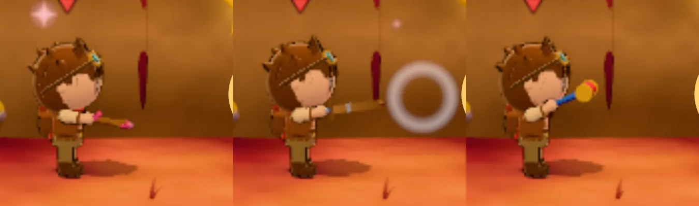
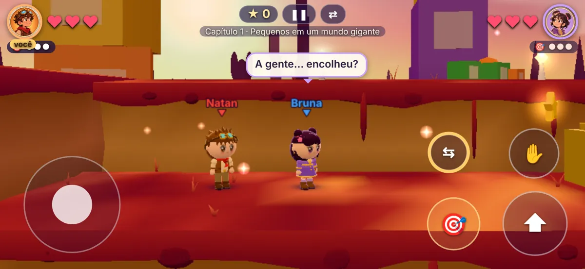

# L4 · Arsenal MVP (núcleo, rede, render, controles, cap. 1)

Data: 2026-11-24. Commits: `f71834d` (núcleo), `73ab60a` (render), `14275da` (botões, HUD e sons), `cc913e0`
(história), `972f575` (pose e ferramentas), `16883ba` (REGISTRO e e2e). Sem push. Nenhum crédito gasto: as armas, os
sons e os efeitos são procedurais ou sintetizados.

## O que mudou
- **Núcleo (`src/core/arsenal.ts`, novo).** O Lança-Estrelas virou um arsenal com 4 espaços: corpo a corpo, tiro 1,
  tiro 2 e ferramenta.
  - **Estilingue de Xuxinha:** 3 pedrinhas que voltam (1 a cada 0,6 s), então nunca acaba. Atira 2,5 vezes por
    segundo, em arco (15 m/s, gravidade 6, alcance 9 m), com mira assistida de ±25° (o joystick para cima levanta a
    mira até 60°). Segurar 0,6 s e soltar dá o tiro carregado: 2 de dano, atravessa 1 bichinho.
  - **Espada de Papelão:** combo 1 + 1 + 2, um golpe a cada 0,3 s. Corta barbante e rebate esporo.
  - **Martelo de Brinquedo:** 2 de dano a cada 0,55 s. Quebra o bloco rachado. Apertar no ar, caindo, dá a
    martelada: 3 de dano numa área de 1,5 m ao pousar.
  - **Troca:** vale a borda do botão, leva 0,15 s e tem três jeitos: espaço direto (1–4), próxima arma (6) e mochila
    do casal na lanterna acesa (5). O 7 é segurar o ⇆ no celular: na lanterna abre a mochila, longe dela é 🎁 dar.
  - **Miçangas:** vão para a arma de munição mais vazia; sem arma de munição, vão para a bolsa. Vêm de bichinho de
    índice par (meia carga), de lanterna acesa ou volta ao checkpoint (1 carga) e de tiro que bate no Rei fechado (a
    pedrinha "defendida" cai como 1 miçanga).
  - **Dar:** com arma de munição, metade da reserva vai para o parceiro se ele estiver a até 8 m (mais longe, cai no
    chão). Com corpo a corpo ou ferramenta, os dois trocam o item.
  - **Sem fogo amigo.**
  - **Elementos de fase:** baú, alvo-sino (abre uma porta por `tempo` s, como uma placa), barbante e bloco rachado.
    O bloco rachado é sólido em `solidos()` e no grafo de alcance.
  - O Lançador de Confeitos (P1) entrou só como dado, para os testes de munição finita. Não aparece em nenhuma fase.
- **Cap. 1 (um uso opcional de cada elemento):**
  - alvo-sino em x 14,2 (3 estrelinhas em cima do cubo);
  - barbante em x 22,5 (3 estrelinhas);
  - baú do Martelo no topo da pirâmide (x 83, y 3);
  - bloco rachado em x 99,6 (3 estrelinhas).

  O mapa de apoio foi regenerado (`npm run apoio`) e as anotações do campo `apoio` continuaram valendo sem mudança.
- **Rede (`instantaneo.ts`):** o arsenal vai no fim do vetor de cada jogador, sem a cauda que é igual ao padrão
  (parado, são 3 ou 4 números). Os elementos, as miçangas soltas e a mochila só vão quando mudam. Os projéteis vão
  como `[id, x, y, vx]` (+ arma e dano, se não forem os padrão). `predicao.ts`: a fila do anfitrião não perde troca
  nem dar quando junta entradas.
- **Bots:** `autoAtaque` (em `arsenal.ts`, para o L6 usar também) escolhe corpo a corpo de perto e Estilingue de
  longe e aperta ATACAR em pulsos. O `TICK_PLANO` mudou nos caps. 1, 2, 5 e 7; o motivo está no comentário de
  `test/fases.test.ts`.
- **Render (`src/render/armas.ts`, novo):**
  - itens na mão procedurais: Estilingue com 300 triângulos, Espada com 140 e Martelo com 256;
  - uma malha por personagem, presa no osso do braço no lugar do Lança-Estrelas;
  - aparece atacando ou trocando, e a pose segue o estado (`carregando` e `espera`);
  - pedrinhas e miçangas num InstancedMesh cada;
  - sino que balança e brilha, pacote que cai, bloco que estoura em cacos de brilho e baú que abre;
  - tudo com o material do mundo (o mesmo programa das peças fixas).
- **Controles e HUD:**
  - ATACAR (o antigo ✨) mostra o ícone da arma na mão;
  - ⇆ fica no canto livre de cima à esquerda dos botões, com anel de munição;
  - chip da arma ao lado dos corações (●●○ no Estilingue);
  - teclado: J ataca, Q é a próxima arma, 1–4 escolhem o espaço, Tab abre a mochila e G dá ao parceiro.
- **Sons (`src/ui/somArmas.ts`):** todos sintetizados, como o pulo:
  - "tlec" do elástico;
  - "vush" de papelão;
  - "pó-pó" do martelo e o "bum" fofo da martelada;
  - "dlim" do sino;
  - "tsic" do barbante;
  - bloco quebrando;
  - arpejo do baú;
  - cliques da troca;
  - contas das miçangas;
  - "boing" do Rei fechado.
- **História:** o prólogo, `docs/HISTORIA.md` e duas falas do roteiro do cap. 1 agora falam em Estilingue de
  Xuxinha e Espada de Papelão.

## Aceite (medido)
| # | Critério | Resultado | Medida |
|---|---|---|---|
| 1 | A2 nos 7 capítulos | **passou** | `test/arsenal.test.ts`, A2: com `semPotes`, os 7 fecham com os bots, 0 voltas ao checkpoint, 0 potes. Ticks: 4011, 4187, 7356, 5589, 4379, 3227 e 5630 |
| 2 | A1 no cap. 1 com a munição real | **passou** | A1: fecha em 4011 ticks; 3 potes pegos |
| 3 | A3 | **passou** | Elemento que abre porta só com recurso infinito; barbante exige o corpo a corpo; o grafo fecha com os blocos rachados inteiros (não são obrigatórios). Nos pontos de combate forçado (cap. 3, x 84–92, e o Rei), 0 ticks sem Estilingue + corpo a corpo |
| 4 | A4 | **passou** | `fases.test.ts`: sem armadilha, "sozinho não se vence" e lanternas, com os rachados no grafo; T14 verde |
| 5 | A5 | **passou** | Baú do cap. 1 alcançável no grafo; baú do Martelo (x 83) antes do bloco rachado (x 99,6); Estilingue e Espada são iniciais |
| 6 | A8 | **passou** | Vitest: o arsenal, os elementos, os potes e os projéteis restaurados do instantâneo batem com o anfitrião em todo instantâneo dos 7 planos. e2e `dupla.mjs`: arsenal, elementos e mochila iguais nos dois no fim do cap. 1. Instantâneo médio: +13,3 % (cap. 1), +6,2 %, +5,3 %, +5,8 %, +9,2 %, +7,5 %, +11,0 % (limite 15 %; travado no teste) |
| 7 | A10 | **passou** | Os bots do cap. 1 rodados duas vezes dão o mesmo estado em JSON; nenhum `Math.random`, `Date.now` ou `performance.now` em `src/core` (teste por glob) |
| 8 | A12 | **passou** | Estilingue (normal e carregado), Espada, Martelo (também a martelada) e Confeitos: os dois lado a lado, atacando um ao outro por 6 s, dão 0 eventos de dano e terminam com 3 e 3 corações |
| 9 | `fases_alcance` | **passou** | `test/fases_alcance*.test.ts` verdes com o bloco rachado no cap. 1 |
| 10 | Combate ≤ 25 % do cap. 1 | **passou** | 4,1 % dos ticks com bichinho vivo a < 8 m (antes do L4: 8,2 %) |
| 11 | Média: até +5 chamadas | **passou** | `tools/revisao/l1/compilacoes.mjs`, cap. 1. Chamadas máximas: baixa 29 → 29, média 35 → 35, alta 52 → 52. Programas: 28 → 26, 32 → 30, 42 → 40 (o Lança-Estrelas tinha 2). Compilações depois do 1º quadro: 0. Por construção, o pior quadro soma +1 do item na mão por personagem atacando, +1 das pedrinhas e +1–2 do elemento na tela |
| 12 | `test/arena*.test.ts` sem mudança | **passou** | Os arquivos não foram tocados e estão verdes |

Mais medidas:
- `npx tsc -p .`, `npx vitest run` (23 arquivos e 342 testes, incluindo os de outros lotes que estão em andamento) e
  `npx vite build`: tudo verde.
- Novos testes: `test/arsenal.test.ts` (47) e `test/render_armas.test.ts` (3).
- Botões medidos no navegador (`tools/revisao/l4/ver.mjs`), Ø do ⇆ e menor folga entre bordas: 844×390 → 55 px e
  18 px; 844×340 → 52 px e 16 px; 873×393 → 55 px e 18 px; 915×412 → 58 px e 19 px. Não há sobreposição.
- No navegador, o cap. 1 com os bots tocou o sino, cortou o barbante, abriu o baú e quebrou o bloco, sem erro no
  console.

## Como reproduzir
- `tools/revisao/l4/rodar.sh medir [--sem-potes] [--json saida]`: instantâneo médio, combate e eventos por capítulo
  (a linha de base está em `tools/revisao/l4/antes.json`).
- `tools/revisao/l4/rodar.sh amostra 1 1500`: instantâneos de amostra.
- `node tools/revisao/l4/ver.mjs --dist dist`: botões nos 4 tamanhos e fotos do cap. 1 com os bots.
- `node tools/revisao/l4/foto_armas.mjs --dist dist`: fotos de perto das armas na mão.

## Desvios do desenho (de propósito)
- `Input.shoot` continua sendo o nome do ATACAR. `normalizarInput` aceita `atk`. Trocar o nome mexeria em 20
  arquivos de teste e na rede, sem ganho.
- `Estado.faiscas` continua com esse nome (agora são projéteis com `vy`, `g`, `arma`, `dano` e `fura`).
- A troca "próxima" e a do segurar ⇆ (6 e 7) são resolvidas na simulação, não na interface: a interface não sabe o
  estado no convidado, e a simulação decide igual nos dois.
- O Martelo não atordoa por 1 s (fica para o P1).
- A roda de 4 espaços, o 🎁 no centro dela e a roda a 30 % no solo ficam para o L5. Aqui, segurar o ⇆ faz a
  mochila ou o dar.
- As estrelinhas de prêmio dos elementos são "soltas" (como as dos bichinhos) e não entram no total da fase. Assim o
  total de cada capítulo e a regra de 100 % (C15) não mudam.
