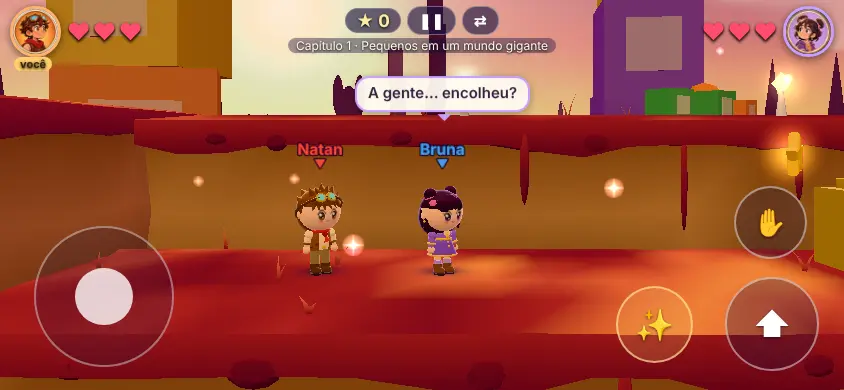
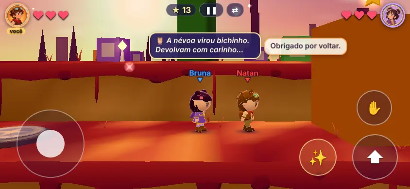
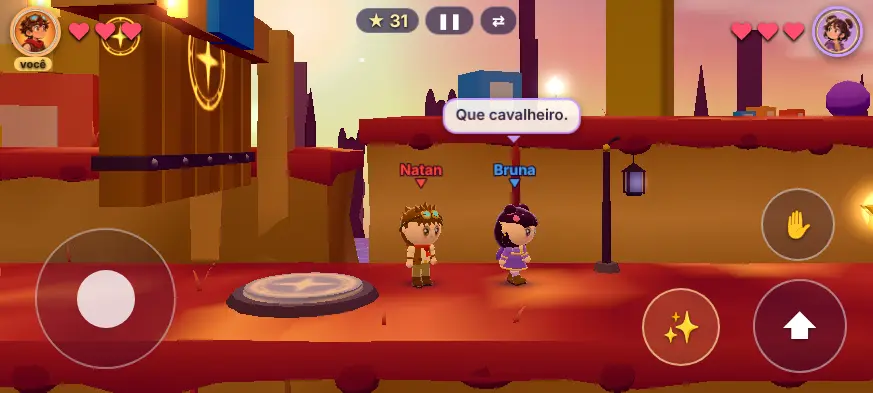

# L8a — Balões de fala, roteiro do capítulo 1 e dicas da primeira vez

2026-11-24 · base `6c8fe5b` · commits do lote: `c983e2b`, `e7d4a75`, `3f36747`, `48d10e6` e o deste relatório (todos
com "L8a" na mensagem). O gancho em `src/ui/partida.ts` entrou no commit `6f17bbd` do L1a (R79).
Medidas na máquina sem GPU (SwiftShader, carregada por outros agentes): **fps não vale**; ticks, retângulos na tela e
chamadas de desenho valem.

## O que mudou

| Assunto | Onde | Registro |
|---|---|---|
| Diretor de balões: gatilhos por zona (com `ambos` e `por`), evento, condição, início e ocioso; respostas encadeadas (`depois`); variante por hash do id e da vez (igual nos dois celulares); prioridade história > dica > reação > ocioso; 1 balão por pessoa; nada durante perigo (bichinho a < 4 m), salvo falas `emPerigo`; momento visto não repete; tempo de leitura 1,2 s + 0,06 s/caractere (teto 4,5 s). Só lê o estado: não mexe em entradas | `src/ui/roteiro/diretor.ts`, `tipos.ts`, `index.ts` | R48, R80 |
| Roteiro do cap. 1 (NARRATIVA §5) cortado: 41 falas (38 fixas + 3 de pool), ≤ 48 caracteres, só textos genéricos (sem [REAL]); Natan 8 × Bruna 10 nas nominais (44 %) | `src/ui/roteiro/cap1.ts` | R48, C10, C14 |
| Dicas da primeira vez (C16): 11 mecânicas do cap. 1 (andar, pular, atirar, lanterna, bolha, placa, mãos dadas, puxar, trenzinho, marca das mãos, placa no alto); não sai se a mecânica já foi usada; volta uma vez aos 20 s com o botão piscando; `nivel()` para o companheiro (45 s e 60 s, L6) | `src/ui/dicas.ts` | R30 |
| Balões em DOM: acima da plaquinha do nome, projetados a cada quadro; Dona Lume no alto (🦉, itálico); fora do joystick, ⬆, ✨, ✋, rostos, corações e botões do HUD e do terço de baixo; na borda com a ponta virada quando o personagem sai do quadro; desvia para o lado em vez de tapar o nome | `src/ui/baloes.ts`, `src/ui/baloes.css` | R48, R81, R82 |
| Murmúrio sintetizado (1 oscilador + filtro; Natan grave, Bruna aguda, Lume com "hu"), 2–6 sílabas | `src/ui/murmurio.ts`; `som.ts` só ganhou `contexto()` | — |
| Opção "Balões: todos / só história / desligados" na pausa (salva no aparelho; `?baloes=` para medir). "Só história" mantém as dicas; "desligados" manda as dicas para o `#aviso` | `src/ui/baloes.ts` (o botão é criado no cartão da pausa, sem mexer em `index.html`) | C16 |

Fora dos arquivos do lote (mínimo): `src/ui/partida.ts` (criar, atualizar e destruir os balões; `__edm.baloes` e
`__edm.baloesLugares` para os testes; 9 linhas), `src/ui/som.ts` (acessor `contexto()`, 4 linhas).

| Abertura (844×390) | Dona Lume + Natan desviando para o lado (R81) | Portão (873×393) |
|---|---|---|
|  |  |  |

Mais capturas: `docs/revisao/img/L8a/` (844×340 e 915×412).

## Aceite do PLANO (L8), itens do L8a

Os itens 5 (T-E1…T-E4: convites), 6 (T-R5/T-R6 do segredo com a caixinha) e 9 (sons dos eventos e primeiro pulo com
som) são do **L8b** e não foram feitos aqui.

| # | Critério | Medida | Passa? |
|---|---|---|---|
| 1 | T-R1 (≤ 48 caracteres, zonas válidas, ids únicos), T-R3 (voz 0,40–0,60), T-R4 (0 "te amo") | `test/roteiro.test.ts`: 41 falas, maior texto 48 caracteres; zonas em [0; 184]; todo `depois` existe e nenhum laço; Natan **0,44** (8 × 10); 0 "te amo"/"amo você" (sem acento e sem caixa); C10: nenhum [REAL], data ou ano | **sim** |
| 2 | T-U1: nenhum balão sobre os controles ou os corações nos 4 tamanhos | `test/e2e/baloes.mjs` em 844×390, 844×340, 873×393 e 915×412: (a) jogando a passada dos bots, 141–162 amostras por tamanho (92–108 com balão): **0 cruzamentos** com joystick, ⬆, ✨, ✋, rostos, corações, ❚❚ e placar, 0 no terço de baixo; (b) grade de 3 132–3 720 âncoras (dentro e fora da tela) com o texto mais longo e um curto, para os 3 falantes: **0 cruzamentos, 0 sem lugar**. `test/baloes.test.ts`: o mesmo na conta pura, em 5 tamanhos. Uma rodada anterior teve 1 amostra cruzando o ❚❚ em 2 tamanhos (R82, causa não confirmada; corrigido o cache e passou na rodada seguinte) | **sim** (R82 em observação) |
| 3 | T-U2: nenhuma trava > 6 s; momento visto não repete | o balão nunca mexe no controle: a passada dos bots com e sem o diretor é **idêntica tick a tick** (estado inteiro em JSON); voltar à lanterna e passar de novo pela tampa não repete c1-20 nem a abertura; recomeçar a fase recomeça o roteiro; no convidado, um tick que volta uns ticks não recomeça (R80) | **sim** (trava de momento roteirizado: não há no L8a) |
| 4 | T-P1: +0 chamadas para balões | e2e: mesma passada com `?baloes=todos` e `?baloes=desligados`, 12 ticks com balão na tela: **0 ticks diferem** (chamadas 20–25); controle sem × sem: 0. Numa rodada anterior, 1 tick diferiu de 1 chamada (a câmera suaviza com o tempo real do quadro; por isso o controle). Estático: nenhum módulo dos balões importa `three` nem `src/render` | **sim** |
| 7 | Soma de balões por passada dos bots ≤ 90 s | vitest (passo a passo): **23 balões, 73,3 s** em 66,8 s de fase; navegador (quadro a quadro, 4 tamanhos): **22 balões, 67,5–69,7 s** | **sim** |
| 8 | Toda mecânica nova do cap. 1 com dica na primeira vez | `test/roteiro.test.ts`: para cada uma das 11 de `MECANICAS_CAP[1]`, a fala de dica existe e **sai** num cenário de quem não sabe (simulação de verdade); com a mecânica já usada, não sai; aos 20 s volta uma vez com `#bt-mao` piscando; `nivel` 2 aos 20 s e 4 aos 60 s | **sim** |
| — | Os dois celulares mostram a mesma fala sem mensagem nova | e2e em dupla (PeerJS local): **22 falas no anfitrião, 22 no convidado, 22 iguais** (id, quem e texto); diferença de início até 7 ticks (0,12 s). vitest: duas passadas dão a mesma sequência | **sim** |
| — | Opções todos / só história / desligados | e2e: o botão na pausa troca todos → só história → desligados → todos e salva; `test/baloes.test.ts` confere o que aparece em cada uma | **sim** |

## Limites e o que fica para depois

- **≤ 90 s vale para a passada dos bots** (o critério). Um jogador que não sabe nada e dispara todas as dicas, as duas
  vezes, pode passar disso: se todas as falas fixas saíssem uma vez seriam 120 s (as dicas são 39 s disso). Só a
  sessão com o casal (L9) diz se é muito; cortar é trocar `gatilho`/`por` no roteiro.
- Primeira vez é **por partida**, não por salvamento: as dicas e os momentos voltam ao recomeçar o capítulo noutro
  dia. Guardar `primeiraVez`/`momentosVistos` no salvo v2 é do L2b (pedido: um campo `vistos: string[]` por slot).
- Sem `perigo` de chefe em ataque além do Rei com o ponto fraco aberto (o cap. 1 não tem chefe).
- O "…obrigado" do bichinho, a contagem de estrelinhas da Bruna e as falas do Seu Algodão, da caixinha e do vislumbre
  ficaram de fora (corte do C14 e geometria do L8b). A fala "Tomem o Lança-Estrelas" muda quando o L4 trocar a arma.
- A Dona Lume fala do alto da tela; não tem modelo nem lugar no cenário.
- O tamanho de letra é 15 px; não medi legibilidade em aparelho de verdade.
- Os textos são genéricos e ainda não passaram pela leitura do Natan (validação humana da NARRATIVA §13).

## Como reproduzir

```
npx tsc -p . && npx vitest run test/roteiro.test.ts test/baloes.test.ts
npx vite build --outDir test-out/dist-l8a && DIST=test-out/dist-l8a node test/e2e/baloes.mjs   # ≈ 25 min sem GPU
```
Saída do e2e: `test-out/baloes/` (capturas e `medidas.json`). Rodar sozinho na máquina (R69): ele tem uma parte em
dupla.
